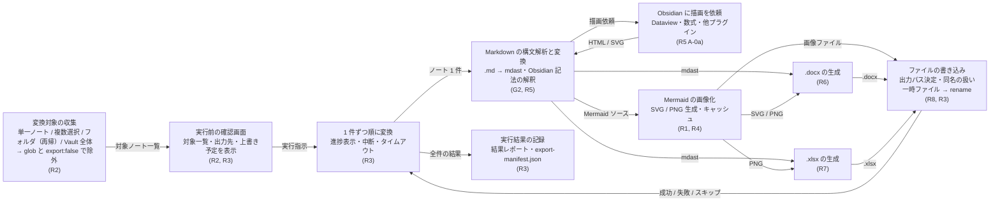

# コンポーネント構成

最終更新: 2026-11-17
段階: 要件単位の全体図（試作）。要件の正本は `docs/ideas.md`

## 全体図（要件単位）

- 1 ノード = 1 コンポーネント。名前は「何をするか」を表し、括弧内に対応する要件 ID を書く
- 実線の矢印 = データの流れ（ラベルは受け渡すもの）
- R3（安全な運用）は性質の違う機能の総称なので、「1 件ずつ順に変換」「ファイルの書き込み」「実行結果の記録」の 3 つに分けている。R3 のドライランは「実行前の確認画面」に含める

## この粒度で表していないもの

- Obsidian API に依存する部分と依存しない部分（G2・G4）の境界。1 つのコンポーネントの中に両方が混ざるため
- 「1 件ずつ順に変換」の中の制御（キャンセル・タイムアウト）と、「ファイルの書き込み」の中のアトミック書き込みの手順
- 必要になったら、該当するコンポーネントだけ詳細図を別に作る
