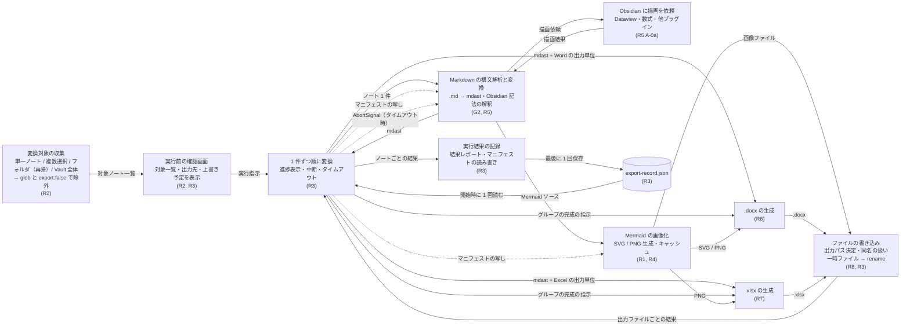
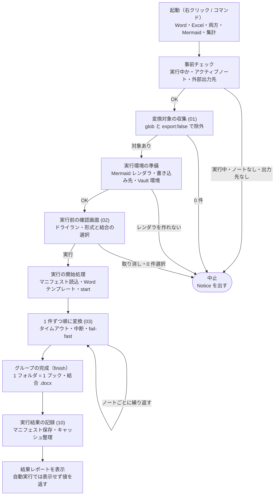
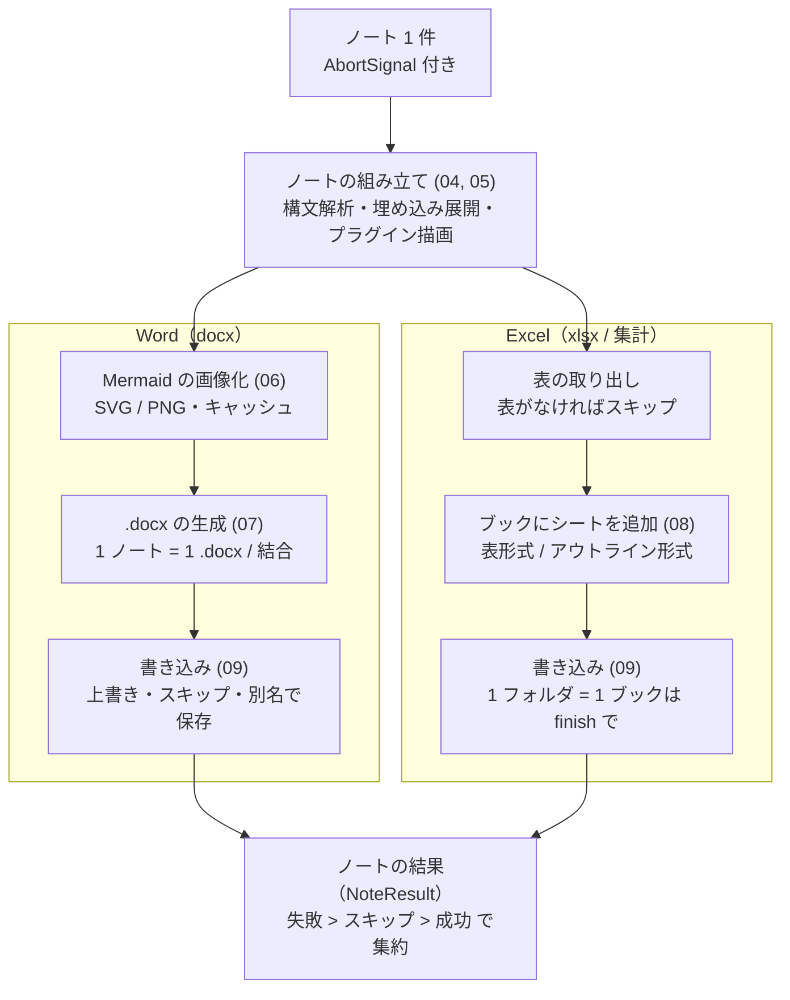

# コンポーネント構成

最終更新: 2026-11-19
段階: 要件単位の全体図（試作）と、実装（1.0.2）の実行順の図。要件の正本は `docs/requirements.md`

## 全体図（要件単位）

- 1 ノード = 1 コンポーネント。名前は「何をするか」を表し、括弧内に対応する要件 ID を書く
- 実線の矢印 = データの流れ（ラベルは受け渡すもの）
- 点線の矢印 = 制御の合図、または実行の文脈として渡す読み取り専用のデータ
- 円柱 = ファイルとして保存するデータ
- R3（安全な運用）は性質の違う機能の総称なので、「1 件ずつ順に変換」「ファイルの書き込み」「実行結果の記録」の 3 つに分けている。R3 のドライランは「実行前の確認画面」に含める
- 「1 件ずつ順に変換」が全体を取りまとめる。構文解析の結果（mdast）はいったんここに戻り、出力単位と、どのグループ（ブック / 結合 .docx）に入るかを添えて .docx・.xlsx の生成に渡す（2026-11-17 決定）
  - 出力単位は形式ごとに持つ（2026-11-18 決定）。Word: 1 ノート = 1 .docx / 結合出力。Excel: 単一ノート / 1 フォルダ = 1 ブック / 1 ノート = 1 ブック
  - グループの全ノートを処理し終えたら、各ノートの成否に関係なく、.docx・.xlsx の生成に「グループの完成の指示」を別に出す（2026-11-18 決定）。最後のノートが失敗しても、ブックや結合 .docx は完成する
- タイムアウト時の `AbortSignal` は、図では「Markdown の構文解析と変換」への 1 本だけを描いている。実際には、ノートごとの文脈として描画・生成・書き込みのすべての処理に渡す（中断ボタンでは abort しない。R3）

## 実装の実行順（1.0.2 時点）

上の全体図はコンポーネント間のデータの流れを表す。ここでは、実装したコードが実際に処理を進める順序を表す。括弧内の番号は下の「コンポーネントごとの処理フロー」の番号に対応する。

### 実行全体（`src/obsidian/export-runner.ts` の `runExport`）

- 起動のモードは Word・Excel・両方（確認画面で形式を選ぶ）・Mermaid 画像として保存・Vault 全体の集計の 5 つ。モードごとに違うのは、確認画面の題名・ドライラン・ノート 1 件の処理・`start`・`finish` だけで、流れは共通
- 中止は 4 か所: 実行中またはアクティブノートなし・外部出力先が未設定 / 除外後の対象が 0 件 / Mermaid レンダラを作れない / 確認画面で取り消し
- 中断・fail-fast で止まっても、`finish` で処理済みの分からブック・結合 .docx を完成させ、マニフェストを保存する
- 開発用の自動実行（`dev-automation.ts`）では、確認画面ですべての候補を選んだことにし、結果画面を出さずに結果を返す

### ノート 1 件の処理（各モードの `process`）

- ノートの組み立て（`src/core/note-assembly.ts` の `assembleNote`）は Word と Excel で共通
- 「両方」は同じノートで Word 側と Excel 側を順に実行し、`mergeResults` で 1 つの結果にまとめる
- 「Mermaid 画像として保存」は Word 側の (06) → (09) だけを通る。Word でも設定 `saveImageFiles` が有効なら画像ファイルを保存する
- 「Vault 全体の集計」は Excel 側と同じ形で、`SummaryRun` がシートを足す
- ノートの結果は、出力ファイルの結果のうちいちばん重いもの（失敗 > スキップ > 成功: D5）

## コンポーネントごとの処理フロー

各コンポーネントの内部の処理フローは、次のファイルに分けている。各ファイルの末尾に、まだ決まっていない点（「決める必要があること」）がある。

| コンポーネント | フロー図 |
|---|---|
| 変換対象の収集 | [01-collect-targets.md](flows/01-collect-targets.md) |
| 実行前の確認画面 | [02-confirm-modal.md](flows/02-confirm-modal.md) |
| 1 件ずつ順に変換 | [03-run-sequential.md](flows/03-run-sequential.md) |
| Markdown の構文解析と変換 | [04-parse-transform.md](flows/04-parse-transform.md) |
| Obsidian に描画を依頼 | [05-obsidian-render.md](flows/05-obsidian-render.md) |
| Mermaid の画像化 | [06-mermaid-image.md](flows/06-mermaid-image.md) |
| .docx の生成 | [07-docx-render.md](flows/07-docx-render.md) |
| .xlsx の生成 | [08-xlsx-render.md](flows/08-xlsx-render.md) |
| ファイルの書き込み | [09-write-file.md](flows/09-write-file.md) |
| 実行結果の記録 | [10-record-results.md](flows/10-record-results.md) |

## この粒度で表していないもの

- Obsidian API に依存する部分と依存しない部分（G2・G4）の境界。1 つのコンポーネントの中に両方が混ざるため
- 「1 件ずつ順に変換」の中の制御（キャンセル・タイムアウト）と、「ファイルの書き込み」の中のアトミック書き込みの手順
- 必要になったら、該当するコンポーネントだけ詳細図を別に作る
