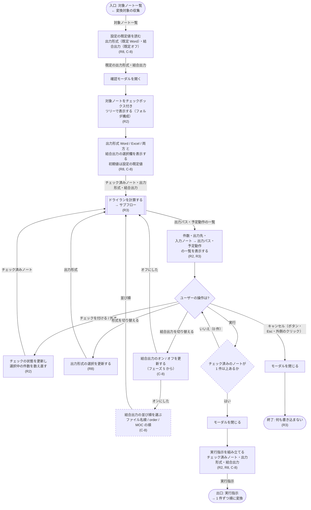
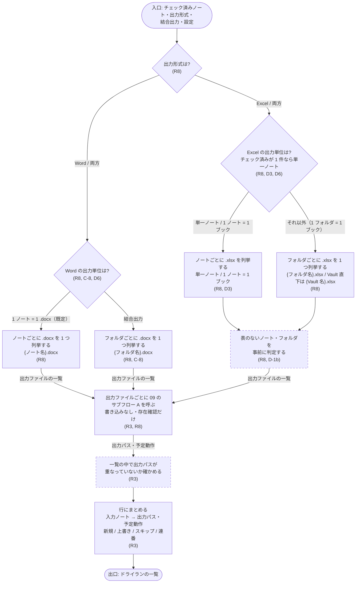

# 実行前の確認画面 のフロー

最終更新: 2026-11-18
対応する要件: R2「対象確認モーダル」、R3「実行前」（ドライラン）・「書き込み時」（同名ファイルの扱い）、R8「出力形式の選び方」「Word のファイルの単位」「Excel のファイルの単位」、R6 C-8（結合出力）

## 役割

「変換対象の収集」から受け取った対象ノート一覧を、チェックボックス付きツリーで表示するモーダル。出力形式（Word / Excel / 両方）と結合出力の有無を選ばせ、ドライラン（各ノートの出力パスと予定動作の一覧）を表示する。実行が押されたら実行指示を「1 件ずつ順に変換」へ渡し、キャンセルされたら何も書き込まずに終わる。出力パスと予定動作の計算そのものは持たず、「ファイルの書き込み」のサブフロー A（出力パスの計算と予定動作の判定）を書き込みなしで呼び出す。

## 入力と出力

| 区分 | 受け取るもの / 渡すもの | 相手のコンポーネント |
|---|---|---|
| 受け取るもの | 対象ノート一覧（除外済み） | 変換対象の収集 |
| 受け取るもの | 設定の既定値: 出力形式（既定 Word）・結合出力（既定オフ）・保存モード・出力ルート・同名ファイルの扱い・Excel の 1 ノート = 1 ブックのオプション | 設定（全体図にはない） |
| 呼び出すもの（全体図にない） | 出力パスの計算と予定動作の判定（書き込みなし。存在確認だけを行う） | ファイルの書き込み（09 のサブフロー A） |
| 渡すもの | 実行指示: チェック済みの対象ノート一覧・出力形式・結合出力の有無（＋結合出力の並び順。「決める必要があること」を参照）。単一ノートかどうかは 03 がチェック済みの件数で判定するので渡さない（D3）。Word の出力単位（1 ノート = 1 .docx / 結合出力）と Excel の出力単位（単一ノート / 1 フォルダ = 1 ブック / 1 ノート = 1 ブック）は、03 がこれらと設定から形式ごとに決める（D6） | 1 件ずつ順に変換 |

## フロー図

### メインフロー: モーダルの表示と操作

### サブフロー: ドライランを計算する

書き込みは行わない。出力パスと予定動作は「ファイルの書き込み」のサブフロー A（`docs/design/flows/09-write-file.md`）を呼んで得る。このサブフローが持つのは、「どの出力ファイルが作られるか」の列挙と、表示用の一覧への整形だけにする。

## 各ステップの補足

| ノード名 | 内容 | 要件 ID |
|---|---|---|
| 設定の既定値を読む | 出力形式の初期値は設定の既定値（既定 Word）。結合出力は既定オフ（ノートごとに 1 つの .docx）。モーダルでの選択はその実行だけに効き、設定値は書き換えない | R8, C-8 |
| 対象ノートをチェックボックス付きツリーで表示する | 対象ノートを Vault のフォルダ構成のツリーで表示する。初期状態は全件チェック済みとする（受け取った一覧は除外済みのため）。フォルダのチェックボックスで配下をまとめて切り替えるかは「決める必要があること」を参照 | R2 |
| 出力形式と結合出力の選択欄を表示する | 出力形式は Word / Excel / 両方 の 3 択。結合出力は Word を含む形式のときだけ意味を持つ。結合出力はフェーズ 5 の機能なので、フェーズ 4 までは選択欄を出さない | R8, C-8 |
| ドライランを計算する | サブフローを参照。出力パスと予定動作の計算は 09 のサブフロー A に任せ、ここでは重複して持たない | R3 |
| 一覧を表示する | 件数（チェック済みのノート数）、出力先（保存モードと出力ルート）、「入力ノート → 出力パス」と予定動作（新規 / 上書き / スキップ / 連番）を表示する | R2, R3 |
| チェックの状態を更新し件数を数え直す | チェックを外したノートは件数と実行指示から除く。ドライランも計算し直す（フォルダ単位の出力は、フォルダ内のノートがすべて外れると作られなくなるため） | R2, R3 |
| 出力形式の選択を更新する | 形式を切り替えると出力ファイルの種類と数が変わるので、ドライランを計算し直す | R8, R3 |
| 結合出力のオン / オフを更新する | オンにすると Word の出力単位が 1 ノート = 1 .docx から結合出力（1 フォルダ = 1 .docx、`{フォルダ名}.docx`）に変わるので、ドライランを計算し直す | C-8, R8, D6 |
| 結合出力の並び順を選ぶ | C-8 の並び順（ファイル名順（既定）/ frontmatter の `order` / MOC の順）。モーダルで選ぶか設定で選ぶかは要件にないため点線枠。並び順は出力パスを変えないが、MOC の順では MOC ノートの指定が要る | C-8 |
| チェック済みのノートが 1 件以上あるか | すべてのチェックを外したときの実行は要件にない。案: 実行ボタンを無効にする。点線枠 | R2 |
| キャンセル | キャンセルボタン・Esc・モーダルの外側のクリックのどれでも、実行指示を渡さずに閉じる。このコンポーネントは書き込み系の処理を一切呼ばない（ドライランも存在確認だけ）ので、キャンセル時に後片付けは要らない | R3 |
| 実行指示を組み立てる | チェック済みの対象ノート一覧・出力形式・結合出力の有無を渡す（03 の入力の定義に合わせる）。同名ファイルの扱いは設定値なので、03・09 が直接参照する。ドライランの結果は渡さない（09 が書き込みの直前に計算し直すため） | R2, R8, C-8 |
| .docx を列挙する | Word の出力単位が 1 ノート = 1 .docx（既定）ならノートごとに `{ノート名}.docx`、結合出力ならフォルダごとに `{フォルダ名}.docx`（サブフォルダは別） | R8, C-8, D6 |
| .xlsx を列挙する | 単一ノート（チェック済みのノートが 1 件。起動方法では判定しない: D3）は `{ノート名}.xlsx`。チェックを付け外しすると単一ノートかどうかも変わるので、ドライランで計算し直す。実行する件数が 2 件以上では 1 フォルダ = 1 ブック（既定）で `{フォルダ名}.xlsx`、Vault 直下のノートは `{Vault 名}.xlsx`。オプションの 1 ノート = 1 ブックでは `{ノート名}.xlsx` | R8 |
| 表のないノート・フォルダを事前に判定する | 表のないノートはシートを作らず、表のあるノートがないフォルダはブックを作らない。これをドライランで見せるには構文解析が必要になるため、行うかどうかは未定。点線枠 | R8, D-1b |
| 出力ファイルごとに 09 のサブフロー A を呼ぶ | 渡すもの: 種類（.docx / .xlsx）・元のパス（ノートまたはフォルダ）・その種類の出力単位（.docx は Word の出力単位 1 ノート = 1 .docx / 結合出力、.xlsx は Excel の出力単位 単一ノート / 1 フォルダ = 1 ブック / 1 ノート = 1 ブック。D6）・設定・アダプタ。アダプタは存在確認だけに使い、書き込み系の呼び出しはしない。画像ファイルは列挙しない（ファイル名に Mermaid の描画結果のハッシュが入り、描画せずには決まらないため。「決める必要があること」を参照） | R3, R8, R4, D6 |
| 一覧の中で出力パスが重なっていないか確かめる | 09 のサブフロー A はディスク上の既存ファイルだけを見るので、同じ実行の中で 2 つの出力が同じパスになる場合（例: `A/B.md` の `B.docx` と、フォルダ `A/B` の結合出力 `B.docx`）を検出しない。どう扱うかは未定。点線枠 | R3 |
| 行にまとめる | 入力ノートごとに行を作る。フォルダ単位の出力（ブック・結合 .docx）は、フォルダ内のノートが同じ出力パスを指す形にする | R3 |

## 決める必要があること

- **ドライランの計算の担当（09 との境界）**: 本図では、出力パスの計算と予定動作の判定を `09-write-file.md` のサブフロー A に任せ、このコンポーネントは「どの出力ファイルが作られるか」の列挙と表示だけを持つ形にした。09 の「決める必要があること」の提案（サブフロー A を書き込みなしの純粋な処理として切り出し、アダプタを引数で渡す）と同じ方針。全体図には「実行前の確認画面」→「ファイルの書き込み」の矢印がないので、呼び出しの矢印を足すかを決める
- **ドライランと書き込み時の判定の違い（09 と同じ論点）**: 09 は書き込みの直前に予定動作を計算し直す。確認後に同名ファイルができた・消えたときに、確認画面で見せた予定動作と実際の動作が変わる。そのまま書き込み時の判定に従うか、警告するかを決める（`09-write-file.md`）
- **出力ファイルの列挙の重複（03 との境界）**: ノートをフォルダ単位にまとめる処理（1 フォルダ = 1 ブック、結合出力）は、`03-run-sequential.md` の「ノートを出力単位でグループに分ける」と同じ規則になる。2 か所で別々に実装すると、ドライランと実際の出力がずれる。同じ関数を共用するか、確認画面で作ったグループを実行指示に含めて 03 に渡すかを決める
- **結合出力の並び順を選ぶ場所**: C-8 は結合出力を「対象確認モーダルで実行ごとに有効にする」とだけ書いている。並び順（ファイル名順 / `order` / MOC の順）と MOC ノートの指定をモーダルで選ぶか、設定で選ぶかが決まっていない。並べ替えをどのコンポーネントで行うかは `03-run-sequential.md` でも未定。確認画面で並べ替えて、その順の一覧を実行指示に入れる案もある（MOC の順はリンクの解決に Obsidian API を使う）
- **結合出力と Excel のみの組み合わせ**: 出力形式が Excel だけのとき、結合出力の選択欄を無効にするか（結合出力は Word のファイル単位の設定）
- **ツリーのチェックボックスの動作**: フォルダのチェックで配下をまとめて切り替えるか、一部だけチェックされたフォルダを中間状態で表すか。初期状態を全件チェック済みとしてよいか
- **チェックが 0 件のときの実行**: 実行ボタンを無効にするか、押せるが何もしないで閉じるか
- **表のないノートのドライランでの扱い**: Excel の出力では、表のないノートはシートを作らず、表のあるノートがないフォルダはブックを作らない（R8・D-1b）。これを予定動作に出すには、確認画面の時点で全ノートを構文解析する必要がある。行わない場合、ドライランでは「ブックを作る予定」と表示され、実行後のレポートで「表なし」になる
- **同じ実行の中での出力パスの衝突**: 09 のサブフロー A は既存ファイルだけを見るため、同じ実行で作る 2 つの出力が同じパスになる場合を検出しない。例: 同じ親フォルダにある `A/B.md` の `B.docx` と、フォルダ `A/B` の結合出力 `B.docx`（09 の「フォルダ単位の出力の置き場所」が親フォルダに決まった場合に起きる）。ドライランで警告するか、片方を連番にするかを決める（`09-write-file.md`）
- **画像ファイルのドライランでの扱い**: 設定「変換時に画像ファイルも保存する」がオンのとき、画像ファイルも出力される。ファイル名にハッシュ（Mermaid ソース・描画設定から計算）が入るため、計算自体は描画なしでできるが、何枚になるかはノートを構文解析しないと分からない。ドライランに画像ファイルを含めるかを決める
- **ドライランを計算し直す範囲と性能**: 本図では、チェック・形式・結合出力のどれを変えても、ドライラン全体を計算し直す。対象が多い（例: 1,000 ノート、U3）とき、変更のたびに全件の存在確認をやり直すと表示が遅れる。変わった行だけ計算し直すか、存在確認の結果を使い回すかを、実装時に検証する
- **設定の受け取り（全体図との差）**: 全体図には設定からの矢印がない。出力形式・結合出力の既定値、保存モード・出力ルート（ドライランに必要）をどこから読むかは、全体図では表していない

## 決定済み（2026-11-17）

- D3: 単一ノートかどうかは、実行する件数（確認画面でチェックが残ったノート）が 1 件かで判定する。起動方法では判定しないので、01 から区別を受け取らず、実行指示にも含めない。フォルダを選んだ後にチェックを外して 1 件だけ残ったときも単一ノートになる（旧「単一ノートの変換かどうかの受け渡し」を解決）
- D3: 用語は「出力単位」に統一する（値: 単一ノート / 1 フォルダ = 1 ブック / 1 ノート = 1 ブック / 結合出力。Vault 全体の集計は別コマンド）（この 1 つの列挙は 2026-11-18 の D6 で形式ごとに分けた）

## 決定済み（2026-11-18）

- D6: 出力単位を形式ごとに分ける。Word の出力単位は 1 ノート = 1 .docx（既定）/ 結合出力、Excel の出力単位は 単一ノート / 1 フォルダ = 1 ブック（既定）/ 1 ノート = 1 ブック（オプション）。ドライランでも、09 のサブフロー A に種類ごとの出力単位を渡す。旧称「単体出力」は「1 ノート = 1 .docx」に置き換える

## 決定済み（2026-11-18・フェーズ 1）

詳細は `docs/requirements.md` の「フェーズ 1 の決定事項」。

- ドライランは、出力パスと予定動作を計算する純粋関数を 09 と共用する。書き込み時に状況が変わっていたら、その時点の状態で判定してレポートに記録する
- チェックが 0 件なら実行ボタンを押せない
- フェーズ 1 の「Mermaid 画像として保存」では、出力形式と結合出力の選択欄は出さない

## 決定済み（2026-11-18・フェーズ 4b）

- 出力形式の選択（R8）: 確認画面に Word / Excel / 両方 のドロップダウンを置く。「Word に変換」「Excel に変換」はその形式、「Office 形式に変換…」は設定 `defaultFormat` を初期値にする。形式を変えると、題名と予定（出力ファイルと動作）を計算し直す（古い計算の結果は捨てる）
- 予定の件数は出力ごとに 1 回だけ数える（1 フォルダ = 1 ブックのブックを、ノートの数だけ数えない）
- 結合出力（C-8・フェーズ 5a）: 形式が Word か両方のとき、チェックボックス「1 フォルダを 1 つの .docx にまとめる」を出す。初期値は設定 `defaultCombine`。変えると予定を計算し直す
