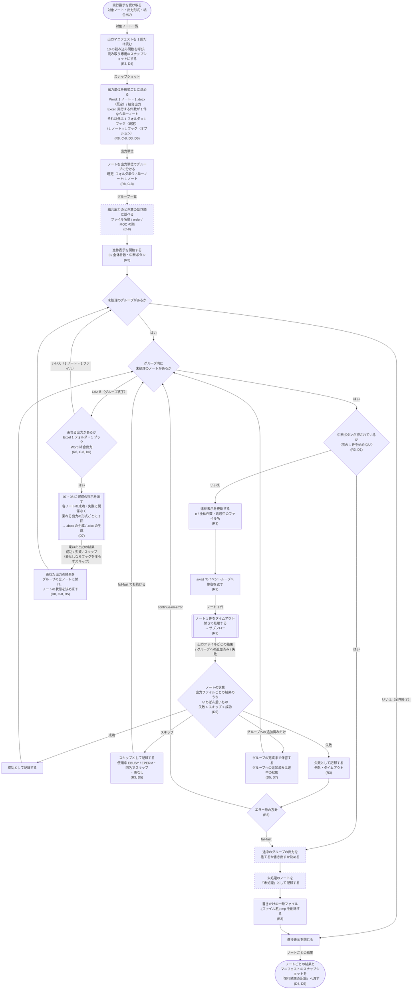
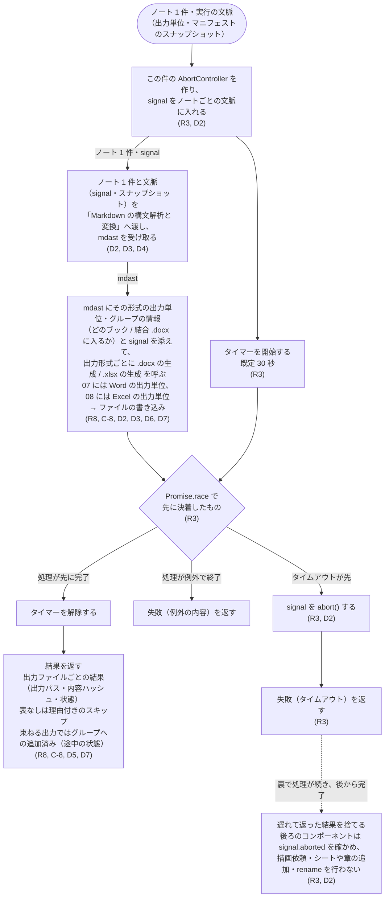

# 1 件ずつ順に変換 のフロー

最終更新: 2026-11-18
対応する要件: R3（実行中・書き込み時の使用中ファイルの扱い）、R8（Excel のファイルの単位・Word のファイルの単位）、R6 C-8（結合出力）

## 役割

「実行前の確認画面」から受け取った実行指示に従い、対象ノートを 1 件ずつ逐次処理で「Markdown の構文解析と変換」へ渡す。進捗表示・キャンセル・1 件ごとのタイムアウト・エラー時の方針（continue-on-error / fail-fast）を制御する。実行の開始時に出力マニフェストを 1 回だけ読み、読み取り専用のスナップショットを実行の文脈として各コンポーネントに渡す。「Markdown の構文解析と変換」から返った mdast に、形式ごとの出力単位（「.docx の生成」には Word の出力単位、「.xlsx の生成」には Excel の出力単位）とグループの情報（どのブック / 結合 .docx に入るか）を添えて呼び、1 ノートでは完結しない出力（Excel の 1 フォルダ = 1 ブック、Word の結合出力）をグループ単位で取りまとめる。グループの全ノートを処理し終えたら、各ノートの成功・失敗に関係なく、「.docx の生成」「.xlsx の生成」に別の呼び出しで完成の指示を出す。出力ファイルごとの結果をノートごとにまとめ、全件の結果を「実行結果の記録」へ渡す。

## 入力と出力

| 区分 | 受け取るもの / 渡すもの | 相手のコンポーネント |
|---|---|---|
| 受け取るもの | 実行指示（チェック済みの対象ノート一覧・出力形式 Word / Excel / 両方・結合出力の有無） | 実行前の確認画面 |
| 呼び出すもの（全体図にない） | 出力マニフェストの読み込み関数（実行の開始時に 1 回だけ）。戻り値は読み取り専用のスナップショット | 実行結果の記録（形式と読み書きの関数を持つ） |
| 渡すもの | ノート 1 件と文脈（ノートごとの `AbortSignal`・マニフェストのスナップショット） | Markdown の構文解析と変換 |
| 受け取るもの（全体図にない） | mdast（`tree.data` に frontmatter と警告）、または失敗 | Markdown の構文解析と変換 |
| 渡すもの（全体図にない） | mdast + その形式の出力単位（07 には Word の出力単位、08 には Excel の出力単位だけ）+ グループの情報（どのブック / 結合 .docx に入るか）+ `AbortSignal` | .docx の生成 / .xlsx の生成 |
| 呼び出すもの（全体図にない） | 完成の指示（どのブック / 結合 .docx を完成させるか）。グループの全ノートを処理し終えたとき、各ノートの成功・失敗に関係なく、束ねる出力の形式ごとに 1 回呼ぶ | .docx の生成 / .xlsx の生成 |
| 渡すもの（全体図にない） | 実行の文脈（`AbortSignal`・マニフェストのスナップショット ほか） | Mermaid の画像化 |
| 受け取るもの | 出力ファイルごとの結果（出力パス・内容ハッシュ・状態 成功 / 失敗 / スキップ） | ファイルの書き込み |
| 受け取るもの（全体図にない） | グループへの追加済み（途中の状態）、表なし（理由付きのスキップ）。完成の指示に対しては、ブックを作らなかったときのスキップ（表なし） | .docx の生成 / .xlsx の生成 |
| 渡すもの | ノートごとの結果（状態と出力ファイルごとの明細）と、マニフェストのスナップショット | 実行結果の記録 |

## フロー図

### メインフロー: グループとノートの二重ループ

### サブフロー: ノート 1 件をタイムアウト付きで処理する

## 各ステップの補足

| ノード名 | 内容 | 要件 ID |
|---|---|---|
| 実行指示を受け取る | 確認画面でチェックが付いたノートだけを受け取る。出力形式（Word / Excel / 両方）、結合出力の有無も含む。同名ファイルの扱いは設定値なので「ファイルの書き込み」が直接参照する | R2, R8, C-8 |
| 出力マニフェストを 1 回だけ読む | マニフェストの形式と読み書きの関数は「実行結果の記録」（10）が持つ。03 は実行の開始時にその読み込み関数を 1 回だけ呼び、読み取り専用のスナップショットを実行の文脈として 04（`isExportTarget`）・06（古い画像の検索）に渡す。更新と保存は実行の最後に 10 が 1 回だけ行う | R3, D4 |
| 出力単位を形式ごとに決める | 用語は「出力単位」に統一し、形式ごとに分ける（D6）。Word の出力単位は 1 ノート = 1 .docx（既定）/ 結合出力（1 フォルダ = 1 .docx）。Excel の出力単位は 単一ノート / 1 フォルダ = 1 ブック（既定）/ 1 ノート = 1 ブック（オプション）。形式「両方」では 2 つを並べて持ち、07 には Word の出力単位、08 には Excel の出力単位だけを添える。単一ノートかどうかは、実行する件数（確認画面でチェックが残ったノート）が 1 件かで判定する。起動方法では判定しないので、01・02 から「変換の種類」を受け取らない。Vault 全体の集計は別コマンドで、出力単位には含めない | R8, C-8, D3, D6 |
| ノートを出力単位でグループに分ける | ループの外側の単位を「出力単位のグループ」、内側を「ノート」にする。Excel の 1 フォルダ = 1 ブックと Word の結合出力は、どちらも「フォルダ = 1 ファイル」なので、フォルダ単位のグループで両方を扱える。サブフォルダは別グループ（R8: サブフォルダは別のブック）。Vault 直下のノートは 1 グループ（ブック名 `{Vault 名}.xlsx`）。単一ノートは、ノート 1 件だけのグループ（`{ノート名}.xlsx`）。Word の 1 ノート = 1 .docx と Excel の 1 ノート = 1 ブック（オプション）では、グループ内でもノートごとに出力が完結する | R8, C-8, D6 |
| 結合出力のとき章の並び順に並べる | C-8 の並び順（ファイル名順（既定）/ frontmatter の `order` / MOC のリンクの出現順、MOC にないノートは末尾にファイル名順）。ノートを 1 件ずつ渡す構造なので、渡す前に並べる必要がある。どのコンポーネントで並べるかは未定 | C-8 |
| 進捗表示を開始する | Notice またはステータスバーに表示し、中断ボタンを置く。全体件数はノートの件数（結果レポートの件数と同じ数え方） | R3, D5 |
| 中断ボタンが押されているか | 中断ボタンはフラグを立てるだけで、`abort()` は呼ばない。判定はノートの処理の前にだけ行い、「次の 1 件を始めない」だけにする。処理中の 1 件は書き込みまで最後まで処理してから止まる | R3, D1 |
| 進捗表示を更新する | 各ノートの処理を始める直前に「n / 全体件数」と処理中のファイル名を更新する。更新を描画させるため、直後に制御を返す | R3 |
| await でイベントループへ制御を返す | 1 件ごとに `await` し、描画・入力イベント（中断ボタンのクリックを含む）を処理させる。逐次処理なので、同時に処理するノートは常に 1 件 | R3 |
| ノート 1 件をタイムアウト付きで処理する | サブフローを参照。構文解析・変換・生成・書き込みまでを 1 件として扱う | R3 |
| ノートの状態 | 09 は出力ファイル 1 つごとに結果（出力パス・内容ハッシュ・状態）を返す。03 はそれをノートごとにまとめ、ノートの状態はいちばん重いもの（失敗 > スキップ > 成功）にする。出力ファイルごとの結果は明細としてノートの結果に残す | D5 |
| 成功 / スキップ / 失敗として記録する | ノートごとの結果を配列に追加する。スキップには理由（使用中・同名でスキップ・表なし）を付ける | R3, D5 |
| スキップとして記録する | 使用中ファイル（Windows の `EBUSY` / `EPERM`）は失敗ではなくスキップとして扱う。そのため fail-fast でも止めずに次へ進む。「表なし」も理由付きのスキップ | R3, D5 |
| グループの完成まで保留する | 束ねる出力のノートは、ノート 1 件の処理では出力ファイルの結果がない（グループの最後のノートも同じ。完成は別の呼び出しで行う: D7）。「グループへの追加済み」は途中の状態で、最終結果にしない。形式「両方」で .docx の結果だけ先にある場合は、その結果を明細に残し、状態は完成の指示の結果を付けるときに決める | D5, D7 |
| エラー時の方針 | 設定の continue-on-error / fail-fast。失敗（例外・タイムアウト）のときだけ判定する | R3 |
| 束ねる出力があるか | グループの全ノートを処理し終えた時点で判定する。Excel の出力単位が 1 フォルダ = 1 ブック、Word の出力単位が結合出力のどちらかであれば「はい」 | R8, C-8, D6 |
| 07・08 に完成の指示を出す | ノート 1 件ごとの呼び出しとは別の呼び出しで、どのブック / 結合 .docx を完成させるかを指定する。各ノートの成功・失敗に関係なく、束ねる出力の形式ごとに 1 回呼ぶ（形式「両方」で両方とも束ねる出力なら 07 と 08 の両方）。グループの構成は 03 が最初から知っているので、グループの最後のノートが失敗しても指示は必ず届く。07 は表紙・目次・連結、08 はブックの完成を行い、09 に渡す。完成の指示にタイムアウトを適用するかは「決める必要があること」を参照 | R8, C-8, D7 |
| 束ねた出力の結果をグループの全ノートに付ける | ブックや結合 .docx の完成と書き込みは、完成の指示の中で 07・08 が行う（D7）。03 はその書き込み結果を、グループの全ノートの明細に付け、各ノートの状態を決め直す。シートが 1 枚もない（表のあるノートがない）フォルダではブックを作らず、グループの全ノートが「スキップ（表なし）」になる（D-1b・R8） | R8, C-8, D-1b, D5 |
| 途中のグループの出力を捨てるか書き出すか決める | 中断・fail-fast で止まったとき、途中まで追加したブック・結合 .docx を書き出すか捨てるかは要件にない | R3 |
| 未処理のノートを「未処理」として記録する | 中断で処理しなかったノートを結果に含めるかは要件にない | R3 |
| 書きかけの一時ファイルを削除する | 中断時に `.{ファイル名}.tmp` を削除する（R3）。中断ボタンでは処理中の 1 件を最後まで処理するので（D1）、中断による書きかけは生じない。残りうるのはタイムアウトで打ち切った件のもの（09 は `signal.aborted` を見て rename せずに一時ファイルを消す） | R3, D1, D2 |
| AbortController を作る | 打ち切りの合図は `AbortSignal` に統一する。ノート 1 件ごとに `AbortController` を作り、その `signal` を 04・05・06・07・08・09 に引数（ノートごとの文脈）で渡す。受け取った側は描画依頼・シートや章の追加・書き込み（rename）などの前に `signal.aborted` を確かめる | R3, D2 |
| タイマーを開始する / Promise.race | 処理の Promise とタイマーの Promise を競わせる。既定 30 秒（設定値）。打ち切れるのは非同期の待ち時間だけで、メインスレッドを占有する同期処理は打ち切れない（その間は UI も固まる） | R3 |
| mdast を受け取る | 04 は mdast を 03 に返すだけで、出力のことは知らない | D3 |
| 07 / 08 を呼ぶ | 03 が mdast にその形式の出力単位とグループの情報（どのブック / 結合 .docx に入るか）を添えて、出力形式に含まれる側を呼ぶ。07 には Word の出力単位、08 には Excel の出力単位だけを添える。形式「両方」では同じ mdast を 07 と 08 の両方に渡す。「グループの終わりか」の情報は添えない（完成は別の指示: D7） | R8, C-8, D3, D6, D7 |
| signal を abort() する | タイムアウトのときだけ `abort()` する。中断ボタンでは `abort()` しない | R3, D1, D2 |
| 遅れて返った結果を捨てる | タイムアウト後も裏で処理が続き、後から完了した場合、その結果を捨てる（R3）。後ろのコンポーネントは `signal.aborted` を確かめて、描画依頼・シートや章の追加・rename を行わないので、失敗扱いの件の出力は残らない | R3, D2 |

## 決める必要があること

- **結合出力の並べ替えの担当**: C-8 の並び順（特に MOC の順はリンクの解決に Obsidian API が必要）を、このコンポーネント・確認画面・.docx の生成のどこで行うか
- **グループ内の 1 件が失敗したときの束ねる出力**: continue-on-error で、ブックからそのシートを除く・結合 .docx からその章を除いて完成させるか
- **完成の指示へのタイムアウトの適用**: 完成の指示の処理（表紙・目次・連結、ブックの完成、09 への書き込み）にもタイムアウトを適用するか。適用する場合、その呼び出しの `AbortSignal` をどう作るか
- **中断・fail-fast で止まったときの途中のグループ**: 途中まで組み立てたブック・結合 .docx を捨てるか、処理済みの分だけで書き出すか。未処理のノートを「未処理」として結果に含めるか
- **一時ファイルの把握**: 中断時に削除する一時ファイルの一覧を、どのコンポーネントが持つか（「ファイルの書き込み」が書き込み中のパスを公開するか）
- **警告の経路（全体図との矛盾）**: 04 の警告は mdast の `tree.data` に入って 03 に返り（D3）、「表なし」は理由付きのスキップとして結果に入る（D5）。残る Mermaid の描画失敗（06）・.docx の生成の警告（07）・セルの切り詰め（08）などは、全体図にそこから「1 件ずつ順に変換」または「実行結果の記録」への矢印がない。1 件の結果に警告を含めて返すか
- **完成処理中の表示**: 全体件数はノートの件数（D5）。グループの完成処理中の表示（例: 「ブックを書き込み中: {フォルダ名}.xlsx」）を出すか
- **制御を返す方法**: R3 は「`await` でイベントループへ制御を返す」とだけ書いている。描画を確実に挟むための具体的な待ち方（`setTimeout(0)`・`requestAnimationFrame` など）は実装時に検証する

## 決定済み（2026-11-17）

- D1: 中断ボタンは「次の 1 件を始めない」だけで、処理中の 1 件は書き込みまで最後まで処理する。処理中の件を途中で打ち切るのはタイムアウト（既定 30 秒）のときだけ
- D2: 打ち切りの合図は `AbortSignal` に統一。03 がノートごとに `AbortController` を作り、`signal` を 04〜09 に引数で渡し、タイムアウトで `abort()` する。世代番号（実行トークン）は使わない（旧「タイムアウト後の遅れた結果を捨てる範囲」を解決）
- D3: 04 は mdast を 03 に返し、03 が出力単位とグループの情報（どのブック / 結合 .docx に入るか・グループの終わりか）を添えて 07・08 を呼ぶ（旧「グループの終わりの通知の経路」「ループの単位」を解決。「グループの終わりか」は 2026-11-18 の D7 でやめた）
- D3: 単一ノートかどうかは、実行する件数（確認画面でチェックが残ったノート）が 1 件かで 03 が判定する。01 から受け取らない（旧「単一ノートの変換かどうかの受け渡し」を解決）
- D4: 実行の開始時に 10 の読み込み関数でマニフェストを 1 回だけ読み、読み取り専用のスナップショットを 04・06 に渡す。更新と保存は実行の最後に 10 が行う
- D5: 09 の出力ファイルごとの結果を 03 がノートごとにまとめ、状態はいちばん重いもの（失敗 > スキップ > 成功）にする。束ねた出力の結果はグループの全ノートに付ける。「グループへの追加済み」は途中の状態、「表なし」は理由付きのスキップ（旧「束ねる出力のときの 1 件の結果」を解決）
- D5: 結果レポートの件数はノートの数で、進捗表示の n / 全体件数とそろえる（旧「全体件数の数え方」のうち件数の数え方を解決）

## 決定済み（2026-11-18）

- D6: 出力単位を形式ごとに分ける。Word は 1 ノート = 1 .docx（既定）/ 結合出力、Excel は 単一ノート / 1 フォルダ = 1 ブック（既定）/ 1 ノート = 1 ブック（オプション）。形式「両方」では 2 つを並べて持ち、07 には Word の出力単位、08 には Excel の出力単位だけを添える（D3 の 1 つの列挙を置き換える。旧称「単体出力」は「1 ノート = 1 .docx」）
- D7: 「グループの終わりか」の情報を mdast に添えるのをやめ、添えるのは「どのグループ（ブック / 結合 .docx）に入るか」だけにする。グループの全ノートを処理し終えたら、各ノートの成功・失敗に関係なく、07・08 に別の呼び出しで完成の指示を出す（旧「グループ内の 1 件が失敗したとき」のうち、最後のノートが失敗すると終わりの情報が届かないケースを解決）

## 決定済み（2026-11-18・フェーズ 1）

詳細は `docs/requirements.md` の「フェーズ 1 の決定事項」。

- 警告は各処理が結果と一緒に返し、03 がノートごとにまとめる（「警告の経路」を解決）
- 一時ファイルの削除は 09 が `finally` で行い、03 は一時ファイルを把握しない（「一時ファイルの把握」を解決）
- エラー時の方針の既定値は continue-on-error
