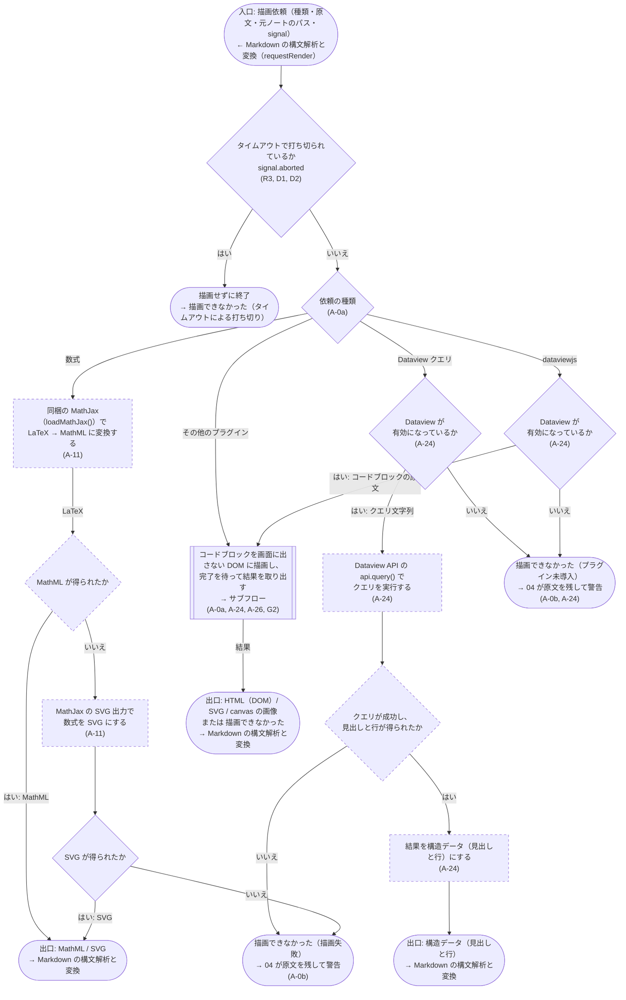
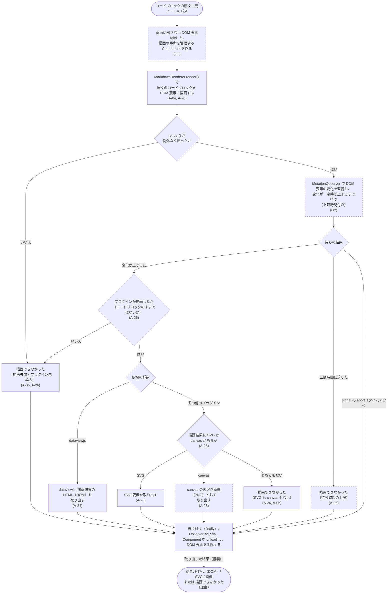
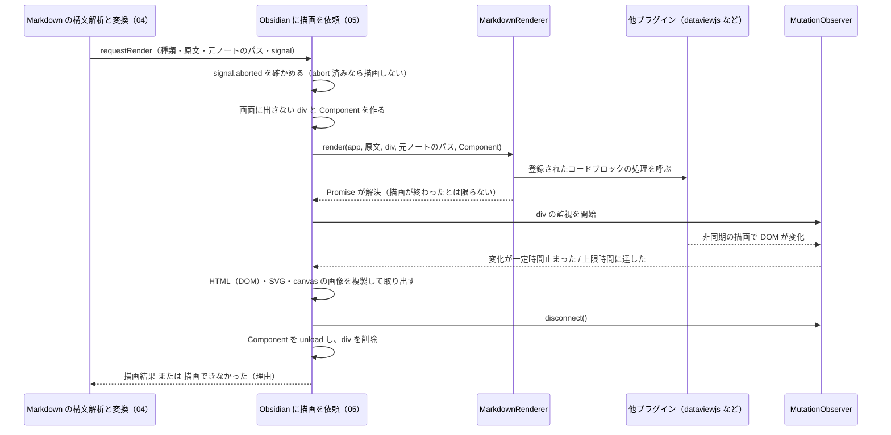

# Obsidian に描画を依頼 のフロー

最終更新: 2026-11-17
対応する要件: G2「HTML を取り込む経路」、R5 の A-0a・A-0b・A-11・A-24・A-26（関連: A-25、A-33、G5、R3 のタイムアウト）

## 役割

「Markdown の構文解析と変換」がホスト関数 `requestRender` で出した描画依頼を 1 件ずつ受け取り、Obsidian 側の機能（Dataview API・`MarkdownRenderer.render()`・同梱の MathJax）で描画した結果を返す。構文解析と変換の本体を Obsidian API に依存させない（G2）ため、Obsidian API を呼ぶ処理はこのコンポーネントに集める。描画できなかったときは「描画できなかった」という結果と理由だけを返し、原文を残して警告を記録する処理は「Markdown の構文解析と変換」（04）が行う。

## 入力と出力

| 受け取るもの / 渡すもの | 内容 | 相手のコンポーネント |
|---|---|---|
| 受け取る: 描画依頼 | 依頼の種類（Dataview / dataviewjs / 数式 / その他のプラグインのコードブロック）、原文（コードブロックの言語名と本文、または LaTeX と表示形式 inline / display）、元ノートのパス（04 の定義に合わせる）、ノートごとの `AbortSignal`（03 が作り、タイムアウトで abort する） | Markdown の構文解析と変換（ホスト関数 `requestRender`） |
| 渡す: HTML / SVG | 描画結果。結果の形は「HTML（DOM）」「SVG」「canvas から得た画像」のいずれか。数式は MathML（失敗時は SVG）、Dataview クエリは構造データ（見出しと行）。全体図のラベル「HTML / SVG」に入らない形は「決める必要があること」を参照 | Markdown の構文解析と変換 |
| 渡す: 描画できなかった | 結果なしと理由（プラグイン未導入・描画失敗・待ち時間の上限・SVG も canvas もない・タイムアウトによる打ち切り）。原文を残す処理と警告の記録は 04 が行う | Markdown の構文解析と変換 |

## フロー図

### 全体の流れ（依頼の種類ごとの分岐）



### サブフロー: 画面に出さない DOM への描画と完了待ち（dataviewjs・その他のプラグイン）



### Obsidian API とのやり取りの順序（sequenceDiagram）

`MarkdownRenderer.render()` を使う経路では、「DOM 要素の用意 → 描画 → 完了待ち → 結果の取り出し → 後片付け」の順序が要点になる（後片付けの後では DOM と canvas の中身が失われ、後片付けをしないと Component と DOM が残り続ける）。そのため、この経路だけ sequenceDiagram を追加する。Dataview クエリと数式は API を 1 回呼ぶだけなので追加しない。



## 各ステップの補足

### 全体の流れ

| ノード名 | 内容 | 要件 ID |
|---|---|---|
| 入口: 描画依頼 | 04 のサブフロー B から 1 件ずつ逐次に呼ばれる（同時に複数の依頼は来ない）。依頼の種類の判別は 04 が行い、このコンポーネントは種類を受け取るだけ | G2, R3 |
| タイムアウトで打ち切られているか | 03 の `Promise.race` でタイムアウトした件の処理が裏で続いても、描画しないための判定。03 がノートごとに作った `AbortController` の `signal` を引数で受け取り、`signal.aborted` を確かめる。abort するのはタイムアウトのときだけで、中断ボタンでは abort しない（処理中のノートの描画は最後まで行う） | R3, D1, D2 |
| Dataview が有効になっているか | Dataview の API を取得できるかで判定する。取得の方法は実装時に決める | A-24 |
| api.query() でクエリを実行する | コードブロック `dataview` の本文をクエリとして渡す。A-24 では「要検証」 | A-24 |
| 結果を構造データにする | 見出しと行の 2 次元の表にする。04 がこれを mdast の表にし、.docx の生成が Word の表にする | A-24 |
| dataviewjs | `api.query()` は使わず、サブフローで描画結果の HTML を取り出す（A-24「描画結果の HTML から取り込む」） | A-24 |
| LaTeX → MathML に変換する | Obsidian 同梱の MathJax（`loadMathJax()`）を第一候補にする。だめなら Temml（MIT）。MathML → OMML の変換は .docx の生成側の処理（A-11）。A-11 は「要検証」のため点線 | A-11, G5 |
| MathJax の SVG 出力で SVG にする | MathML が得られなかった式の代わり（A-11「変換に失敗した式は MathJax の SVG 出力で画像化する」） | A-11 |
| 数式と Excel | Excel では数式は LaTeX のまま（A-33）。数式の依頼を出すかどうかは 04 の判断で、このコンポーネントは出力形式を知らない | A-33 |
| 描画できなかった | 理由（プラグイン未導入・描画失敗・待ち時間の上限・SVG も canvas もない・タイムアウトによる打ち切り）を付けて返す。原文を等幅で残し警告を記録するのは 04 の「原文のまま等幅で残し、警告を記録する」ノード | A-0b |
| インラインフィールド | `key:: value`（A-25）は描画依頼の対象ではない（04 がテキストのまま渡す） | A-25 |

### サブフロー: 画面に出さない DOM への描画と完了待ち

| ノード名 | 内容 | 要件 ID |
|---|---|---|
| 画面に出さない DOM 要素と Component を作る | `MarkdownRenderer.render()` の描画先の要素と、描画したプラグインの後片付け（イベントの登録解除など）に使う `Component` を用意する。要素を `document` につなぐか（つながないと大きさを測るグラフ系のプラグインが描画しない可能性がある）、つなぐなら画面外にどう隠すかは未定のため点線 | G2 |
| MarkdownRenderer.render() で描画する | 原文はコードブロックの記法のまま（```` ```言語名 ```` で囲んで）渡す。`sourcePath` には元ノートのパスを渡し、プラグインが相対リンクやクエリの基準に使えるようにする | A-0a, A-26 |
| render() が例外なく戻ったか | 例外は「描画失敗」として扱う | A-0b |
| MutationObserver で変化が止まるまで待つ | Dataview などは `render()` が戻った後も非同期で描画を続ける（G2）。待ちの最中も `signal` の `abort` イベントを監視し、abort されたら待ちをやめて後片付けに進む（D2）。「変化が止まった」とみなす無変化の時間と、上限時間の値は未定（G2 で「要検証」）。上限時間は、03 の 1 件ごとのタイムアウト（既定 30 秒）より短くする必要がある | G2, R3 |
| プラグインが描画したか | 該当するコードブロックの処理を登録したプラグインがない場合、`render()` は通常のコードブロック（`pre > code`）を描画するだけで終わる。描画結果がコードブロックのままなら「描画できなかった（プラグイン未導入）」とする。この判定方法は要件にないため点線 | A-26 |
| dataviewjs: HTML（DOM）を取り出す | 描画結果の DOM を複製して返す。04 が DOM → hast → mdast に変換する（G2） | A-24, G2 |
| SVG 要素を取り出す | 複製して返す。.docx / .xlsx 用の PNG にする処理（ラスタ化）の担当は未定 | A-26 |
| canvas の内容を画像として取り出す | `cloneNode()` では canvas の描画内容は複製されないため、後片付けの前に画像（PNG）に変換する必要がある。外部の画像を描いた canvas は tainted になり読み出せない（`SecurityError`）可能性がある。いずれも要件にないため点線 | A-26 |
| 後片付け（finally） | 結果の有無・例外・タイムアウトによる打ち切りにかかわらず、`MutationObserver.disconnect()`、`Component.unload()`、DOM 要素の削除を行う。取り出す結果は後片付けの前に複製しておく | R3 |

## 決める必要があること

境界（全体図・ほかのコンポーネント）に関すること
- **結果の形が全体図のラベル「HTML / SVG」に収まらない**（04 の「Dataview の結果は HTML ではない」と同じ論点、`docs/design/flows/04-parse-transform.md`）: このフローでは、Dataview クエリは構造データ（見出しと行）、数式は MathML（失敗時は SVG）、canvas は画像（PNG）を返す。全体図の矢印のラベルを「描画結果（HTML / SVG / 画像 / 構造データ / MathML）」に広げるか。04 のサブフロー B の「結果の形」の分岐（HTML / SVG・canvas の 2 つ）に、構造データと MathML の分岐を足す必要がある
- **完了待ちの上限時間と 03 のタイムアウトの関係**: 1 件のノートに描画依頼が複数あると、完了待ちの上限時間 × 依頼数が 03 の既定 30 秒を超えうる。上限時間を依頼ごとの固定値にするか、ノート 1 件の残り時間から計算するか
- **SVG・canvas のラスタ化の担当**（04 の「他プラグインの SVG のラスタ化」と同じ論点）: .docx 用の PNG フォールバックと .xlsx 用の PNG（A-33）を作る処理を、このコンポーネント・04・.docx / .xlsx の生成のどこで行うか。canvas だけは後片付けの前に画像にする必要があるため、このコンポーネントで PNG にする案にした
- **数式の描画依頼の範囲**: A-11 の LaTeX → MathML を Obsidian 同梱の MathJax で行う場合、Obsidian API（`loadMathJax()`）に依存するのでこのコンポーネントに置いた。一方、Temml を使う場合は Obsidian に依存しないので、04 の変換段で直接変換でき、描画依頼にする必要がない。A-11 の検証結果に合わせて担当を決める
- **ホスト関数 requestRender のインターフェース**: 04 の案（`requestRender`）に合わせた。引数（種類・原文・元ノートのパス・`AbortSignal`）と戻り値（結果の形と「描画できなかった」の理由）を、実装（フェーズ 2〜3）の前に確定させる

要件に書かれていない・決まっていないこと
- **完了待ちの判定の値**（G2 で「要検証」）: 「変化が止まった」とみなす無変化の時間と、上限時間の既定値。設定で変えられるようにするか
- **上限時間に達したときの扱い**: このフローでは「描画できなかった」にした。途中まで描画された DOM を使う案もある
- **描画先の DOM 要素を document につなぐか**: つながないと、要素の大きさを測って描画するプラグイン（グラフ系など）が何も描かない可能性がある。つなぐ場合は画面外に置く方法（`position: fixed` で画面外・`visibility: hidden` など）を決める。テスト用 Vault で確認する（G5: Vitest では確認できない）
- **プラグインが描画したかの判定方法**: 処理を登録したプラグインがないコードブロックは、`render()` が通常のコードブロックとして描画する。結果が `pre > code` だけかどうかで判定する案にしたが、要件にない。04 の「その他のプラグインのコードブロックの判別方法」（登録済みの言語を問い合わせる案）が決まれば、この判定は不要になる
- **canvas の読み出し**: canvas の内容は後片付けの前に PNG にする必要がある。tainted な canvas（`SecurityError`）は「描画できなかった」にするか
- **Dataview クエリの結果の種類**: A-24 は「見出しと行」（TABLE）だけを想定している。LIST・TASK・CALENDAR など表でない結果をどう返すか（表にする / 「描画できなかった」にする / dataviewjs と同じく `MarkdownRenderer.render()` で HTML を取り出す）
- **Dataview の API の取得方法と有効かの判定**: Dataview が無効・未導入・読み込み途中の場合を区別するか
- **DOM の取り出し方**: 結果を DOM の複製で返すか、HTML 文字列で返すか。04 は「文字列を経由せず DOM から hast を作る」としているので、このフローでは DOM の複製にした
- **描画したプラグインが外部に及ぼす副作用**: dataviewjs や他プラグインのコードは任意の処理を実行できる（ノートの書き換えを含む）。R3 の「元ノートは書き換えない」は、このプラグイン自身が書き込み系 API を呼ばないことしか保証できない。この限界を README などで明記するか

## 決定済み（2026-11-17）

- D1: 処理中のノートを途中で打ち切るのはタイムアウト（既定 30 秒）のときだけ。中断ボタンでは処理中のノートの描画依頼は最後まで処理する。このため打ち切りの判定は「中断要求またはタイムアウト」ではなく「タイムアウト（`AbortSignal` が abort 済み）」だけにした
- D2: 打ち切りの合図は `AbortSignal` に統一。`requestRender` の引数で `signal` を受け取り、依頼の受け付け時に `signal.aborted` を確かめ、完了待ちの最中は `abort` イベントで待ちをやめる。世代番号は使わない（旧「中断の合図の受け渡し」を解決）

## 決定済み（2026-11-18・フェーズ 3a）

- フェーズ 3a では `MarkdownRenderer.render()` による描画依頼は使わない。Obsidian に頼るのは、リンクの解決（`getFirstLinkpathDest`）・画像の読み込みと PNG 化（canvas）・コードのトークン化（`loadPrism()`）・frontmatter（`metadataCache`）だけで、どれも `src/obsidian/vault-env.ts` のホスト関数にした
- 描画依頼（Dataview・他プラグインのコードブロック・数式）はフェーズ 3b で扱う。このフローの未決事項は 3b の準備で決める

## 決定済み（2026-11-18・フェーズ 3b）

詳細は `docs/requirements.md` の「フェーズ 3b の決定事項」。実装は `src/obsidian/plugin-render.ts`。

- 結果の形: 描画結果は、このコンポーネントの中で mdast（表・リスト・段落・画像など）にしてから返す。Dataview も同じ（「結果の形が全体図のラベルに収まらない」「Dataview クエリの結果の種類」を解決: TABLE・LIST・TASK とも描画結果の表・リストを取り込む）
- 完了待ち: 0.5 秒続けて DOM が変わらなければ完了。1 依頼の上限は 10 秒の固定で、ノートのタイムアウト（`AbortSignal`）が先ならそこで打ち切る（「完了待ちの判定の値」「完了待ちの上限時間と 03 のタイムアウトの関係」を解決）。上限に達したら「描画できなかった」として原文を残す（「上限に達したときの扱い」を解決）
- 描画先は document につなぎ、`position: fixed` で画面外に置いて `visibility: hidden` にする（「描画先の DOM 要素を document につなぐか」を解決）。終わったら `Component.unload()` と要素の削除で片付ける
- プラグインが描画したかの判定: 描画する前に登録の一覧（`MarkdownPreviewRenderer.codeBlockPostProcessors`、非公開）で判別し、描画後も結果が `pre > code` だけ・空なら「描画できなかった」にする
- canvas は後片付けの前に PNG にする。tainted な canvas などで画像にできなければ、その画像だけを落とす
- 数式（A-11）は `docx/math` の `latexToMath` で直接 OMML にするので、MathJax は変換できない式の画像化だけに使う（「数式の描画依頼の範囲」を解決）
  - 2026-11-18 更新: Obsidian 1.15.1 同梱の MathJax は CHTML 出力（`tex2chtml`）だけで `tex2svg` がなく、画像化は実際には動いていなかった。プラグインに同梱した `mathjax-full` 3.2.2 の SVG 出力（DOM を使わない liteAdaptor、`fontCache: none`）に切り替え、変換の本体は Obsidian に依存しない `src/core/math-svg.ts` に置いた。このコンポーネントは SVG を画像（PNG の代替付き）にするだけ
- 副作用（dataviewjs などが任意の処理を実行できること）は、README（フェーズ 6）に書く（「描画したプラグインが外部に及ぼす副作用」を解決）
- ホスト関数は `renderableLanguage`・`renderBlock`・`renderMath`・`fetchImage`・`calloutColor`（案の `requestRender` を置き換えた）
