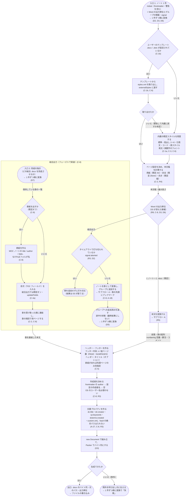
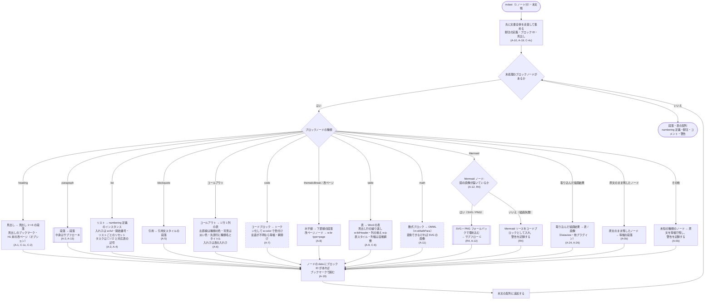
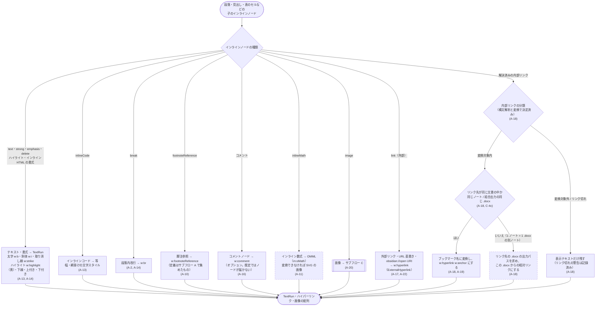
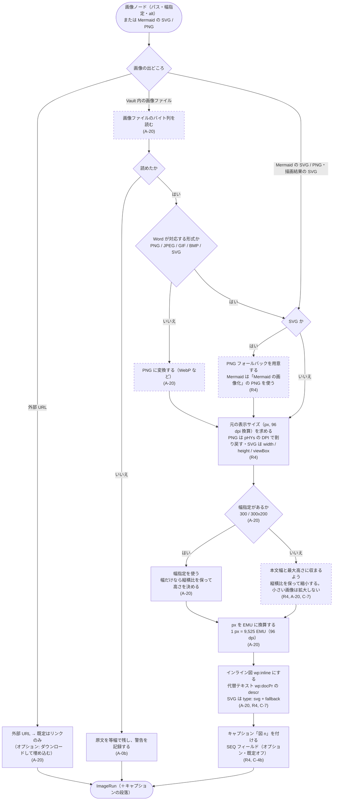

# .docx の生成 のフロー

最終更新: 2026-11-18
対応する要件: G3、R5 の Word に関する項目（A-0b・A-1〜A-27）、R6 全体（C-1〜C-8）、R4「Word に貼るときのサイズ」「Word への埋め込み形式」「描画に失敗したとき」「キャプションと代替テキスト」、R3 の個人情報の設計原則、R8「Word のファイルの単位」

## 役割

「Markdown の構文解析と変換」が作った mdast を、「1 件ずつ順に変換」から Word の出力単位とグループの情報と一緒に受け取り、`docx` ライブラリ（G3）のオブジェクトに対応付け、スタイル・ページ設定・本文・ヘッダー・フッター・文書プロパティの順に文書を組み立てて .docx のバイト列にする。Mermaid の図は「Mermaid の画像化」から受け取った SVG / PNG を SVG + PNG フォールバックで埋め込む。1 ノート = 1 .docx（既定）では 1 ノートごとに .docx を完成させ、結合出力（C-8、フェーズ 5）ではノートを章として受け取るたびに追加し、「1 件ずつ順に変換」からの完成の指示（ノート 1 件ごとの呼び出しとは別の呼び出し）で表紙・目次・連結を行って 1 つの .docx を完成させ、「ファイルの書き込み」へ渡す。

## 入力と出力

| 区分 | 受け取るもの / 渡すもの | 相手のコンポーネント |
|---|---|---|
| 受け取るもの | mdast（04 が作ったもの。標準のノード + 独自ノード。`tree.data` に frontmatter と警告の一覧）。リンクはリンク先のノートのパス・見出し・ブロック ID・分類（変換対象内 / 変換対象外 / リンク切れ）を持つ。画像ノードはパス・幅指定・alt だけを持つ | 1 件ずつ順に変換（04 が 03 に返した mdast を 03 が渡す） |
| 受け取るもの | Mermaid の SVG / PNG（図ごと。ノートと連番で識別）、または描画失敗 | Mermaid の画像化 |
| 受け取るもの（全体図にない） | mdast に添えた Word の出力単位（1 ノート = 1 .docx / 結合出力）とグループの情報（どの結合 .docx に入るか）と、ノートごとの `AbortSignal`。章の並び順は完成の指示より前に決まっている前提 | 1 件ずつ順に変換 |
| 受け取るもの（全体図にない） | 完成の指示（どの結合 .docx を完成させるか）。結合出力のとき、グループの全ノートの処理が終わった後に、各ノートの成功・失敗に関係なく別の呼び出しで届く | 1 件ずつ順に変換 |
| 渡すもの | .docx のバイト列・元ノートのパス（結合出力ではフォルダのパス）・Word の出力単位（1 ノート = 1 .docx / 結合出力）・`AbortSignal` | ファイルの書き込み |
| 渡すもの（全体図にない） | 結合出力でノート 1 件を章として追加したときの「グループへの追加済み」（途中の状態で、最終結果にしない）。生成の失敗は例外として呼び出し元に伝わる | 1 件ずつ順に変換 |

## フロー図

### 全体の流れ: 文書の組み立ての順序

`docx` ライブラリでは、各部品（段落・表・numbering 定義・脚注・ヘッダー・フッター・プロパティ）を作ってから `new Document({...})` にまとめて渡し、`Packer` でバイト列にする。下の順序は、前の段の結果を後の段が使う依存関係の順（本文の画像サイズの計算に本文幅が必要、など）である。入口は 2 つある。ノート 1 件ごとの入口と、結合出力の完成の指示の入口（D7）。

### サブフロー A: ブロック要素の対応付け

mdast の木を先頭から順にたどり、ブロックノードごとに `docx` のオブジェクト（`Paragraph`・`Table` など）を作る。インライン要素はサブフロー B、画像はサブフロー C に分ける。

### サブフロー B: インライン要素とリンクの対応付け

### サブフロー C: 画像の読み込みとサイズ計算

## 各ステップの補足

### 全体の流れ

| ノード名 | 内容 | 要件 ID |
|---|---|---|
| ユーザーのテンプレートが設定されているか | 設定で .docx / .dotx のパスを指定したときだけ使う（オプション）。指定がなければ内蔵の既定スタイル | C-1b |
| テンプレートから styles.xml を取り出す | .docx / .dotx（ZIP）から `word/styles.xml` を取り出し、`docx` ライブラリの `externalStyles` に渡す。テンプレートに表スタイルがあれば、表にはそれを使う（C-6）。ファイルを読むのは I/O なのでホスト関数経由になる | C-1b, C-6 |
| 取り出せたか | ファイルがない・ZIP として壊れている・`styles.xml` がない場合の扱いは要件にない（点線枠） | C-1b |
| 内蔵の既定スタイルを用意する | 本文は「標準」、見出しは「見出し 1〜6」（`w:pStyle`）、引用は「引用文」、コードは等幅＋網掛けの文字・段落スタイル。フォントは東アジア言語用（`w:eastAsia`）と英数字用（`w:ascii` / `w:hAnsi`）を分ける。既定は本文 游明朝 + Century、見出し 游ゴシック + Arial。表は格子の罫線・見出し行に網掛けと太字 | C-1a, C-3, C-6 |
| ページ設定を決め、本文幅を計算する | 用紙 A4（既定）/ B5 / Letter、余白 既定 上下左右 25mm、向き 既定 縦。本文幅 = 用紙幅 − 左右の余白（A4・25mm で約 16cm）。本文の高さ（用紙の高さ − 上下の余白）も最大高さの計算に使う。実行ごとに 1 回計算すればよい | C-2, R4 |
| Word の出力単位 | 1 ノート = 1 .docx（既定）と結合出力（1 フォルダ = 1 .docx）。結合出力は確認画面で実行ごとに選ぶ（既定オフ）。どちらかは、03 が mdast に添える Word の出力単位で受け取る（Excel の出力単位は受け取らない） | R8, C-8, D3, D6 |
| 本文を変換する | サブフロー A。本文の配列のほか、numbering 定義・脚注・コメント・警告を集めて返す | R5 |
| ノートを章として変換し、グループに追加する | 結合出力。ノート 1 件ごとにサブフロー A を適用し、グループ（フォルダ）の章の一覧に足す。この時点では .docx を完成させない。章の先頭（ノート名の位置）にブックマークを付け、別の章からの `[[ノート]]` のリンク先にする | C-8, A-18 |
| タイムアウトで打ち切られているか | 章をグループに追加する前に、03 から受け取った `signal.aborted` を確かめる。abort 済み（タイムアウト）なら、失敗扱いのノートの章をグループに足さない。中断ボタンでは abort されない。書き込み（rename）の前の確認は「ファイルの書き込み」が行う | R3, D1, D2 |
| グループへの追加済みを返す | 03 のサブフローの結果に入る。「グループへの追加済み」は途中の状態で、最終結果にしない。グループの最後のノートでもここを通り、.docx は完成させない（完成は入口 2 の完成の指示で行う: D7）。結合 .docx の書き込み結果は、03 がそのグループの全ノートに付ける | C-8, D5, D7 |
| 入口 2: 完成の指示 | 03 がグループの全ノートを処理し終えたとき、各ノートの成功・失敗に関係なく、ノート 1 件ごとの呼び出しとは別の呼び出しで届く。どの結合 .docx かを指定され、保持している章の一覧で表紙・目次・連結へ進み、.docx を完成させて 09 に渡す。グループの最後のノートが失敗しても届く | C-8, D7 |
| 表紙を作る | 内蔵の表紙に frontmatter の `title` / `author` / `date` を差し込む。結合出力では MOC ノート、なければフォルダ名から作る。1 ノート = 1 .docx でも表紙のオプションは使える（図では結合出力の中にだけ描いた。「決める必要があること」を参照） | C-8 |
| 目次を入れる | TOC フィールドを入れ、`features.updateFields` で開いたときに更新させる。1 ノート = 1 .docx では既定オフ、結合出力では既定オン。開くたびに確認ダイアログが出ることは設定画面に注意書きする | C-4a |
| 章を受け取った順に連結し、境目で改ページする | 並び順（ファイル名順 / `order` / MOC の順）は 03 側で決まった順に届く前提（並べ替えの担当は 03 で未定）。結合出力では章の境目で常に改ページする | C-2, C-8 |
| ヘッダー・フッターを作る | フッター中央にページ番号「n / 総ページ数」（`PAGE`・`NUMPAGES` フィールド、既定オン）。ヘッダーの文書タイトル（既定オフ）は frontmatter の `title`、なければノート名、結合出力ではフォルダ名。表紙を出すときは `titlePage`（先頭ページのみ別指定）で表紙にヘッダー・フッターを出さない | C-5 |
| 作成者を決める | `dc:creator` は frontmatter の `author` → 設定の作成者名 → 空。OS のユーザー名（`os.userInfo()` など）は参照しない。`docx` ライブラリが `creator`・`lastModifiedBy` に既定値を入れるかは要検証で、空のときも明示的に指定する | C-8, R3 |
| 文書プロパティを作る | `docProps/core.xml` の `dc:title`・`dc:creator`・`cp:keywords`・`dcterms:created` と、ユーザー設定プロパティ（`docProps/custom.xml`）に frontmatter から入れる。キーとプロパティの対応は設定で変えられる。Vault の絶対パスはプロパティにも本文（リンク・代替テキスト・画像の名前）にも入れない | A-27, C-8, R3 |
| new Document で組み立て、Packer でバイト列にする | スタイル・numbering 定義・脚注・コメント・セクション（ページ設定・ヘッダー・フッター・本文）・プロパティを `new Document({...})` に渡し、`Packer.toBuffer()`（または `toBlob()`）でバイト列にする | G3 |
| 例外を呼び出し元に伝える | 生成の失敗は例外のまま返す。03 のサブフローでは「処理が例外で終了」→「失敗（例外の内容）」として記録される | R3 |
| 出口 | バイト列に、元ノートのパス（結合出力ではフォルダのパス）と Word の出力単位（1 ノート = 1 .docx / 結合出力）と `signal` を添えて、09 の入力の形で渡す。出力パスはこのコンポーネントでは決めない。09 は出力ファイルごとに結果（出力パス・内容ハッシュ・状態）を返す | R8, D2, D5 |

### サブフロー A: ブロック要素

| ノード名 | 内容 | 要件 ID |
|---|---|---|
| 先に文書全体を走査して集める | 脚注は参照より先に定義を `footnotes` に登録する必要があるため、定義を先に集める。見出しとブロック ID も集め、リンクのブックマーク名を前もって決める（本文の後ろにあるブックマークへのリンクを作れるようにするため） | A-10, A-19, C-4c |
| 見出し | 「見出し 1〜6」に 1 対 1 で対応させる。オプション: レベルを 1 段下げてファイル名を「表題」にする / 見出しの段落番号（1 / 1.1 / 1.1.1、numbering 定義、既定オフ）。オプション: H1 の前で改ページ（既定オフ）。`[[ノート#見出し]]` のリンク先として、見出しにブックマークを付ける | A-1, C-1c, C-2, C-4c |
| リスト | `numbering.xml` の `w:abstractNum` を箇条書き / 番号付きで用意し、リストごとに別のインスタンス（`docx` の `reference` と `instance`）を使って番号をリセットする。開始番号（`3.` 始まり）を反映する。入れ子は `w:ilvl`。タスクは ☐（U+2610）/ ☑（U+2611）と、`[/]` `[-]` `[>]` などの対応表の記号 | A-3, A-4 |
| 引用 | 組み込みスタイル「引用文」 | A-5 |
| コールアウト | 1 行 1 列の表。左罫線を種類の色、背景を淡い色（`w:shd`）。先頭行に種類名とタイトル。折りたたみ（`[!note]-`）は常に展開。色は「既定色の固定表 / テーマの `--callout-color` を読む」を設定で選ぶ（後者は Obsidian の DOM に依存する） | A-6 |
| コードブロック | Prism（`loadPrism()`）でトークン化し、トークンの種類ごとに `w:color` を付ける。言語が不明なら等幅フォント＋網掛け。オプション: 行番号。`loadPrism()` は Obsidian API なので、レンダラから呼ぶにはホスト関数として渡す必要がある（点線枠） | A-7, G2 |
| 水平線 / 改ページ | `---` は段落の下罫線。04 が作る改ページノード（`page-break-after` の `div`）は `w:br w:type="page"` | A-8 |
| 表 | 見出し行を各ページで繰り返す（`w:tblHeader`）。列の揃え（`w:jc`）。セル内の書式と ` ` はサブフロー B で保持する。列幅は既定で内容に合わせて自動調整、オプションで本文の幅いっぱい。図表番号「表 n」はオプション（C-4b） | A-9, C-6, C-4b |
| 数式ブロック | LaTeX → MathML → OMML。失敗した式は MathJax の SVG で画像化する。mdast に数式がどの形（MathML / OMML / SVG）で届くかは、04 で A-11 の検証待ちになっている（点線枠） | A-11 |
| Mermaid ノード: 図の画像が届いているか | 06 から届いた SVG / PNG を、ノートと連番で Mermaid ノードと対応付ける | A-12, R4 |
| Mermaid ソースをコードブロックとして入れる | 描画に失敗した図は、ソースをコードブロックとして挿入し、結果レポートに記録する | R4 |
| 取り込んだ描画結果 | 04 が Dataview の結果・dataviewjs の HTML から作った表は「表」と同じ対応付け、他プラグインの SVG / canvas から作った画像はサブフロー C | A-24, A-26 |
| 原文のまま残したノード / 未知の種類のノード | 04 が A-0b で残したノードは等幅の段落にする。04 の検査を通り抜けた未知の種類のノードも、同じく原文を等幅で残して警告を記録する（念のための経路） | A-0b |
| ブックマークで囲む | 04 がノードの data に付けたブロック ID を、Word の制約（40 文字以内、英数字と `_`）に合わせたブックマーク名に変換し、段落を `w:bookmarkStart` / `w:bookmarkEnd` で囲む | A-19 |

### サブフロー B: インライン要素とリンク

| ノード名 | 内容 | 要件 ID |
|---|---|---|
| テキスト・書式 | 太字 → `w:b`、斜体 → `w:i`、取り消し線 → `w:strike`、ハイライト → `w:highlight`（黄）、インライン HTML の `<u>` `` `` `<mark>` → 下線・上付き・下付き・ハイライト。書式は入れ子を合成して 1 つの `TextRun` にする | A-13, A-14 |
| 段落内改行 | 04 が「厳密な改行」の設定に従って作った `break`、および ` ` を `w:br` にする | A-2, A-14 |
| 脚注参照 | `[^1]` もインライン脚注 `^[...]` も、サブフロー A で集めた定義の番号を参照する | A-10 |
| コメントノード | A-16 のオプションを有効にしたときだけ 04 がコメントノードを作る。`w:comment` にする | A-16 |
| 外部リンク | 外部リンク・URL 直書きは `w:hyperlink`。PDF・音声・動画（A-22）は 04 が `obsidian://open` URI のリンクにしてあるので、同じく外部リンクとして出す | A-17, A-22 |
| 内部リンクの分類 | 04 が `isExportTarget` で決めた分類（変換対象内 / 変換対象外 / リンク切れ）に従う。「変換対象内」には、今回の対象ノートと、出力マニフェストに .docx 出力済みとして記録されたノートを含む | A-18 |
| リンク先が同じ文書の中か | 1 ノート = 1 .docx では同じノートの中の見出し・ブロックへのリンク（`[[#見出し]]`・`[[#^id]]`）。結合出力では同じ .docx に入っている章（ノート）・見出し・ブロックへのリンク | A-18, C-4c |
| ブックマーク名に変換する | 見出し・ブロック ID・章の先頭のブックマーク名を、Word の制約（40 文字以内、英数字と `_`）に合わせて変換し、`w:hyperlink w:anchor` にする | A-18, A-19 |
| 相対リンクにする | 1 ノート = 1 .docx で別のノートへのリンクは、リンク先の .docx への相対リンクにする。リンク先の出力パスの計算が必要（点線枠、「決める必要があること」を参照） | A-18 |
| 表示テキストだけ残す | 変換対象外とリンク切れ。リンク切れの警告は 04 が記録済みなので、ここでは記録しない | A-18 |

### サブフロー C: 画像

| ノード名 | 内容 | 要件 ID |
|---|---|---|
| 外部 URL | 既定ではリンクのみ（画像の代わりに URL のハイパーリンクを置く）。オプション: ダウンロードして埋め込む（ネットワーク通信になるので G1 の明示が必要） | A-20, G1 |
| 画像ファイルのバイト列を読む | 04 は画像ノードにパスだけを持たせている。読むのがこのコンポーネント（ホスト関数）か 04 かは未定（点線枠） | A-20 |
| Word が対応する形式か | `docx` ライブラリの `ImageRun` が受け付ける PNG / JPEG / GIF / BMP / SVG はそのまま使う | A-20 |
| PNG に変換する | WebP など。変換の方法（Obsidian の DOM の canvas を使うなど）が決まっていない（点線枠）。R4 の後回し「既存画像も同じ処理の流れで扱う（WebP / HEIC / GIF → PNG 変換）」と範囲が重なる | A-20, R4 |
| PNG フォールバックを用意する | Word への埋め込みは SVG + PNG フォールバック（`type: "svg"` + `fallback`）。Mermaid は 06 が作った PNG を使う。ユーザーが貼った .svg 画像と、他プラグインの描画結果の SVG（A-26）の PNG を誰が作るかは未定（点線枠） | R4, A-12, A-26 |
| 元の表示サイズを求める | 06 の PNG は DPI / 96 倍の画素数で描かれ、`pHYs` に DPI が書かれているので、画素数 × 96 / DPI で 96 dpi 換算の px に戻す。`pHYs` がない画像は 96 dpi とみなす。SVG は `width` / `height`、なければ `viewBox` | R4 |
| 幅指定を使う | `![[a.png\|300]]` は幅 300 px、`300x200` は幅と高さ。幅だけなら縦横比を保って高さを決める | A-20 |
| 本文幅と最大高さに収まるよう縮小する | 縮小率 = min(1, 本文幅 / 幅, 最大高さ / 高さ)。1 を超えない（小さい画像は拡大しない）。最大高さの値は要件にない（点線枠） | R4, A-20, C-7 |
| px を EMU に換算する | 96 dpi で 1 px = 9,525 EMU。`docx` ライブラリの `transformation` は px で指定し、ライブラリが EMU に換算する | A-20 |
| インライン図にする | 配置は「行内」（`wp:inline`）に固定。alt テキストを代替テキスト（`wp:docPr` の `descr`）にする。Mermaid の代替テキストは R4 のオプション（タイトル、なければ図の種類） | A-20, R4, C-7 |
| キャプション「図 n」を付ける | R4・C-4b のオプション（既定オフ）。Word の `SEQ` フィールド。出どころは Mermaid の frontmatter の `title` → 直前の見出し、その他の画像は alt テキスト → 直前の見出し | R4, C-4b |

## 決める必要があること

境界（全体図・ほかのコンポーネント）に関すること
- **結合出力の途中で止まったときの章の一覧（03-run-sequential.md と同じ論点）**: 中断・fail-fast で止まったとき、保持している章の一覧を捨てるか、処理済みの章だけで .docx を完成させるか。continue-on-error で 1 件が失敗したとき、その章を抜いて完成させるか
- **リンク先の .docx の出力パス（04-parse-transform.md・09-write-file.md と同じ論点）**: 04 はリンクにリンク先のノートのパスと分類だけを持たせ、相対パスへの変換をこのコンポーネントに任せた。出力パスは 09 のサブフロー A（出力パスの計算と予定動作の判定）で決まるため、それを書き込みなしで呼べる純粋な処理として共有する案を前提にしたい。ただし、次の点が未定
  - リンク先がまだ書き込まれていない（同じ実行の後ろの方で処理される）とき、同名ファイルの扱いが「連番」だと `name (1).docx` になるかどうかは書き込み時まで分からない。連番の結果をリンクに反映するか、反映しない（`name.docx` を指す）と割り切るか
  - リンク先が「スキップ」になった場合や、出力マニフェストに記録された過去の出力（A-18）の場合は、マニフェストに記録された出力パスを使うか
  - 1 ノート = 1 .docx で別のノートの見出し・ブロックへのリンク（`[[別ノート#見出し]]`）を、`別ノート.docx#ブックマーク名` の形にするか、ファイルへのリンクだけにするか（Word で相対パス + ブックマークのリンクが動くかは要検証）
- **結合出力で、同じ .docx に入っていない変換対象内のノートへのリンク**: 結合出力のとき、別のフォルダ（= 別の結合 .docx）にあるノートや、出力マニフェストにだけあるノートへのリンクを、相対リンク（その .docx へ）・表示テキストのみ、のどちらにするか。A-18 は結合出力を「文書内ブックマークへのリンク」としか書いていない
- **画像のバイナリを誰が読むか（04-parse-transform.md と同じ論点）**: 本図では「画像ファイルのバイト列を読む」をこのコンポーネントに置いた（点線枠）。このコンポーネントが読む場合は、Obsidian API に依存しないように読み込み関数（例: `readBinary`）をホスト関数として受け取る。.xlsx の生成（08）も同じ画像を読むので、08 と同じ方式にそろえる
- **SVG の PNG フォールバックを誰が作るか（04-parse-transform.md と同じ論点）**: Mermaid 以外の SVG（ユーザーの .svg 画像、A-26 の他プラグインの描画結果）の PNG フォールバックを作る処理の担当が決まっていない。ラスタ化には DOM の canvas が必要で、06 の PNG 化（DPI・背景の白塗り・`pHYs`）と同じ処理になるため、06 の処理を共有するかどうかを含めて決める。WebP などの PNG 変換も同じ論点
- **Mermaid ノードと画像の対応付け（04-parse-transform.md と同じ論点）**: 06 の結果は全体図では 06 → 07 に直接届く。mdast の Mermaid ノードと届いた SVG / PNG を、ノートと連番・ハッシュのどちらで対応付けるか。また、ノート 1 件の本文の変換を始める前に、そのノートの図の画像がすべて届いている（待ち合わせる）必要がある。どちらの処理が先に走り、どこで待つかを決める
- **Obsidian 依存の処理をレンダラから呼ぶ方法**: `loadPrism()`（A-7）・コールアウトの `--callout-color`（A-6 の設定）・テンプレートの読み込み（C-1b）・WebP の PNG 変換は、Obsidian API・DOM・ファイル I/O に依存する。G2 は parse と transform だけを Obsidian 非依存と定めており、render（このコンポーネント）の扱いは明記されていない。04 と同じくホスト関数で外から渡す形にそろえるか
- **数式が mdast に届く形（04-parse-transform.md と同じ論点）**: A-11 の検証（LaTeX → MathML → OMML）の結果によって、数式ノードが MathML / OMML / SVG のどれを持って届くかが変わる。MathML → OMML の変換をどちらのコンポーネントで行うかも合わせて決める
- **警告の経路（03・04 と同じ論点）**: このコンポーネントでも警告が発生する（Mermaid の描画失敗の記録、画像を読めない、未知のノード、テンプレートを読めない）。全体図に「実行結果の記録」へ届く矢印がない。04 の案と同じく、警告の一覧を結果と一緒に返す形にそろえるか

要件に書かれていない・決まっていないこと
- **テンプレートを読めなかったとき**: C-1b のテンプレートが見つからない・壊れているときに、内蔵の既定スタイルに戻して警告するか、そのノート（または実行全体）を失敗にするか
- **テンプレートと内蔵の設定の優先順位**: `externalStyles` を使うと `styles.xml` が丸ごと置き換わる。テンプレートを指定したとき、C-3 の和文 / 英数字のフォント設定や C-6 の内蔵の表スタイルを上書きで適用するか、テンプレートに完全に従うか。テンプレートの表スタイルをどの名前（スタイル ID）で探すか
- **画像の最大高さの値**: R4 は「最大高さも制限する」とだけ書き、値がない。案: 本文の高さ（用紙の高さ − 上下の余白）
- **幅指定が本文幅を超えるとき**: A-20 は「幅指定がなければ本文の幅に縮める」と書いており、幅指定（`|800` など）が本文幅を超えた場合に縮めるかが決まっていない
- **画像を読めなかったときの表し方**: 本図では A-0b に合わせて原文（`![[a.png]]`）を等幅で残す案にした。alt テキストやファイル名だけを残す案もある
- **1 ノート = 1 .docx での表紙**: C-8 の表紙は「v1・オプション」で、1 ノート = 1 .docx でも使えるように読める。図では結合出力の中にだけ描いたので、1 ノート = 1 .docx でも表紙を出すかを決める（出す場合は全体の流れの「本文を変換する」の前に同じ処理を置く）
- **結合出力の文書プロパティ**: 結合出力ではノートが複数あるため、`dc:title`・`dc:creator`・`cp:keywords`・`dcterms:created` を何から取るかが決まっていない。案: 表紙と同じく MOC ノートの frontmatter、なければフォルダ名と設定の作成者名。あわせて、MOC ノートの frontmatter をこのコンポーネントにどう渡すか（MOC は対象ノートの 1 つとして届くのか、別に渡すのか）
- **結合出力での ID の重複**: 章ごとに変換すると、脚注の番号・ブックマーク名・numbering のインスタンス・コメントの ID が章の間で重複しうる。章の識別子を接頭辞に付ける、または通し番号を振り直すかを決める。ブックマーク名は 40 文字の制約があるので、接頭辞の長さも含めて決める
- **見出しのブックマーク名の作り方**: A-19 のブックマーク名の規則（40 文字以内、英数字と `_`）では、日本語の見出しをそのまま使えない。連番・ハッシュなどで ID を作り、見出しのテキストとの対応表を持つ形にするか。同じテキストの見出しが複数あるときの扱いも決める
- **`docx` ライブラリの既定のプロパティ値**: `creator`・`lastModifiedBy` などに `docx` ライブラリが既定値を入れるか（要検証）。OS のユーザー名が入る経路がないことを、生成した .docx の `docProps/core.xml` のテストで確認する

## 決定済み（2026-11-17）

- D1・D2: 打ち切りの合図は 03 がノートごとに作る `AbortSignal`。章をグループに追加する前に `signal.aborted` を確かめ、abort 済み（タイムアウト）なら追加しない。中断ボタンでは abort されない（旧「タイムアウト後に遅れて返った章」を解決）
- D3: mdast は 04 から直接ではなく、03 が出力単位とグループの情報（どの結合 .docx に入るか・グループの終わりか）を添えて渡す。「グループの終わり」の情報が付いたノートで .docx を完成させる。このコンポーネントは追加済みの章の一覧をグループの終わりまで保持する（旧「グループの終わりの通知の経路」を解決。「グループの終わりか」の情報と、それによる完成は 2026-11-18 の D7 で完成の指示に置き換えた）
- D5: 「グループへの追加済み」は途中の状態で、最終結果にしない。結合 .docx の書き込み結果は 03 がそのグループの全ノートに付ける

## 決定済み（2026-11-18）

- D6: このコンポーネントが受け取る出力単位は Word の出力単位（1 ノート = 1 .docx（既定）/ 結合出力）だけ。旧称「単体出力」は「1 ノート = 1 .docx」に置き換える
- D7: 「グループの終わりか」の情報は受け取らない。結合出力では、03 がグループの全ノートを処理し終えたときに、各ノートの成功・失敗に関係なく別の呼び出しで届く完成の指示で、表紙・目次・連結を行って .docx を完成させ、09 に渡す。入口はノート 1 件ごとの入口と完成の指示の入口の 2 つになる

## 決定済み（2026-11-18・フェーズ 2）

詳細は `docs/requirements.md` の「フェーズ 2 の決定事項」。

- フェーズ 2 の出力単位は 1 ノート = 1 .docx だけ。結合出力はフェーズ 5
- 画像の最大高さは本文の高さ（用紙の高さ − 上下の余白）（「画像の最大高さの値」を解決）
- 未対応の記法は、元の Markdown を等幅の段落で残して警告する（A-0b）
- 文書プロパティの作成者は設定の作成者名、なければ空。`docx` ライブラリの既定値で OS のユーザー名が入らないことをテストで確かめる（「`docx` ライブラリの既定のプロパティ値」を解決）
- Mermaid の画像は SVG + PNG フォールバックで埋め込む。描画に失敗した図はソースをコードブロックとして入れて警告する

## 決定済み（2026-11-18・フェーズ 3a）

詳細は `docs/requirements.md` の「フェーズ 3 の決定事項」。

- 1 ノート = 1 .docx での別のノートへのリンクは、ファイルへのリンクだけにする（`[[別ノート#見出し]]` もファイルへ）。リンク先が「連番」で別の名前になっても、リンクは `name.docx` を指す（割り切り）。相対パスは 04 の組み立ての段で計算して、リンクのノードに URL として付ける
- 見出しのブックマーク名は `h_{連番}`、ブロックは `b_{id を英数字と _ にしたもの}`。リンクされている見出し・ブロックにだけ付ける（「見出しのブックマーク名の作り方」を解決）
- SVG の PNG の代替画像と WebP などの PNG 化は、Obsidian 側の画像の読み込みで行う（「SVG の PNG フォールバックを誰が作るか」を解決）。Prism も Obsidian 側でトークンにして、このコンポーネントは配色だけを持つ（「Obsidian 依存の処理をレンダラから呼ぶ方法」を解決: ホスト関数の結果をノードに付けて渡す）
- 幅の指定が本文の幅を超えるときも本文の領域に収める（「幅指定が本文幅を超えるとき」を解決）。読めなかった画像は原文（`![[a.png]]`）を等幅で残す（「画像を読めなかったときの表し方」を解決）
- コールアウトは 1 行 1 列の表（左の罫線 = 種類の色、背景 = 白と 10% 混ぜた色、先頭に太字の種類名かタイトル）。表が続くと Word がまとめるので、表と表の間に空の段落を入れる
- 脚注は参照された順に番号を振る。脚注の中は段落だけにする（表などは落とす）
- 作成日時（`dcterms:created`）は docx ライブラリで指定できないので、`docProps/core.xml` を作り直して差し替える。ユーザー設定のプロパティは `customProperties`

## 決定済み（2026-11-18・フェーズ 3b）

- 数式は `docx` の `Math` と `docx/math` の `latexToMath` で OMML にする。ブロックの数式は中央揃えの数式だけの段落。変換できない式は MathJax の画像（SVG + PNG の代替）、それもなければ LaTeX の原文を等幅で残す（「数式が mdast に届く形」を解決: LaTeX のまま届き、このコンポーネントで変換する）
- 外部の画像はオプションのときだけ埋め込み、取得に失敗したらリンクにする
- コールアウトの色は、テーマから読んだ色（`data.calloutColor`）があればそれを使い、なければ固定の色表

## 決定済み（2026-11-18・フェーズ 5a）

詳細は `docs/requirements.md` の「フェーズ 5 の決定事項」。実装は `src/core/docx-combine.ts`（結合出力）・`src/core/docx-export.ts`（`prepareDocxNote` と `pageDecorations`）・`src/core/docx-render.ts`（表紙・目次・ヘッダー・フッター）。

- 結合出力の組み立て方: ノートごとに 1 ノート = 1 .docx と同じ組み立て（`prepareDocxNote`: 構文解析・埋め込み・リンク・画像・図）をし、全ノートの処理の後に章として 1 つの文書の木にまとめて `renderDocx` に 1 回渡す。まとめるときに脚注の識別子・ブックマーク名・コメントの番号・Mermaid の図の連番を章ごとに付け直し、各ノードに章の原文（`data.original`）を持たせる（未対応の記法を原文で残すため）
- 章: 先頭に見出し 1（ブックマーク `c{n}_ch`）、ノートの見出しは 1 段下げる。2 章目から前に改ページ
- 章へのリンク: 組み立てでは「章へのリンク」の印を付け、まとめるときに同じ文書の章なら章の先頭へのリンク、なければ文字だけにする。別のノートの見出しへのリンクも章の先頭へ（別のノートの見出しの位置は分からないため）
- 結合出力の途中で止まったとき（中断・fail-fast）: 処理済みの章で完成させる（Excel の 1 フォルダ = 1 ブックと同じ）
- 結合出力で、同じ .docx に入っていない変換対象内のノートへのリンク: 今回の対象ならその文書（フォルダの .docx）への相対リンク、マニフェストにある過去の変換なら `{ノート名}.docx` への相対リンク
- 結合出力の文書プロパティ: MOC の frontmatter（`title`・`author`）→ フォルダ名・設定の作成者名
- 表紙・目次・ヘッダー・フッター: `docx` ライブラリの `titlePage`（先頭ページのみ別指定）・`TableOfContents`（`TOC \h \o "1-3"`、開いたときに更新を求める dirty の状態）・`features.updateFields`・`PageNumber.CURRENT` / `TOTAL_PAGES`

## 決定済み（2026-11-18・フェーズ 5b）

詳細は `docs/requirements.md` の「フェーズ 5b の決定事項」。実装は `src/core/docx-render.ts`・`src/core/docx-template.ts`・`src/core/docx-export.ts`（`styleOptions`）。

- 見出しのスタイル（C-1a）: 内蔵の見出し 1〜6・表題に大きさ・太字・前後の間隔・keepNext / keepLines
- テンプレート（C-1b）: `fflate` で .docx / .dotx から `word/styles.xml` を取り出して `externalStyles` に、テーマは docx の `readTheme` で `theme` に渡す。テンプレートがあるときは内蔵の既定（フォント・見出しの大きさ）を渡さず、テンプレートにない内蔵の段落スタイル（Quote・SourceCode・Caption）だけを補う。組み込みスタイルの ID は名前から docx ライブラリの ID（Heading1 など）に付け直す（日本語版の Word は `1` などで保存するため）
- 段落番号（C-1c）: 番号の定義 `heading-numbering`（%1 / %1.%2 / …、後ろは空白）を見出しの段落が参照する。docx ライブラリが付ける開始番号の上書きは、パック後に numbering.xml から見出しの定義の分だけ取り除く（Word の PDF で番号が戻るのを防ぐ）
- 見出し 1 の前の改ページ（C-2）: `pageBreakBefore`。最初のブロックと、直前が改ページのときは付けない
- 表の幅（C-6）: `tblW` を 100%（pct）
- 図表番号（R4・C-4b）: 段落スタイル Caption、「ラベル 番号: キャプション」。番号は `SEQ ラベル` フィールド。図は Mermaid の図と画像だけの段落の後ろ、表は前（次の段落と同じページ）
