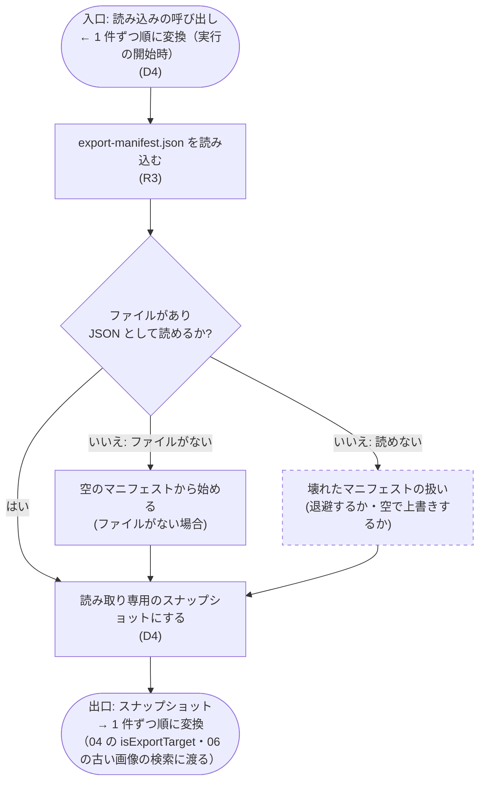

# 実行結果の記録 のフロー

最終更新: 2026-11-17
対応する要件: R3「実行後」（結果レポート・出力マニフェスト）、R3「書き込み時」（使用中ファイルのスキップの記録）、R4「古い画像の置き換え」、R5 A-0b・A-18、R7 D-1b、R8「Excel のファイルの単位」の境界条件

## 役割

出力マニフェスト `export-manifest.json` の形式と、その読み込み・保存の関数を持つ。実行の開始時には「1 件ずつ順に変換」が読み込み関数を 1 回だけ呼び、読み取り専用のスナップショットを実行の文脈として「Markdown の構文解析と変換」（A-18 のリンク先の判定）と「Mermaid の画像化」（古い画像の置き換え）に渡す。実行の最後には「1 件ずつ順に変換」からノートごとの結果とスナップショットを受け取り、成功・失敗・スキップの件数（ノートの数）と警告を集約して結果レポートとして画面に表示する。あわせて、スナップショットを元に今回書き込んだ出力ファイルを反映し、マニフェストを 1 回だけ保存する。

## 入力と出力

| 受け取るもの / 渡すもの | 内容 | 相手のコンポーネント |
|---|---|---|
| 提供する（全体図にない）: マニフェストの読み込み関数 | 実行の開始時に 1 回だけ呼ばれ、読み取り専用のスナップショットを返す | 「1 件ずつ順に変換」（スナップショットを 04・06 に渡す） |
| 受け取る: ノートごとの結果 | ノートごとの状態（成功 / 失敗 / スキップ。出力ファイルごとの結果のうちいちばん重いもの）と、出力ファイルごとの明細（出力パス・内容ハッシュ・状態）、元ノート、失敗・スキップの理由（表なしを含む）、警告（未対応記法・リンク切れ など）、実行の終わり方（完了 / キャンセル / fail-fast による停止） | 「1 件ずつ順に変換」 |
| 受け取る: マニフェストのスナップショット | 実行の開始時に読んだもの。更新の元にする | 「1 件ずつ順に変換」 |
| 渡す: 結果レポートの画面表示 | 件数（ノートの数）と警告の一覧、出力ファイルごとの明細 | 利用者（画面） |
| 渡す: export-manifest.json の保存 | 出力パス・元ノート・内容ハッシュ・日時の一覧 | ファイル（プラグインのデータフォルダ）。次回の実行の開始時に「1 件ずつ順に変換」がこのコンポーネントの読み込み関数で読む |

## フロー図

### メインフロー: 実行の最後の集約と保存

```mermaid
flowchart TD
  classDef undecided stroke-dasharray: 5 5

  In(["入口: ノートごとの結果と<br/>マニフェストのスナップショット<br/>← 1 件ずつ順に変換<br/>(D4, D5)"])
  Stop{"実行の終わり方は?<br/>(R3 実行中)"}
  Partial["処理済みの件だけを記録対象にする<br/>未処理の件は「未実行」として数える"]:::undecided
  Count["成功・失敗・スキップの件数を<br/>ノートの数で数える<br/>（進捗表示の n / 全体件数とそろえる）<br/>(R3 実行後, D5)"]
  Warn["警告を種類ごとに集約する<br/>未対応記法 (A-0b)・リンク切れ (A-18)<br/>・Mermaid 描画失敗 (R4)<br/>スキップの理由: 使用中 (R3)・表なし (D-1b, R8)"]
  Base["開始時のスナップショットを<br/>更新の元にする<br/>（ここでは読み直さない）<br/>(D4)"]
  Rel["出力パスを相対パスに変換する<br/>Vault 内: Vault からの相対<br/>Vault 外: 出力ルートからの相対 (R3)"]
  Upsert["成功した出力ファイルごとに記録を追加・更新する<br/>出力パス・元ノート・内容ハッシュ（09 が計算済み）・日時<br/>(R3, D5)"]
  Removed["古い画像の削除を反映する<br/>削除した画像の記録を消す (R4)"]:::undecided
  Save["export-manifest.json を 1 回だけ保存する<br/>{Vault}/.obsidian/plugins/<br/>batch-office-export/ (R3, D4)"]
  SaveOk{"保存に成功したか?"}
  SaveErr["保存失敗を警告に加える<br/>出力ファイルはそのまま残す"]:::undecided
  Show["結果レポートを表示する<br/>件数（ノートの数）・警告の一覧<br/>・出力ファイルごとの明細 (R3 実行後, D5)"]:::undecided
  End(["終了"])

  In -->|"ノートごとの結果"| Stop
  Stop -->|"完了"| Count
  Stop -->|"キャンセル / fail-fast で停止"| Partial
  Partial -->|"処理済みの結果"| Count
  Count --> Warn
  Warn -->|"件数と警告"| Base
  Base -->|"スナップショット"| Rel
  Rel -->|"相対パス"| Upsert
  Upsert --> Removed
  Removed -->|"更新後のマニフェスト"| Save
  Save --> SaveOk
  SaveOk -->|"はい"| Show
  SaveOk -->|"いいえ"| SaveErr
  SaveErr -->|"警告を追加"| Show
  Show --> End
```

### サブフロー: マニフェストの読み込み関数（実行の開始時に 03 が 1 回だけ呼ぶ）

点線枠のノードは、要件に決まっていない点を含む（下の「決める必要があること」を参照）。

## 各ステップの補足

| ノード名 | 内容 | 要件 ID |
|---|---|---|
| ノートごとの結果とスナップショットを受け取る | 「1 件ずつ順に変換」が逐次処理を終えた（または中断した）後に 1 回だけ呼ばれる。09 は出力ファイル 1 つごとに結果（出力パス・内容ハッシュ・状態）を返し、03 がそれをノートごとにまとめて渡す。束ねた出力（ブック・結合 .docx）の結果は、そのグループの全ノートに付いている。「グループへの追加済み」は途中の状態なので、ここには届かない | R3, D5 |
| 実行の終わり方は? | 完了・キャンセル・fail-fast による停止の 3 通り。キャンセルと fail-fast では、未処理の件が残る | R3 実行中 |
| 処理済みの件だけを記録対象にする | 中断時は、書き込みが完了した出力だけがディスクに存在する。中断ボタンでは処理中の 1 件を書き込みまで終えるので（D1）、中断による書きかけは生じない。処理済みの分を記録するかどうかは要件に書かれていない | R3, D1 |
| 件数をノートの数で数える | 結果レポートの件数はノートの数で、進捗表示の n / 全体件数とそろえる。ノートの状態はいちばん重いもの（失敗 > スキップ > 成功）。使用中ファイル（`EBUSY` / `EPERM`）のスキップ、同名ファイルの扱いで「スキップ」を選んだ場合のスキップ、「表なし」のスキップは、どれもスキップとして数える | R3, D5 |
| 警告を種類ごとに集約する | 要件で「レポートに記録する」と書かれているもの: 未対応・変換失敗の記法（A-0b）、リンク切れ（A-18）、表のないノート・表のあるノートがないフォルダ（D-1b、R8。理由付きのスキップとして届く）、Mermaid の描画失敗（R4）、使用中ファイルのスキップ（R3）、セルの文字数上限を超えた切り詰め（D-4）、必要なプラグインがない（A-24） | R3, A-0b, A-18, D-1b, R4, R8, D5 |
| 開始時のスナップショットを更新の元にする | 実行の最後にはマニフェストを読み直さず、開始時に 03 から受け取ったスナップショットを元に更新する。実行中にマニフェストを書き換えるコンポーネントはない（更新と保存はここで 1 回だけ） | R3, D4 |
| 出力パスを相対パスに変換する | Vault 内の出力は Vault からの相対パス、Vault 外の出力は出力ルートからの相対パスで記録する。Vault を移しても使えるようにするため | R3 |
| 成功した出力ファイルごとに記録を追加・更新する | 記録する項目は、出力パス・元ノート・内容ハッシュ・日時。内容ハッシュは 09 が出力ファイルのバイト列から計算して結果に含めたもの（SHA-256）を記録するだけで、ここでは計算しない。同じ出力パスの記録があれば置き換える | R3, D5 |
| 古い画像の削除を反映する | 「Mermaid の画像化」が古い画像を削除した場合、その画像の記録をマニフェストから消す必要がある。削除の情報がどの経路でここに届くかは決まっていない | R4 |
| export-manifest.json を 1 回だけ保存する | 保存先は `{Vault}/.obsidian/plugins/batch-office-export/export-manifest.json`。Vault 内の出力フォルダには置かない（同期の対象やファイルエクスプローラーの表示に混ざるのを避けるため） | R3, D4 |
| 保存失敗を警告に加える | 出力ファイルの書き込みはすでに終わっているので、マニフェストの保存に失敗しても出力は消さない。どう扱うかは要件に書かれていない | — |
| 結果レポートを表示する | 成功・失敗・スキップの件数（ノートの数）と、警告の一覧を表示する。出力ファイルごとの内訳は明細で見られるようにする。表示の形式（モーダル・Notice など）は要件に書かれていない。詳細ログファイルの出力は R3 で後回し | R3, D5 |
| マニフェストの読み込み関数 | 形式と読み書きの関数はこのコンポーネントが持つ。呼び出すのは「1 件ずつ順に変換」で、実行の開始時に 1 回だけ。G2 により、構文解析と変換の段には Obsidian API に依存しない形（読み取り専用のスナップショット）で渡る | R3, D4, G2 |
| 空のマニフェストから始める | 初回の実行ではファイルがない。この場合は空の一覧として扱う（ファイルがないことはエラーではない） | R3 |
| 壊れたマニフェストの扱い | JSON の構文エラーや、想定と違う形式のとき。要件に書かれていない | — |

## 決める必要があること

- **中断時に記録するか**: キャンセル・fail-fast で途中終了したとき、処理済みの出力をマニフェストに記録するか。要件に記述はない。書き込みが完了したファイルはディスクに残るので、記録しないと次回の A-18（出力済みの .docx へのリンク）と R4（古い画像の置き換え）がそのファイルを認識できない。処理済みの分を記録する案が自然だが、決定が必要
- **古い画像の削除の記録の経路**: R4 で「Mermaid の画像化」が古い画像を削除したとき、その画像の記録をマニフェストから消す必要がある。全体図には、削除の情報をこのコンポーネントへ運ぶ矢印がない（「ファイルの書き込み」→「1 件ずつ順に変換」の矢印は出力ファイルごとの結果だけ）
- **警告の運び方（全体図の境界との不整合）**: 04 の警告（未対応記法・リンク切れ）は mdast の `tree.data` に入って 03 に返り（D3）、「表なし」は理由付きのスキップとして結果に入る（D5）。残る描画失敗（「Mermaid の画像化」）・セルの切り詰め（「.xlsx の生成」）などは、全体図にこれらの警告を「1 件ずつ順に変換」へ運ぶ矢印がなく、「ノートごとの結果」に含まれる経路が決まっていない
- **マニフェストの記録の形式**: 形式はこのコンポーネントが持つ（D4）。要件で決まっている項目は「出力パス・元ノート・内容ハッシュ・日時」だけ。次の点が未定
  - R4 の「同じノート・同じ連番」で古い画像を探すために、画像の連番と出力の種類（docx / xlsx / 画像）を記録するか
  - 1 つの出力に複数の元ノートがある場合（1 フォルダ = 1 ブックの .xlsx、結合出力の .docx）に、元ノートを配列で持つか
  - 将来の形式変更に備えた、形式のバージョン番号を持つか
- **Vault 外の出力の記録**: 出力ルートからの相対パスだけを記録すると、設定で出力ルートを変えた後に、記録がどのルートに対する相対パスか区別できない。出力先が Vault 内か Vault 外かの区別と、出力ルートの識別（出力ルートそのものは Vault の絶対パスと同様に個人情報を含みうる点に注意: R3）をどう記録するか
- **ファイルがない・壊れているときの扱い**: ファイルがないときは空として扱う（初回の実行）でよいが、壊れているときに空として上書きすると過去の記録が失われる。壊れたファイルを別名で退避して警告するか、保存をやめるかを決める
- **マニフェストの保存が失敗したときの扱い**: 結果レポートに警告を出す以外に、再試行するか。保存自体をアトミック書き込み（一時ファイル → rename、R3）にするか、Obsidian の `vault.adapter` 経由で書くか
- **スキップした出力の扱い**: 同名ファイルの扱いで「スキップ」した場合と、使用中ファイルでスキップした場合、既存のマニフェストの記録（前回の出力）をそのまま残すか
- **結果レポートの表示の形式**: モーダル・Notice・ペインのどれで表示するか。警告が多い場合の表示（種類ごとの折りたたみ、ノートを開くリンクなど）
- **R1 の単独保存のコマンドとの関係**: Mermaid 画像の単独保存のコマンドで保存した画像も、このコンポーネントで記録・レポートするか（R4 の古い画像の置き換えは、単独保存で出した画像にも効く必要がある）

## 決定済み（2026-11-17）

- D4: マニフェストの形式と読み書きの関数はこのコンポーネントが持つ。実行の開始時に 03 が読み込み関数を 1 回だけ呼び、読み取り専用のスナップショットを 04（`isExportTarget`）・06（古い画像の検索）に渡す。更新と保存は実行の最後にこのコンポーネントが 1 回だけ行い、開始時のスナップショットを元に更新する（旧「マニフェストの読み込みのタイミングと、読む側への渡し方」を解決）
- D5: 内容ハッシュは、バイト列を持つ 09 が出力ファイルから計算して結果に含め、このコンポーネントは記録するだけ。対象は出力ファイル（旧「内容ハッシュの対象」を解決）
- D5: 結果の単位は、09 では出力ファイル 1 つ、03 からはノートごと（状態はいちばん重いもの: 失敗 > スキップ > 成功）。結果レポートの件数はノートの数で、ファイルごとの内訳は明細で見る。「表なし」は理由付きのスキップ、「グループへの追加済み」は途中の状態で最終結果にしない
- D1: 中断ボタンでは処理中の 1 件を書き込みまで終えるので、中断時に書きかけの出力は生じない
