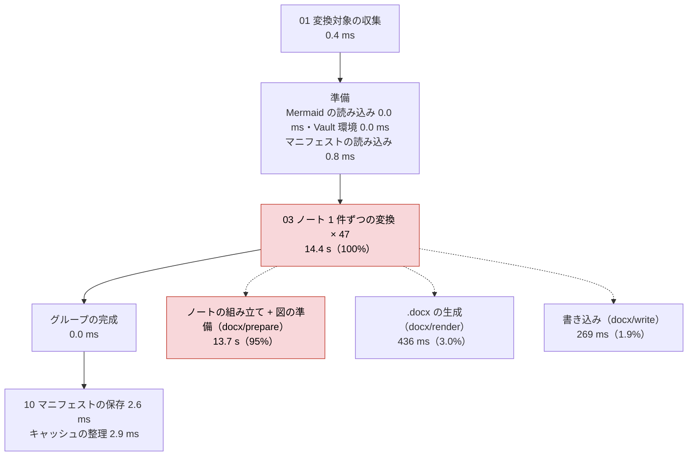
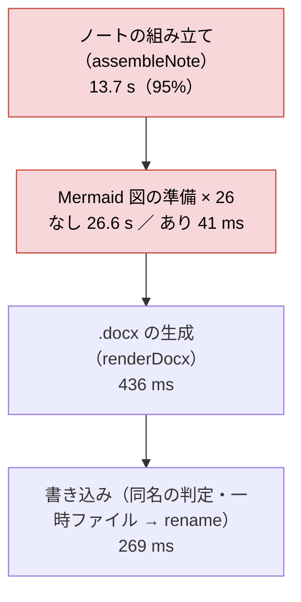
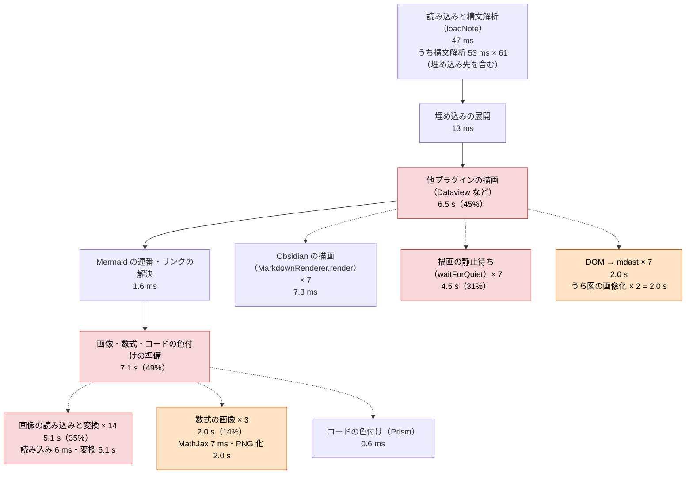
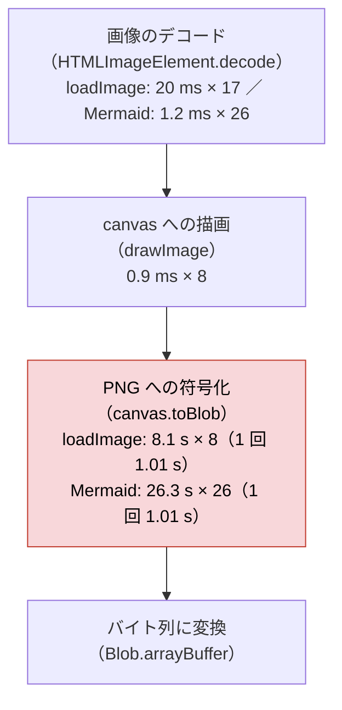
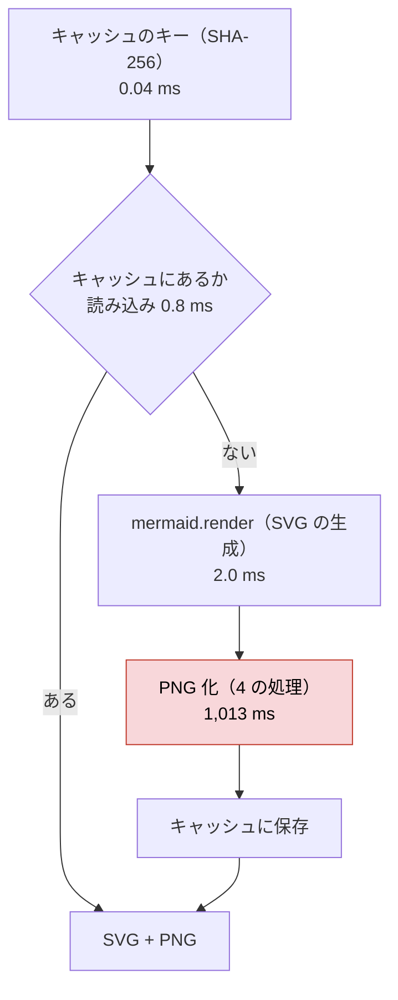
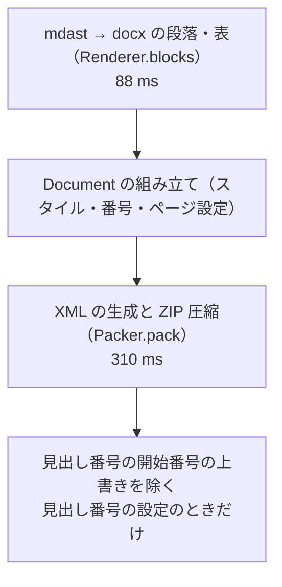
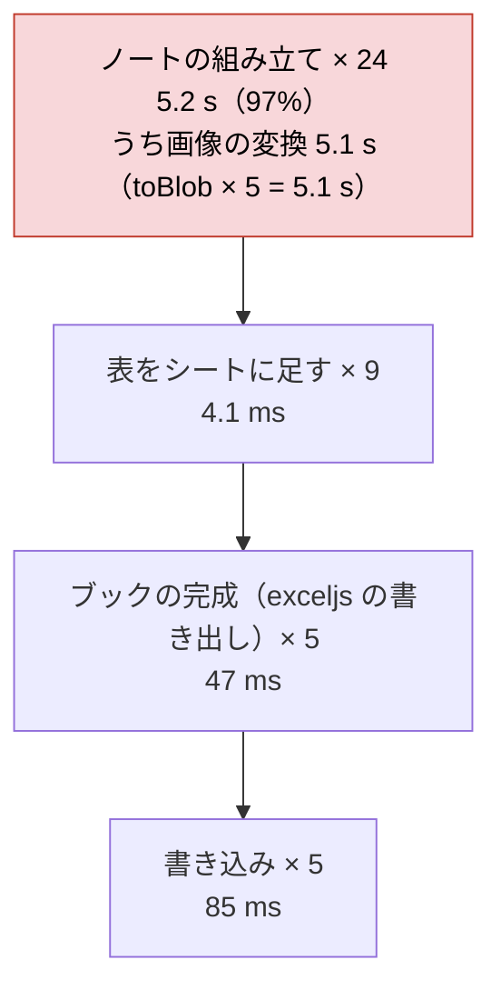
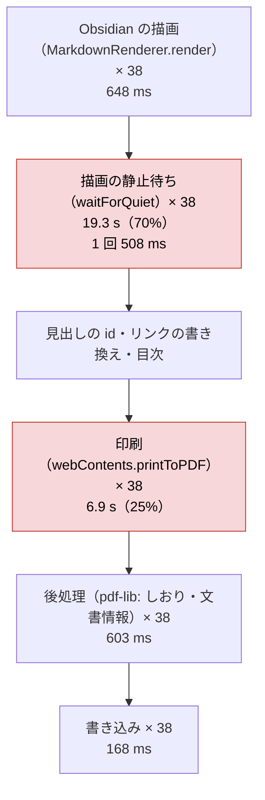

# 処理時間のフロー（計測結果）

最終更新: 2026-11-19
段階: 高速化の検討のための現状の計測。計測の手順は `docs/process/development.md` の「処理時間の計測」、経緯は `docs/process/worklog.md`

## 計測の条件

- ビルド: 開発用ビルド（1.1.1 の後、`feat/profiling`）。`npm run obsidian:run -- --profile` で計測した
- Obsidian: テスト用 Vault を開き、ウィンドウは後ろに置いた状態（前面ではない）
- 対象

| 実行 | 対象のフォルダ | ノート数 | 備考 |
|---|---|---|---|
| Word（キャッシュなし） | `word3a`・`word3b`・`mermaid`・`style` | 47 | Mermaid のキャッシュを消してから実行。Mermaid 図 26 個 |
| Word（キャッシュあり） | 同上 | 47 | 直前の実行のキャッシュが残っている |
| Excel | `excel`・`word3a` | 24 | 1 フォルダ = 1 ブック。表のある 9 件がシートになり、15 件はスキップ |
| PDF | `word3a`・`mermaid` | 38 | 1 ノート = 1 PDF |

## 図の読み方

- 1 ノード = 1 つの処理。ノードの数値は**実行全体での合計時間**（包含時間: 子の処理の時間を含む）と呼び出し回数。単位は ms、s
- 実線の矢印 = 処理の順序。点線の矢印 = 子の処理への分解（親の時間に含まれる）
- 赤 = 全体の 20% 以上を占める処理、橙 = 5〜20%、色なし = 5% 未満
- 合計が親と一致しないのは、計測点を置いていない処理（分岐・データの組み替えなど）の時間があるため

## 1. 実行全体（Word・キャッシュあり: 14.4 s）

確認画面（02）は自動実行では出さないので、計測に含まない。

## 2. ノート 1 件の変換（Word）

| 処理 | キャッシュなし | キャッシュあり |
|---|---:|---:|
| ノート 1 件の変換（合計） | 41.3 s | 14.4 s |
| ノートの組み立て（`assembleNote`） | 13.7 s | 13.7 s |
| Mermaid 図の準備 × 26 | **26.6 s** | 41 ms |
| .docx の生成 | 508 ms | 436 ms |
| 書き込み | 501 ms | 269 ms |

## 3. ノートの組み立て（13.7 s）

Word と Excel で共通（`src/core/note-assembly.ts`）。

## 4. 画像を PNG にする処理（各所の共通の部品）

SVG の画像の PNG の代替・WebP などの変換（`vault-env.ts` の `loadImage`）、数式の画像、他プラグインの図の画像化、Mermaid 図の PNG 化（`mermaid-renderer.ts` の `svgToPng`）は、どれも同じ手順で PNG を作る。

- `toBlob` は呼び出しごとに 1.01 s 前後でほぼ一定。画像の大きさに関係しない。キャッシュなしの Word では、`toBlob` が全体の **83%**（34.4 s / 41.3 s）、キャッシュありでも **56%**（8.1 s / 14.4 s）を占める
- デコードと描画は合わせて数十 ms なので、時間の大半は PNG の符号化そのものではなく、`toBlob` が符号化を始めるまでの待ちと考えられる（Chromium は `toBlob` の符号化をアイドル時間に回す。ウィンドウが後ろにあるとアイドル時間が来ず、一定時間後に始めるという仮説。前面での計測で確かめる）

## 5. Mermaid 図の準備（1 図あたり）

## 6. .docx の生成（436 ms・47 件）

## 7. Excel（5.4 s・24 件）

- 表のないノート（15 件はシートにならずスキップ）の画像も、組み立ての段階で読み込んで PNG にしている

## 8. PDF（27.6 s・38 件）

- 静止待ちは、DOM の変化が `QUIET_MS`（500 ms）続けて止まるまで待つ。変化しないノートでも 500 ms かかるので、1 回 508 ms がほぼ下限どおり

## まとめ: 時間の大きい処理

| 順位 | 処理 | 影響する形式 | 時間（この計測） | 性質 |
|---|---|---|---|---|
| 1 | `canvas.toBlob`（PNG への符号化の待ち） | Word・Excel | Word キャッシュなし 34.4 s（83%）、あり 8.1 s（56%）、Excel 5.1 s（94%） | 1 回 1.01 s の待ち。計算ではない |
| 2 | 描画の静止待ち `waitForQuiet` | PDF・Word（他プラグイン） | PDF 19.3 s（70%）、Word 4.5 s（31%） | 1 回 500 ms 以上の固定の待ち |
| 3 | `printToPDF` | PDF | 6.9 s（25%） | Chromium の印刷。この仕組みでは減らしにくい |
| — | 構文解析・.docx の生成・ZIP 圧縮・ファイルの読み書き | すべて | 合わせて 1 s 未満 | CPU の処理。改善の余地は小さい |
