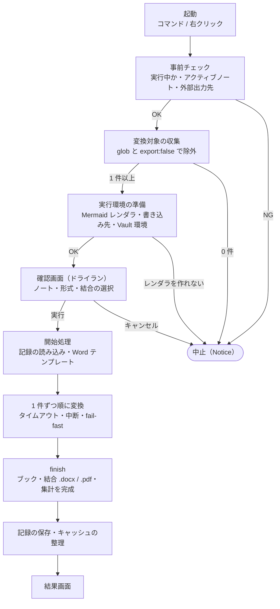

# システム仕様書: Batch Office Export

最終更新: 2026-11-19
対象の版: 1.1.3（`manifest.json` の `version`）

## 0. この文書の位置づけ

- 1.1.3 時点で**実装されている振る舞い**を、機能ごとに 1 か所にまとめた仕様書。経緯（いつ・誰が決めたか）は書かない
- 要件の正本は [requirements.md](../requirements.md)。この文書と要件が食い違ったら要件を優先し、この文書を直す
- 設定項目の正本は [settings.md](settings.md)、内部の処理フローは [architecture.md](architecture.md) と [flows/](flows/)。この文書はそれらを要約し、詳細はリンク先に任せる
- 括弧内の ID（R3・A-18・C-8・H1-PDF など）は requirements.md の要件 ID

---

## 1. 概要

### 1.1 目的

Obsidian の Markdown ノート（.md）を、Word 文書（.docx）・Excel ブック（.xlsx）・PDF に**一括で**変換する Obsidian のコミュニティプラグイン。Mermaid の図は画像にして埋め込む。図だけを画像ファイルとして保存することもできる。

### 1.2 基本情報

| 項目 | 値 |
|---|---|
| プラグイン ID | `batch-office-export`（公開後は変更不可） |
| 表示名 | Batch Office Export |
| ライセンス | MIT |
| 動作環境 | Obsidian 1.15.1 以降（`minAppVersion`）、デスクトップ版のみ（`isDesktopOnly: true`。Windows・macOS・Linux） |
| 配布物 | `main.js`・`manifest.json`・`styles.css`（GitHub Releases、コミュニティプラグイン） |
| UI の言語 | 英語・日本語。Obsidian の表示言語が日本語なら日本語、それ以外は英語 |
| ネットワーク | 既定では使わない。設定 `downloadExternalImages` をオンにしたときだけ外部の画像を取得する |

### 1.3 機能一覧

| 機能 | 出力 | 要件 |
|---|---|---|
| Word に変換 | 1 ノート = 1 .docx、または 1 フォルダ = 1 .docx（結合出力） | R5・R6・C-8 |
| Excel に変換 | ノートの表（またはアウトライン）を .xlsx に | R5（A-30〜A-33）・R7・R8 |
| PDF に変換 | Obsidian の読みモードの表示どおりの PDF。結合出力あり | H1-PDF |
| 形式を選んで変換 | 確認画面で Word / Excel / PDF を組み合わせて選ぶ | R8 |
| Vault を Excel に集計 | プロパティ・タスク・Dataview の結果を 1 ブックに | A-34 |
| Mermaid 画像として保存 | 図ごとの SVG / PNG ファイル | R1・R4 |

### 1.4 設計原則

1. **元ノートを書き換えない**（R3）: `.md`・`.canvas` と今回の変換元には書き込まない。書き込み処理の入口で拒否する
2. **個人情報を出力に入れない**（R3）: 文書プロパティや埋め込むパスに、OS のユーザー名・Vault の絶対パスを入れない
3. **中核は Obsidian に依存しない**（G2・G4）: `src/core/` は `obsidian` を import しない。単体テスト（`tests/architecture.test.ts`）で検査する
4. **外部ツールに依存しない**（G3）: 生成は純 JS のライブラリだけで行う（Pandoc などを呼ばない）
5. **UI を固めない**（R3）: ノートを 1 件ずつ処理し、件ごとにイベントループへ制御を返す

---

## 2. 用語

| 用語 | 意味 |
|---|---|
| mdast | unified / remark の Markdown 抽象構文木（AST）。変換の中間表現（G2） |
| ミラー出力 | 出力ルートの下に、元ノートと同じフォルダ構成を再現して保存する保存モード |
| 同一フォルダ | 元ノートと同じフォルダに保存する保存モード（Vault 内のみ） |
| 出力ルート | ミラー出力の起点。Vault 内のフォルダ（既定 `_export`）か Vault 外の絶対パス |
| 結合出力 | 1 フォルダのノートを 1 つの .docx / .pdf にまとめる出力（フォルダ = 1 冊、ノート = 1 章） |
| MOC | Map of Contents。フォルダと同じ名前のノート（例: `combine/combine.md`）。結合出力の章の順と表紙に使う |
| ドライラン | 書き込まずに出力パスと予定動作を計算すること。確認画面に表示する |
| 予定動作 | 新規（create）/ 上書き（overwrite）/ 変更なし（unchanged）/ スキップ（skip）/ 連番（rename） |
| 書き出しの記録 | 出力ファイルと元ノートの対応を保存した JSON（`export-record.json`）。コード上の名前は manifest |
| グループ | 複数のノートを束ねる出力（1 フォルダ = 1 ブック、結合 .docx / .pdf、集計ブック） |
| finish | 全ノートの処理の後に、グループの出力を完成させて書き込む段 |

---

## 3. システム構成

### 3.1 レイヤ

| レイヤ | 場所 | 責務 | Obsidian への依存 |
|---|---|---|---|
| 入口 | `src/main.ts` | 設定の読み込み、設定画面・コマンドの登録 | あり |
| Obsidian 側 | `src/obsidian/` | 起動・対象の収集・画面（確認・進捗・結果・設定）・描画の依頼・ファイルの読み書き・PDF の印刷 | あり |
| 中核 | `src/core/` | 構文解析・変換・.docx / .xlsx の生成・出力パスの計算・逐次実行・記録の形式・PDF の後処理 | **なし**（純粋関数とクラス） |
| 言語リソース | `src/i18n/` | 英語・日本語の UI 文字列（キーの過不足は型で検査） | なし |

ファイルの読み書き（`FsOutputWriter`）・Mermaid の描画（`MermaidRenderer`）・Vault の参照（`VaultEnvironment`）は、中核が定義したインタフェースを Obsidian 側が実装して渡す（依存性の注入）。

### 3.2 主なモジュール

| 機能 | 中核（`src/core/`） | Obsidian 側（`src/obsidian/`） |
|---|---|---|
| 起動・全体の流れ | `run.ts`（逐次実行） | `commands.ts`・`export-runner.ts` |
| 対象の収集 | `targets.ts`（glob・`export: false`） | `collect.ts` |
| 確認・進捗・結果の画面 | — | `confirm-modal.ts`・`progress.ts`・`report-modal.ts` |
| 構文解析と変換 | `markdown.ts`・`obsidian-syntax.ts`・`comments.ts`・`frontmatter.ts`・`note-assembly.ts`・`dom-to-mdast.ts` | `vault-env.ts`・`plugin-render.ts` |
| Mermaid | `mermaid.ts`・`mermaid-export.ts`・`svg-css.ts`・`png.ts` | `mermaid-renderer.ts`・`diagram-cache.ts` |
| 数式 | `math-svg.ts`（MathJax で SVG） | — |
| Word | `docx-export.ts`・`docx-render.ts`・`docx-combine.ts`・`docx-template.ts` | — |
| Excel | `xlsx-export.ts`・`xlsx-render.ts`・`xlsx-values.ts`・`xlsx-outline.ts`・`xlsx-summary.ts` | — |
| PDF | `pdf-export.ts`（計画）・`pdf-postprocess.ts`（pdf-lib） | `pdf-export.ts`・`pdf-print.ts`（Electron の印刷） |
| 書き込み・記録 | `output-plan.ts`・`manifest.ts`・`cache-policy.ts`・`hash.ts` | `fs-writer.ts`・`manifest-store.ts` |
| 設定 | `settings.ts`（型・既定値・正規化） | `settings-tab.ts` |

### 3.3 依存ライブラリ（同梱）

| ライブラリ | 用途 | ライセンス |
|---|---|---|
| `unified`・`remark-parse`・`remark-gfm`・`remark-frontmatter`・`remark-math` | Markdown → mdast | MIT |
| `docx` | .docx の生成、LaTeX → OMML（`docx/math` の `latexToMath`） | MIT |
| `exceljs` | .xlsx の生成 | MIT |
| `mathjax-full` | OMML にできない数式の SVG 化 | Apache-2.0 |
| `pdf-lib` | PDF の後処理（表紙の差し込み・リンクの書き換え・文書プロパティ） | MIT |
| `fflate` | テンプレートの .docx / .dotx の展開 | MIT |
| `picomatch` | glob の照合（extglob は無効） | MIT |

Obsidian に同梱された mermaid.js・Prism は、Obsidian の API（`loadMermaid()`・`loadPrism()`）で読み込んで使う。同梱の依存のライセンス文は `THIRD_PARTY_NOTICES.md` と、本番ビルドの `main.js` の末尾に入れる。詳細は [dependencies.md](dependencies.md)。

---

## 4. 起動方法

### 4.1 コマンド

コマンド ID は `batch-office-export:` の後に続く。「現在のノート」のコマンドは、アクティブなファイルが `.md` のときだけ実行できる（`checkCallback`）。

| モード | 現在のノート | Vault 全体 | 確認画面の形式の初期値 |
|---|---|---|---|
| Word | `convert-word-current-note` | `convert-word-vault` | Word |
| Excel | `convert-excel-current-note` | `convert-excel-vault` | Excel |
| PDF | `convert-pdf-current-note` | `convert-pdf-vault` | PDF |
| 形式を選ぶ | `convert-office-current-note` | `convert-office-vault` | 設定 `defaultFormats` |
| Mermaid 画像 | `save-mermaid-images-current-note` | `save-mermaid-images-vault` | （形式を選ばない） |
| 集計 | — | `summarize-vault-excel` | （形式を選ばない） |

### 4.2 ファイルエクスプローラーの右クリック

- 対象: ファイル 1 つ（`file-menu`）と複数選択（`files-menu`）
- 選んだ項目に `.md` ファイルかフォルダが 1 つ以上あるときだけ、次の 5 項目を出す: 「Word（.docx）に変換」「Excel（.xlsx）に変換」「PDF に変換」「形式を選んで変換…」「Mermaid 画像として保存」
- 集計は右クリックからは呼べない（コマンドだけ）

### 4.3 同時実行

実行中にもう一度起動すると、Notice「書き出しを実行中です。」を出して何もしない。

---

## 5. 実行の流れ

### 5.1 全体



### 5.2 中止する条件

| 時点 | 条件 | 表示 |
|---|---|---|
| 事前チェック | すでに実行中 | 「書き出しを実行中です。」 |
| 事前チェック | 「現在のノート」で、アクティブなファイルが .md でない | 「先に Markdown のノートを開いてください。」 |
| 事前チェック | 出力先が Vault 外・ミラー出力で、`externalOutputRoot` が空 | 「設定で『Vault 外の出力フォルダ』を指定してください。」 |
| 収集 | 除外の後の対象が 0 件 | 「変換するノートがありません。{n} 件を除外しました。」 |
| 準備 | Mermaid を読み込めない | 「Mermaid を読み込めませんでした: …」 |
| 確認画面 | キャンセル、または選んだノートが 0 件 | なし |

### 5.3 設定の写し

実行の開始時に設定の写し（`structuredClone`）を作り、実行中はそれを使う。実行中に設定画面で値を変えても、その実行には影響しない。

---

## 6. 変換対象の収集（R2）

### 6.1 候補の集め方

| 起動方法 | 候補 | 直接選んだ扱い |
|---|---|---|
| ファイルの右クリック・複数選択 | 選んだファイル | する |
| フォルダの右クリック | フォルダの下の .md すべて（サブフォルダを再帰的に含む） | しない |
| 現在のノート | アクティブなノート | する |
| Vault 全体 | `vault.getMarkdownFiles()` のすべて | しない |

### 6.2 絞り込みの規則（`src/core/targets.ts`）

上から順に判定し、最初に当てはまった理由で除外する。

1. `.md` 以外 → 除外（理由 `notMarkdown`）
2. frontmatter の `export` が真偽値 `false`、または文字列 `"false"` / `"no"`（前後の空白と大文字・小文字を無視）→ 除外（`frontmatter`）。**直接選んだノートにも適用する**
3. 直接選んでいないノートで、含めるパターン（`includeGlobs`、空ならすべて）に合わない、または除外パターン（`excludeGlobs`）に合う → 除外（`glob`）
4. それ以外 → 対象

- 同じパスが複数回来たら 1 つにまとめる。どれか 1 つでも直接選ばれていれば直接選んだ扱い
- 対象はパスの辞書順に並べる
- glob は picomatch で照合する（`dot: true`。extglob の `+(a|b)` などは使えない）

---

## 7. 確認画面（R2・R3 のドライラン）

- 対象のノートを、チェックボックス付きのフォルダのツリーで表示する。初期状態はすべて選択
- 件数（「{全体} 件中 {選択} 件を選択中」）、除外した件数、出力先を表示する
- ノートごとに、出力ファイルのパスと予定動作（新規 / 上書き / 変更なし / スキップ / 連番）を計算して表示する。計算は書き込み時と同じ純粋関数（`src/core/output-plan.ts`）で行う
- 形式を選ぶモードでは、出力形式（Word / Excel / PDF）のチェックボックスを表示する。1 つ以上を選ぶ
- 形式が Word か PDF を含むときは、「1 フォルダを 1 つのファイルにまとめる（Word・PDF）」を表示する。初期値は設定 `defaultCombine`
- 形式や結合の選択を変えると、予定を計算し直す
- 予定は「チェックが残っている件数」で計算する。Excel の出力名は実行するノートが 1 件かどうかで変わる（9.2）ので、チェックが 1 件かどうかが変わったときも計算し直す
- 選択が 0 件のときは実行ボタンを押せない
- 確認画面の後に状況が変わっていた（例: なかったファイルができた）ときは、書き込みの時点の状態で判定し、警告 `planChanged` を記録する

---

## 8. 逐次実行（R3）

### 8.1 ループ（`src/core/run.ts` の `runSequential`）

1. 中断ボタンが押されていれば、ここで終える（終わり方 `cancelled`）
2. 進捗（「n / 全体」と処理中のファイル名）を更新し、イベントループに制御を返す
3. ノートごとに `AbortController` を作り、タイムアウトと競わせて処理する
4. 結果を記録する。失敗で、`onError` が `failFast` なら終える（`failFast`）
5. 全件を終えたら `completed`

### 8.2 中断とタイムアウト

| 種類 | きっかけ | 処理中のノート | 以降のノート |
|---|---|---|---|
| 中断 | 進捗表示の中断ボタン | 書き込みまで最後まで処理する（abort しない） | 処理しない |
| タイムアウト | 1 件の処理が `timeoutSeconds`（既定 30 秒）を超えた | `AbortSignal` を abort し、失敗（理由 `timeout`）にする。遅れて返った結果は捨てる | 続ける |
| fail-fast | 失敗したノートが出た（`onError: failFast`） | — | 処理しない |

- `AbortSignal` は構文解析・描画・生成・書き込みの各処理に渡す。受け取った側は、描画の依頼や書き込み（rename）の前に `signal.aborted` を確かめる
- 制限: タイムアウトは `Promise.race` で実現するため、打ち切れるのは非同期の待ちだけ。メインスレッドを占有する同期処理は打ち切れない
- 中断・fail-fast で止まっても、finish で処理済みのノートからグループの出力を完成させ、記録を保存する。タイムアウトしたノートはグループに入れない

### 8.3 結果の集約（D5）

- 書き込みの結果は出力ファイル 1 つごと（`FileResult`: 出力パス・種類・状態・理由・内容ハッシュ）
- ノートの状態は、出力の状態のうちいちばん重いもの: **失敗 > スキップ > 成功**。出力が 0 件ならスキップ
- グループの出力（ブック・結合ファイル）の結果は、そのグループの全ノートに付ける
- 複数の形式を選んだときは、形式ごとの処理を順に実行して 1 つの結果にまとめる。同じ警告は 1 つにする。Excel の「表なし」はノートのスキップにしない

---

## 9. 出力先とファイル名（R8・R3・G4）

### 9.1 出力先フォルダ

| 保存モード | 出力先 | 出力フォルダ |
|---|---|---|
| `mirror`（既定） | `vault`（既定） | `{outputRoot}/{元ノートのフォルダ}`（既定の `outputRoot` は `_export`） |
| `mirror` | `external` | `{externalOutputRoot}/{元ノートのフォルダ}` |
| `sameFolder` | （出力先の設定を使わない） | 元ノートと同じフォルダ |

### 9.2 ファイル名

| 出力 | ファイル名 | 置き場所 |
|---|---|---|
| Word（1 ノート） | `{ノート名}.docx` | ノートの出力フォルダ |
| Word・PDF の結合出力 | `{フォルダ名}.docx` / `.pdf`（Vault 直下は `{Vault 名}`） | フォルダの出力フォルダ |
| PDF（1 ノート） | `{ノート名}.pdf` | ノートの出力フォルダ |
| Excel（実行するノートが 1 件） | `{ノート名}.xlsx` | ノートの出力フォルダ |
| Excel（2 件以上、`excelBookUnit: perFolder`） | `{フォルダ名}.xlsx`（Vault 直下は `{Vault 名}.xlsx`）。サブフォルダは別のブック | フォルダの出力フォルダ |
| Excel（2 件以上、`perNote`） | `{ノート名}.xlsx` | ノートの出力フォルダ |
| 集計 | `{Vault 名}_集計.xlsx`（英語の UI では `{Vault 名}_Summary.xlsx`） | 出力ルートの直下（同一フォルダでは Vault の直下） |
| Mermaid 画像 | `{ノート名}_mermaid_{連番 2 桁}_{ハッシュ 8 桁}.{svg\|png}` | ノートの出力フォルダ |

### 9.3 同名ファイルの扱い（`onConflict`）

| 状況 | 予定動作 |
|---|---|
| ファイルがない | 新規 |
| 名前にハッシュが入る出力（Mermaid 画像）で同名のファイルがある | 変更なし（書き込まない） |
| それ以外で同名のファイルがある | `overwrite`（既定）→ 上書き / `skip` → スキップ / `rename` → `name (1).ext` から空いている最初の番号 |

### 9.4 書き込みの手順（`src/obsidian/fs-writer.ts`）

1. 保護されたパス（拡張子 `.md`・`.canvas`、今回の変換元）なら書かずに失敗（理由 `protected`）
2. 出力フォルダを作る（`mkdir -p`）
3. 一時ファイル `.{ファイル名}.tmp` に書く（ドットで始まるので、Obsidian のファイルエクスプローラーに出ない）
4. タイムアウトで abort されていれば置き換えない
5. `rename` で本来の名前に置き換え、内容の SHA-256 を計算する
6. 一時ファイルは成否にかかわらず `finally` で消す

- 書き込みのエラーが `EBUSY`・`EPERM`・`EACCES`（Word / Excel で開いているなど）なら、スキップ（理由 `inUse`）にして実行を続ける。それ以外のエラーは失敗
- 書き込みは Node.js の `fs` で行う（Vault の API を使わない）。Vault 外にも書けるのはこのため

---

## 10. Markdown の構文解析と変換（G2・R5）

### 10.1 段

1. **前処理**: コードの中を除いて、コメント `%%…%%` を取り除く（設定 `keepCommentsAsWordComments` がオンなら Word のコメントとして残す）
2. **構文解析**: `remark-parse` + `remark-gfm`（表・脚注・タスク・取り消し線・URL の自動リンク）+ `remark-frontmatter` + `remark-math` で mdast を作る
3. **変換**: 処理の配列で、Obsidian 独自の記法を mdast の独自ノードにする（Wikilink・埋め込み・コールアウト・ハイライト・ブロック ID・Mermaid の連番付け・未対応の印付け）
4. **組み立て**（`assembleNote`。Word と Excel で共通）: ノートの埋め込みを展開し、他プラグインのコードブロックを Obsidian に描画させて取り込み、画像を読む
5. **出力**: mdast → 形式ごとのレンダラ（.docx / .xlsx）

PDF はこの経路を通らない（13 章）。

### 10.2 Obsidian に描画させる部分（A-24・A-26）

- 対象: `dataview`・`dataviewjs` と、Obsidian にコードブロックの処理が登録されている言語（`mermaid` は Mermaid の処理で扱う）
- 方法: 画面外の要素で `MarkdownRenderer.render()` を呼び、DOM の変化を `MutationObserver` で見て完了を判定する

| 段 | 値 |
|---|---|
| 最初の変化を待つ上限 | 0.5 秒（変化がなければ完了） |
| 変化の後、完了とみなす静止時間 | 0.2 秒 |
| 1 依頼の上限 | 10 秒（ノートのタイムアウトが先ならそこで打ち切る） |
| 1 ノートの中で同時に頼む数 | 8 個まで |

- 結果の DOM を自作の変換（`dom-to-mdast.ts`）で mdast にする: 表・リスト（タスクを含む）・段落・見出し・リンク・強調・コード・画像。`svg` は SVG + PNG の代替画像、`canvas`・`img` は PNG。それ以外の要素は文字だけ残す
- 時間切れ・結果が `pre > code` だけ・空のときは、原文を等幅で残して警告 `renderFailed`。プラグインが入っていなければ `pluginMissing`
- `dataviewjs` などのコードは、ノートを読みモードで開いたときと同じく実行される（プラグインとしては動作を保証しない）

### 10.3 記法ごとの扱い（Word）

| 記法 | Word での扱い | ID |
|---|---|---|
| 見出し `#`〜`######` | 組み込みスタイル「見出し 1〜6」。`fileNameAsTitle` がオンなら 1 段下げてファイル名を「表題」に | A-1 |
| 単一改行 | Obsidian の「厳密な改行」に従う（読めなければ `strictLineBreaksFallback`）。オフなら段落内改行 | A-2 |
| 番号付き・箇条書きリスト | Word の段落番号。リストごとに番号を振り直し、開始番号を反映。入れ子は 9 段まで | A-3 |
| タスク | `[ ]` → ☐、`[x]` → ☑、`[/]` → ◐、`[-]` → ☒、`[>]` → ➔。それ以外は文字のまま | A-4 |
| 引用 | 組み込みスタイル「引用文」 | A-5 |
| コールアウト | 1 行 1 列の表。左罫線を種類の色、背景を淡い色、先頭行に種類名とタイトル。折りたたみは常に展開、入れ子は表の入れ子。色は `calloutColorSource` | A-6 |
| コードブロック | Prism でトークン化して色付け。言語が分からなければ等幅 + 網掛け。`codeLineNumbers` で行番号 | A-7 |
| 水平線 | 段落の下罫線 | A-8 |
| `<div style="page-break-after: always">` | 改ページ | A-8 |
| 表 | 見出し行を各ページで繰り返す、列の揃えを反映、幅は自動調整（`tableFullWidth` で 100%）。格子の罫線、見出し行は網掛けと太字 | A-9・C-6 |
| 脚注 `[^1]`・`^[…]` | Word の脚注 | A-10 |
| 数式 `$…$`・`$$…$$` | Word の数式（OMML）。できなければ MathJax で SVG（PNG の代替画像付き）にして警告 `mathAsImage`。それも無理なら LaTeX を等幅で残して `mathFailed` | A-11 |
| Mermaid | SVG + PNG の代替画像で埋め込む（14 章）。描画に失敗したらソースをコードブロックで入れて警告 | A-12 |
| 太字・斜体・取り消し線・`==ハイライト==`・インラインコード | `w:b`・`w:i`・`w:strike`・黄色の `w:highlight`・等幅 + 網掛け | A-13 |
| インライン HTML | `<u>` `<sup>` `<sub>` `<mark>` `<br>` は書式に。それ以外のタグは除いて文字だけ残す | A-14 |
| タグ `#tag`・インラインフィールド `key:: value` | 文字のまま | A-15・A-25 |
| 外部リンク・URL | ハイパーリンク | A-17 |
| 内部リンク（Wikilink・`[x](note.md)`） | リンク先を `getFirstLinkpathDest` で解決。変換対象（今回の対象 + 記録に .docx として残るノート）なら出力した .docx への相対リンク、対象外なら文字だけ、リンク切れは文字だけ残して警告 `brokenLink`。`[[ノート#見出し]]` はファイルへのリンク | A-18 |
| `[[#見出し]]`・`[[#^id]]` | 文書内のブックマークへのリンク。ブックマーク名は見出しが `h_{連番}`、ブロックが `b_{id}`（英数字と `_`、40 文字以内） | A-19 |
| ブロック ID `^id` | 本文から消し、その段落にブックマーク | A-19 |
| 画像 `![[x.png]]`・`` | インライン図。`\|300`・`\|300x200` を反映、指定がなければ本文の領域に収める（拡大しない）。WebP・GIF などは PNG に変換、SVG は PNG の代替画像付き。外部 URL は既定でリンクだけ（`downloadExternalImages` で 20 MB まで取得） | A-20 |
| ノート埋め込み `![[ノート]]` | 同じ変換をかけて展開。`#見出し` はその節、`#^id` はそのブロックだけ。見出しのレベルは元のまま。循環は `embedCycle`、5 段を超えたら `embedDepth` でリンクとして残す | A-21 |
| PDF・音声・動画の埋め込み | `obsidian://open` のリンク | A-22 |
| Excalidraw | 同じフォルダに書き出し済みの .svg / .png があれば使う。なければ原文を残して警告 | A-23 |
| Canvas の埋め込み | 原文のまま残して警告 `unsupportedEmbed` | A-23 |
| frontmatter | 文書プロパティへ（11.3）。`frontmatterTable` で冒頭にプロパティの表 | A-27 |
| その他の未対応の記法 | 元の Markdown を等幅で残して警告 `unsupportedSyntax` | A-0b |

---

## 11. Word 出力（R6）

### 11.1 体裁

| 項目 | 内容 | 設定 |
|---|---|---|
| 用紙・向き・余白 | A4 / B5 / Letter、縦 / 横、上下左右 mm | `paperSize`・`orientation`・`marginsMm` |
| フォント | 本文 游明朝 + Century、見出し 游ゴシック + Arial（東アジア用と英数字用を分ける） | `bodyFont*`・`headingFont*` |
| 見出しのスタイル | 見出し 1 = 16 pt、2 = 14 pt、3 = 12 pt、4〜6 = 11 pt、表題 = 24 pt。すべて太字、次の段落と同じページ（keepNext） | テンプレートで置き換え可 |
| テンプレート | .docx / .dotx の `word/styles.xml` とテーマを使う。ないスタイル（引用文・コード・図表番号）は内蔵のもので補う。言語ごとのスタイル ID を名前から付け直す。読めなければ内蔵のスタイルで続け、警告 `templateFailed` | `wordTemplatePath`（Vault 内のパスか絶対パス） |
| 見出しの段落番号 | 「1」「1.1」「1.1.1」…（見出し 1〜6） | `headingNumbering` |
| 見出し 1 の前の改ページ | 文書の最初の見出し 1 と、直前に改ページがある見出し 1 には付けない | `pageBreakBeforeH1` |
| 図番号 | Mermaid と、画像だけの段落の画像の下に「図 n: キャプション」（SEQ フィールド）。キャプションは図の `title` / 代替テキスト → 直前の見出し → 番号だけ | `figureCaptions` |
| 表番号 | 表の上に「表 n: キャプション」。キャプションは直前の見出し → 番号だけ | `tableCaptions` |
| 表紙 | タイトル・作成者・日付（frontmatter の `date`、なければ変換した日）を 1 ページ目に。表紙のページにはヘッダー・フッターを出さない | `coverPage` |
| 目次 | TOC フィールド（見出し 1〜3）を表紙の後に置き、改ページ。`updateFields` で開いたときに更新させる（Word が確認のダイアログを出す） | `tableOfContents`（`never` / `combined` / `always`） |
| フッター | 中央に「n / 総ページ数」（PAGE・NUMPAGES） | `footerPageNumber`（既定オン） |
| ヘッダー | 文書のタイトルを右寄せ・小さめで | `headerTitle` |

「図」「表」「目次」の文字は UI の言語に合わせる（英語は Figure / Table / Contents）。

### 11.2 結合出力（C-8）

- 単位: 1 フォルダ = 1 つの .docx。サブフォルダは別の文書
- 章: ノート = 1 章。章の先頭にノート名（frontmatter の `title` があればそれ）を見出し 1 として置き、ノートの見出しを 1 段ずつ下げる（見出し 6 はそのまま）。章の境目では常に改ページ
- 並び順（`combineOrder`）

| 値 | 並び |
|---|---|
| `fileName`（既定） | ファイル名順 |
| `frontmatterOrder` | frontmatter の `order` の数値の小さい順。ないノートは後ろにファイル名順 |
| `moc` | MOC に書かれたリンクの出現順。MOC にないノートは後ろにファイル名順。MOC 自体は章にせず、表紙とタイトルに使う。MOC がなければファイル名順 |

- リンク: 同じ文書のノート（とその見出し）へのリンクは、その章の先頭のブックマークへ。別の文書に入るノートは、その .docx への相対リンク。変換対象外は文字だけ
- 脚注・ブックマーク名・コメント・Mermaid の図の連番は章ごとに付け直す
- 完成は finish で行う（8.2 のとおり、中断・fail-fast でも処理済みの章で完成させる）

### 11.3 文書プロパティ

| プロパティ | 1 ノート | 結合出力 |
|---|---|---|
| タイトル（`dc:title`） | frontmatter の `title` → ノート名 | MOC の `title` → フォルダ名 |
| 作成者（`dc:creator`） | frontmatter の `author` → 設定 `authorName` → 空 | MOC の `author` → `authorName` → 空 |
| キーワード（`cp:keywords`） | frontmatter の `tags` | — |
| 作成日時（`dcterms:created`） | frontmatter の `created` | — |
| ユーザー設定のプロパティ | frontmatter のそれ以外のキー | — |

OS のユーザー名は入れない（単体テストで確認）。

---

## 12. Excel 出力（R7・A-30〜A-34）

### 12.1 ブックとシート

- ブックの単位は 9.2 のとおり。1 フォルダ = 1 ブックは finish で完成させる
- シートの単位（`excelSheetUnit`）: `perNote`（既定）は 1 ノート = 1 シートで表を縦に並べる（表の間は空行）。`perTable` は 1 表 = 1 シート
- 抽出する表: ノートの中のすべての表（コールアウト・引用・リストの中、埋め込んだノート、Dataview などの描画結果を含む）。表の外の段落・画像・Mermaid は出さない
- 表題行: `perNote` では、直前に見出しがある表の前に、その見出しを太字で置く（コールアウトの中の表はそのタイトル）。`perTable` では置かない
- 表のないノートはシートを作らず、スキップ（理由: 表なし）。シートが 1 枚もないブックは作らない
- 書き込み中に例外が出たノートは、そのノートで足したシートを取り除いてから失敗にする
- シート名: 禁止文字 `[ ] : * ? / \` を `_` に、先頭・末尾の `'` を外し、31 文字に切り詰める。空なら「Sheet」。重複は大文字・小文字を区別せずに判定して ` (2)` などを付ける。`History` は `History_`
- 目次シート: シートが 2 枚以上のときだけ先頭に置く（日本語は「目次」）。列は「シート」（リンク `#'シート名'!A1`）・「元ノート」・「見出し」（ノートの最初の見出し）・「表の数」

### 12.2 値の型（D-2）

列単位で判定する。見出し行と空のセルを除いた全セルが同じ型として読めるときだけ変換し、1 つでも読めなければ列全体を文字列にする。

| 型 | 認識する形 | 値と表示形式 |
|---|---|---|
| 数値 | `123`・`-1.5`・`1,200` | 数値。桁区切りがあれば `#,##0`（小数があれば `#,##0.00` など） |
| パーセント | `12%`・`12.5%` | 0.12。`0%` / `0.0%` |
| 通貨 | 先頭 `¥`・`￥`・`$`、末尾 `円`（列の中で記号がそろうときだけ） | 数値。`"¥"#,##0` / `"$"#,##0.00` / `#,##0"円"` |
| 日付 | `YYYY-MM-DD`・`YYYY/MM/DD`（後ろに ` HH:mm` 可） | 書かれた日時をそのまま。`yyyy-mm-dd` / `yyyy-mm-dd hh:mm` |
| 真偽値 | `true`・`false`（大文字・小文字を問わない） | 真偽値 |

- 文字列のままにする例外: 先頭がゼロの整数（`00123`。`0`・`0.5` は除く）、郵便番号の形 `123-4567`、電話番号の形（`0` で始まり `-` で区切る）、15 桁を超える数字、`△100`・`(100)`
- 数式インジェクション対策: 文字列はすべて文字列型で書く（`=` で始まる値も数式にしない）

### 12.3 セルの中身（A-32・A-33・D-4）

- 太字・斜体・取り消し線はリッチテキスト。ハイライトは無視。インラインコードは Consolas。数式は LaTeX のまま。脚注参照・タグは表示テキストだけ
- `<br>` はセル内の改行（折り返しを有効にする）
- リンク: セルの最初のリンクだけをハイパーリンクにする（リンクのあるセルはリッチテキストにしない）。内部リンクは、同じブックのノートならそのシート、それ以外は `obsidian://open`。リンク切れは文字だけ
- 画像: セルの最初の画像を PNG / JPEG / GIF のまま置く（SVG は PNG の代替画像）。幅 200 px を上限に縮め、行の高さと列幅を広げる。2 つ目以降は代替テキスト
- 32,767 文字を超えるセルは切り詰めて警告 `cellTruncated`

### 12.4 見た目（D-3・D-5）

| 項目 | 内容 |
|---|---|
| Excel テーブル | `excelAsTable`（既定オン）。名前は `Table1`…（ブック内で一意）。空の列名は `列1` など、重複は ` (2)` など |
| 見出し行 | 太字。テーブルにしないときは薄い灰色の塗りと罫線も |
| ウィンドウ枠の固定・印刷タイトル | シートの表が 1 つのときだけ、見出し行まで（表題行を含む） |
| 列幅 | 文字数（全角は 2）の最大 + 2。最小 8、上限 60 で、超える列は折り返し |
| 印刷 | A4、幅を 1 ページに収める。列幅の合計が 120 を超えるシートは横向き |
| 配置 | Markdown の列の揃えをセルの水平方向の配置に |
| 「元ノート」「見出し」の列 | `excelSourceColumns` で各表の左に追加（型の判定は元の列だけ） |

### 12.5 アウトライン形式（`excelOutlineMode`）

- 表だけでなく本文全体を 1 ノート = 1 シートに出す（`perTable` より優先。表のないノートもシートを作る）
- 列は「H1」「H2」「H3」「本文」。見出しは該当する列に太字。H4〜H6 は「本文」に太字
- 1 段落 = 1 行、リストの 1 項目 = 1 行（入れ子は字下げ、タスクは ☐ / ☑）。コードブロックは 1 行。画像は代替テキスト、数式は LaTeX、水平線は出さない
- 表は「本文」の列から右へ並べる（型の判定は表ごと）
- 行のグループ化（`outlineLevel`）: H1 の下を 1 段、H2 を 2 段、H3 を 3 段。H1 の前の行はグループにしない
- 1 行目を見出し行にして固定する。Excel テーブルにはしない。印刷の「幅を 1 ページに収める」は付けない（exceljs の要素の順序の不具合で Excel が開けなくなるため）

### 12.6 プロパティ

| プロパティ | 単一ノート / 1 ノート = 1 ブック | 1 フォルダ = 1 ブック |
|---|---|---|
| タイトル | frontmatter の `title` → ノート名 | フォルダ名 |
| 作成者 | frontmatter の `author` → `authorName` | `authorName` |

### 12.7 Vault 全体の集計（A-34）

- 対象: Vault 全体のノート（`includeGlobs`・`excludeGlobs`・`export: false` を適用）。確認画面・進捗・結果画面は共通
- 出力: 1 つのブック（9.2）。行のあるシートだけを作り、2 枚以上なら目次シートを付ける。テーブル・列幅・固定・印刷は 12.4 と同じ

| シート | 行 | 列 |
|---|---|---|
| プロパティ | frontmatter のあるノート 1 件 = 1 行 | 「ノート」（`obsidian://open` のリンク）+ 全ノートのキーを最初に出てきた順に。配列は `, ` でつなぐ。型の判定は列ごと |
| タスク | タスク 1 件 = 1 行（コードブロックの中は数えない） | 「状態」（未完了 / 完了 / それ以外は `[ ]` の中の文字）・「タスク」（Tasks プラグインの記号を除く）・「期日」（📅 の日付、日付型）・「優先度」（🔺 最高・⏫ 高・🔼 中・🔽 低・⏬ 最低）・「ノート」・「見出し」 |
| Dataview | `dataview` / `dataviewjs` の結果の表を縦に並べる | 表題は「ノート名: クエリの 1 行目」。表のない結果は入れない |

---

## 13. PDF 出力（H1-PDF）

### 13.1 方式

- ノートを Obsidian の読みモードと同じ `MarkdownRenderer.render()` で HTML に描き、Electron の `webContents.printToPDF()` で PDF にする。Obsidian 標準の印刷用のスタイル（`body` 直下の `.print` 要素だけを印刷する）を使う
- Mermaid・数式・コールアウト・Dataview などは Obsidian が描いたものをそのまま使う。mdast → レンダラの経路は通らず、Word の体裁の設定（フォント・図表番号など）は効かない
- PDF を含む実行の間だけ、Obsidian を（`body` のクラスで）ライトテーマにし、終わったら戻す。実行中は画面もライトテーマになる
- 印刷は 1 つずつ行う
- Electron に触れる処理は `src/obsidian/pdf-print.ts` に閉じ込める

### 13.2 描画の完了待ち

- 10.2 と同じ判定で待つ。ただし、非同期に描かれうるもの（他プラグインのコードブロック・Dataview のインラインクエリ。埋め込んだノートも 5 段までたどる。ノート以外の埋め込みは描かれうるとみなす）がなければ、最初の変化は 0.03 秒だけ待つ
- 画像の読み込みを待つ（上限 5 秒）

### 13.3 ページ設定（PDF 専用）

| 項目 | 設定 | 既定 |
|---|---|---|
| 用紙 | `pdfPaperSize`: A4 / A3 / B5（JIS）/ Letter | A4 |
| 向き | `pdfOrientation` | 縦 |
| 余白 | `pdfMarginsMm`（上下左右） | 各 25 mm |
| 拡大率 | `pdfScale`（10〜200 %） | 100 % |
| 本文の文字の大きさ | `pdfFontSizePt`（6〜24 pt、0.5 刻み） | 10.5 pt |
| 本文のフォント | `pdfFontFamily`（CSS の font-family。空なら Obsidian のフォント） | BIZ UDP ゴシック ほか |
| コードのフォント | `pdfCodeFontFamily`（同上） | BIZ UD ゴシック ほか |

- 画像・図はページの境目で切らない。高さの上限を印字領域（用紙の高さ − 上下の余白、拡大率を反映）の 85% にして縮める
- 余白は設定の余白だけ（読みモードの表示用の余白は印刷では 0）
- 印字領域に収まらない表は 0.7 倍まで縮小し、それでもはみ出すときは列の最小の幅を外し、さらにセルの中を文字の途中でも折り返す（`src/obsidian/pdf-print.ts` の `fitWideTables`）。コードの長い行は折り返す
- Mermaid 図の拡大・縮小のボタンは印刷しない

### 13.4 機能

| 機能 | 仕様 | 設定（Word と共用） |
|---|---|---|
| 結合出力 | 1 フォルダ = 1 PDF。並び順・MOC・出力名は Word と同じ関数。ノートを 1 つの HTML に順に描いて 1 回で印刷。章の境目で改ページ。ノートの見出しを 1 段ずつ下げる | `combineOrder`・確認画面の結合 |
| しおり | 見出し H1〜H6（`generateDocumentOutline`）。結合出力ではノート名が 1 段目 | — |
| 内部リンク | 同じ PDF の中の見出し・ノートは PDF 内リンク。別の PDF になる変換対象（今回の対象 + 記録に PDF として残るノート）は、その PDF への相対リンク（GoToR、1 ページ目を開く）。それ以外は文字だけ。外部リンクはそのまま | — |
| 表紙 | 表紙だけを別に印刷し、後処理で本文の先頭に差し込む。表紙にヘッダー・フッターは出ない | `coverPage` |
| 目次 | 見出し 1〜3 の一覧（各見出しへのリンク付き、ページ番号なし） | `tableOfContents` |
| フッター | 中央に「n / 総ページ数」。表紙を数えない（本文の 1 ページ目が 1） | `footerPageNumber` |
| ヘッダー | 文書のタイトル | `headerTitle` |

### 13.5 後処理（`src/core/pdf-postprocess.ts`、pdf-lib）

- 表紙の差し込み
- 別の PDF へのリンク: 印刷の前に目印の URL `https://batch-office-export.invalid/pdf-link/{相対パス}` にしておき、後処理で GoToR のリンクに書き換える
- 文書プロパティ: タイトル（frontmatter の `title` → ノート名。結合出力では MOC の `title` → フォルダ名）、作成者（frontmatter の `author` → `authorName`）、言語（Obsidian の表示言語）、作成ツール（`Batch Office Export`）

---

## 14. Mermaid 画像（R1・R4）

### 14.1 描画

- `loadMermaid()` で Obsidian 同梱の mermaid.js を使い、`mermaid.render()` で SVG を作る
- Obsidian のプレビューの表示を変えないよう、`mermaid.initialize()` は呼ばない。設定は図ごとにソースの先頭へ `%%{init: …}%%` を付けて渡す。利用者が書いた `%%{init}%%` は、テーマ・フォント・`htmlLabels` だけプラグインの値で上書きし、それ以外は残す
- テーマは `neutral` に固定、背景は白（PNG だけ `pngTransparentBackground` で透過）、フォントは `mermaidFontFamily`
- PNG: canvas を `pngDpi / 96` 倍の大きさにして描き、PNG の `pHYs` チャンクに解像度を書く（既定 192 dpi）。canvas が tainted で PNG にできなければ SVG だけを保存して警告 `pngFailedSvgOnly`

### 14.2 ハッシュとキャッシュ

- ハッシュ: SHA-256 の先頭 8 桁。入力は Mermaid のソースと、描画結果を変える設定値（テーマ・フォント・DPI・背景）と mermaid.js のバージョン（`mermaid.version`、取れなければ Obsidian のバージョン）
- 専用キャッシュ: `.obsidian/plugins/batch-office-export/cache/mermaid/`。同じハッシュの画像があれば描き直さない。画像ファイルを保存しない設定でも効く
- 上限 100 MB。超えたら最後に使った時刻の古いものから消す（実行の最後）

### 14.3 画像ファイルの保存

| 実行 | 画像ファイルを保存するか | 形式 |
|---|---|---|
| Mermaid 画像として保存 | する | `mermaidImageFormat`（`png` 既定 / `svg` / `both`） |
| Word に変換 | `saveImageFiles` がオンのときだけ | 同上 |
| Word への埋め込み | （ファイルにしない） | 常に SVG + PNG の代替画像 |
| Excel への貼り付け | （ファイルにしない） | 常に PNG |

- 同名の画像があれば「変更なし」（9.3）
- 古い画像の削除: 新しい画像を書き終えた後、記録に同じノート・同じ図の連番として残る古い画像を消す。記録にないファイルには触れない
- 図が 1 つもないノートは警告 `noDiagrams`

### 14.4 Word に貼るときの大きさ

本文幅（用紙の幅 − 左右の余白）を超える図は縦横比を保って縮める。最大の高さは本文の高さ（用紙の高さ − 上下の余白）。小さい図は拡大しない。

---

## 15. 実行結果の記録

### 15.1 書き出しの記録（`export-record.json`）

- 場所: `.obsidian/plugins/batch-office-export/export-record.json`
- 読み書きの時点: 実行の開始時に 1 回読み、読み取り専用の写しを実行中の処理（内部リンクの変換対象の判定、古い画像の検索）に渡す。実行の最後に 1 回だけ保存する（中断・fail-fast でも書き込んだ分を記録する）。保存は一時ファイル → rename
- 壊れていたら空として扱い、元のファイルを `.broken` として退避して警告 `manifestBroken`

```json
{
  "version": 1,
  "entries": [
    {
      "output": { "location": "vault", "path": "_export/word/01-headings.docx" },
      "sources": ["word/01-headings.md"],
      "kind": "docx",
      "contentHash": "（SHA-256 の 16 進）",
      "writtenAt": "2026-11-19T00:00:00.000Z"
    }
  ]
}
```

| フィールド | 内容 |
|---|---|
| `output.location` | `vault` / `external` |
| `output.path` | Vault 内は Vault からの相対パス、Vault 外は出力ルートからの相対パス（Vault を移しても使える） |
| `sources` | 元ノート（束ねた出力では複数） |
| `kind` | `image` / `docx` / `xlsx` / `pdf` |
| `diagramIndex` | 図の連番（画像のときだけ） |
| `contentHash` | 出力の SHA-256 |
| `writtenAt` | 書き込んだ日時（ISO 8601）。内容が変わらなければ前の日時を残す |

反映の規則: 書き込んだ・変更なしの出力は記録を足すか置き換える。スキップ・失敗した出力は既存の記録を残す。削除した古い画像は記録から消す。

### 15.2 結果画面

- 終わり方: 完了 / 中断（残りのノートは処理していない）/ 最初の失敗で停止
- 件数はノートの数で数える: 「ノート: 成功 n · スキップ n · 失敗 n」
- ファイルの件数: 「書き込み n · 変更なし n · 削除した古い画像 n」
- 明細（失敗・スキップ・警告）は種類ごとに折りたためる

### 15.3 警告の一覧

| コード | 内容 |
|---|---|
| `mermaidRenderFailed` | 図を描画できなかった |
| `pngFailedSvgOnly` | PNG にできず、SVG を保存した |
| `noDiagrams` | Mermaid の図がない |
| `manifestBroken` / `manifestSaveFailed` | 記録が壊れていた / 保存できなかった |
| `planChanged` | 確認画面の後にファイルが変わっていた |
| `cacheFailed` | 画像のキャッシュを使えなかった |
| `unsupportedSyntax` | 未対応の記法を Markdown のまま残した |
| `brokenLink` | リンク先のノートや見出しが見つからない |
| `embedCycle` / `embedDepth` | 埋め込みの循環 / 5 段を超えた |
| `imageFailed` | 画像を読み込めなかった |
| `unsupportedEmbed` | 未対応の埋め込みを文字のまま残した |
| `pluginMissing` / `renderFailed` | コードブロックのプラグインがない / 描画できなかった |
| `mathAsImage` / `mathFailed` | 数式を画像にした / LaTeX のまま残した |
| `cellTruncated` | セルを 32,767 文字に切り詰めた |
| `templateFailed` | Word のテンプレートを読めなかった |

---

## 16. 設定

`data.json` に保存する。読み込むときに `normalizeSettings` で、欠けた項目・不正な値（範囲外の数値、知らない選択肢など）を既定値に戻す。例外にはしない。全項目の値と既定値は [settings.md](settings.md) を正本とする。

| 区分 | キー | 既定値 |
|---|---|---|
| 出力 | `defaultFormats`（確認画面の形式の初期値。`word` / `excel` / `pdf` の 1 つ以上） | `["word"]` |
| 出力 | `outputLocation`（`vault` / `external`）・`outputRoot`・`externalOutputRoot` | `vault`・`_export`・空 |
| 出力 | `saveMode`（`mirror` / `sameFolder`） | `mirror` |
| 出力 | `onConflict`（`overwrite` / `skip` / `rename`） | `overwrite` |
| 対象 | `includeGlobs`・`excludeGlobs` | 空・`["**/*.excalidraw.md"]` |
| 実行 | `onError`（`continue` / `failFast`）・`timeoutSeconds` | `continue`・30 |
| Mermaid | `mermaidImageFormat`・`pngDpi`・`pngTransparentBackground`・`mermaidFontFamily`・`saveImageFiles` | `png`・192・オフ・游ゴシック系・オフ |
| Word の要素 | `fileNameAsTitle`・`strictLineBreaksFallback`・`codeLineNumbers`・`keepCommentsAsWordComments`・`frontmatterTable`・`downloadExternalImages`・`calloutColorSource` | すべてオフ・`fixed` |
| Word の体裁 | `paperSize`・`orientation`・`marginsMm`・フォント 4 項目・`authorName` | A4・縦・各 25 mm・游明朝 / Century / 游ゴシック / Arial・空 |
| Word の体裁 | `wordTemplatePath`・`headingNumbering`・`pageBreakBeforeH1`・`tableFullWidth`・`figureCaptions`・`tableCaptions` | 空・すべてオフ |
| Word・PDF 共通 | `coverPage`・`tableOfContents`・`footerPageNumber`・`headerTitle`・`combineOrder`・`defaultCombine` | オフ・`combined`・オン・オフ・`fileName`・オフ |
| Excel | `excelBookUnit`・`excelSheetUnit`・`excelAsTable`・`excelOutlineMode`・`excelSourceColumns` | `perFolder`・`perNote`・オン・オフ・オフ |
| PDF | `pdfPaperSize`・`pdfOrientation`・`pdfMarginsMm`・`pdfScale`・`pdfFontSizePt`・`pdfFontFamily`・`pdfCodeFontFamily` | A4・縦・各 25 mm・100・10.5 pt・BIZ UDP ゴシック・BIZ UD ゴシック |

- 古い設定の移行: 1.0 までの `defaultFormat`（`word` / `excel` / `both`）だけがあれば、`defaultFormats` に移す（`both` → Word と Excel）
- 余白は 0 以上 100 未満の数値だけを受け付ける。`pdfScale` は 10〜200 の整数。`pdfFontSizePt` は 6〜24 の 0.5 刻み
- 設定を持たないもの: Mermaid のテーマ（`neutral` 固定）、`export: false` による除外（常に有効）、画像の配置（行内に固定）

---

## 17. 非機能の仕様

### 17.1 性能

- 計測と対策の記録は [performance.md](performance.md)
- バンドルの大きさの目安は `main.js` 3 MB 以下（MathJax の同梱で約 1.7 MB 増えた）
- 描画の待ちは 10.2・13.2 の値まで縮めてある。1 ノートの中の他プラグインのコードブロックは 8 個まで同時に描画を頼む

### 17.2 安全性とプライバシー

- 元ノートを書き換えない（9.4 の保護）
- 一時ファイルを残さない（`finally` で削除）
- OS のユーザー名・Vault の絶対パスを出力に入れない。exceljs は作成者が空だと `Unknown` を書く
- ノートの内容を外部に送らない。ネットワークを使うのは `downloadExternalImages` がオンのときの画像の取得（`requestUrl`、1 枚 20 MB まで）だけ
- Vault の外のファイルを読み書きするのは、Vault 外の出力先か、絶対パスのテンプレートを設定したときだけ
- Excel の数式インジェクション対策（12.2）
- glob の extglob を無効にしている（picomatch の ReDoS の回避）
- 配布物の静的な検査（コミュニティプラグインの自動レビュー）への対策: exceljs の `script` 要素を作る経路と `new Function` の経路を、ビルド時に `scripts/patch-exceljs.mjs` で取り除く

### 17.3 国際化

UI の文字列は `src/i18n/en.ts`・`ja.ts` に置く（キーは型で照合）。出力に入る文字（目次・図・表・集計のシート名と列名・Excel の目次の列名）も UI の言語に合わせる。

---

## 18. 制約と既知の制限

- デスクトップ版のみ。モバイル版では動かない
- タイムアウトで打ち切れるのは非同期の待ちだけ（8.2）
- Excel: セルのリンクは 1 つまで。リンクとリッチテキストを 1 セルで両立しない。ハイライトは表せない
- 結合出力の Word: 別のノートの見出しへのリンクは、その章の先頭に飛ぶ（見出しの位置までは指さない）
- PDF: 目次にページ番号がない。別の PDF へのリンクは 1 ページ目を開く。ページ番号は表紙を数えないので、Word（表紙を 1 ページ目と数える）と番号が 1 つずれる
- PDF の変換中は Obsidian の画面がライトテーマになる
- Canvas の埋め込みは描画しない（原文を残す）
- Word の目次は、開くたびに Word がフィールドの更新を確認する
- 書き出しの記録に残っていない古い出力（ノートの削除・改名の後に残ったもの）は消さない

---

## 19. 開発と検証

| コマンド | 内容 |
|---|---|
| `npm run build` | 型チェック → 同梱の依存のライセンス文の検査 → 本番ビルド（`main.js`） |
| `npm run dev` | 変更を監視して開発用ビルド |
| `npm test` | 単体テスト（Vitest）。.docx はスナップショットテスト（`word/document.xml`） |
| `npm run lint` | ESLint（`eslint-plugin-obsidianmd` の推奨設定） |
| `npm run deploy:test-vault` | テスト用 Vault（`test-vault/`）にビルド結果を置く |
| `npm run obsidian:run` | Obsidian を起動し、開発用の自動実行で変換させる（確認画面ですべて選んだことにし、結果を返す） |
| `npm run preview:export` | 変換結果のプレビュー |

- テスト用 Vault には記法ごと・機能ごとのサンプル（`word/`・`word3a/`・`word3b/`・`excel/`・`combine/`・`style/`・`mermaid/`・`pdf-images/` など）を置く
- 開発用ビルド（`__DEV__`）だけに、開発用のコマンドと自動実行、テスト用のコードブロックの処理を登録する
- 手順の詳細は [development.md](../process/development.md)、ブランチ・コミット・版の規則は [git-rules.md](../process/git-rules.md)

---

## 20. 将来の拡張（未実装）

requirements.md の各節の「後回し」と H 章に記録している。主なもの: CSV・HTML・pptx などの出力形式、逆変換（.docx → .md）、差分変換と自動変換、MOC からリンクをたどる収集、孤立ファイルの掃除、Undo、PDF の目次のページ番号、モバイル対応、公開 API・CLI 版。
