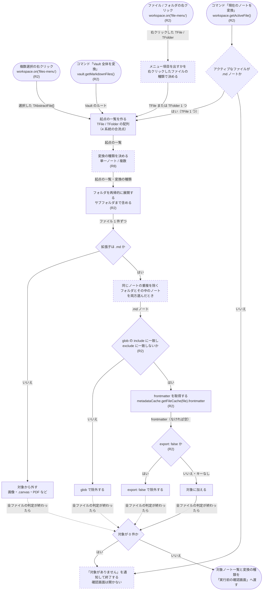

# 変換対象の収集 のフロー

最終更新: 2026-11-17
対応する要件: R2（起動方法・対象範囲・除外）、R8（Excel のファイルの単位）

## 役割

4 系統の起動方法（ファイル / フォルダの右クリック、複数選択の右クリック、コマンド「現在のノートを変換」、コマンド「Vault 全体を変換」）から受け取った起点（ファイル・フォルダ）を、1 つの共通処理に合流させる。フォルダはサブフォルダまで再帰的に展開して .md ファイルだけを集め、glob の include / exclude と frontmatter の `export: false` で除外した結果を、対象ノート一覧として「実行前の確認画面」へ渡す。あわせて、R8 で Excel のファイル単位を決めるための「変換の種類（単一ノート / 複数）」を一覧に付けて渡す。

## 入力と出力

| 区分 | 受け取るもの / 渡すもの | 相手のコンポーネント |
|---|---|---|
| 受け取るもの | 起動のきっかけ: ファイル・フォルダの右クリック（`workspace.on('file-menu')`）、複数選択の右クリック（`workspace.on('files-menu')`）、コマンド「現在のノートを変換」（`workspace.getActiveFile()`）、コマンド「Vault 全体を変換」（`vault.getMarkdownFiles()`） | Obsidian（ユーザー操作） |
| 受け取るもの | 設定値: glob の include / exclude パターン | 設定画面 |
| 渡すもの | 対象ノート一覧（`TFile` の配列。各ノートの Vault 内のパスを含む）と、変換の種類（単一ノート / 複数） | 実行前の確認画面 |
| 渡すもの（対象が 0 件のとき） | 「対象がありません」の通知（確認画面は開かない） | ユーザー（Notice） |

フォルダ単位のグループ分けは、このコンポーネントでは行わない。各ノートの Vault 内のパス（親フォルダ）が分かれば、「1 件ずつ順に変換」（`03-run-sequential.md`）がフォルダ単位のグループに分けられるため、一覧は平らな配列で渡す。

## フロー図

点線の矢印は「除外したファイルのあとも、残りのファイルの判定を続け、全件が終わったら件数を確認する」ことを表す。

## 各ステップの補足

| ノード名 | 内容 | 要件 ID |
|---|---|---|
| ファイル / フォルダの右クリック | `workspace.on('file-menu')` のコールバックで、右クリックした `TAbstractFile`（`TFile` または `TFolder`）を 1 つ受け取る | R2 |
| メニュー項目を出すかを右クリックしたファイルの種類で決める | 画像・.canvas などの .md 以外のファイルを右クリックしたときに、メニュー項目「変換」を出すかは要件にない。出す場合も、後ろの「拡張子は .md か」で外れて 0 件になる | R2 |
| 複数選択の右クリック | `workspace.on('files-menu')` のコールバックで `TAbstractFile[]` を受け取る。ファイルとフォルダが混ざってよい | R2 |
| コマンド「現在のノートを変換」 | `addCommand()` で登録し、`workspace.getActiveFile()` で 1 件を得る | R2 |
| アクティブなファイルが .md ノートか | 開いているファイルがない・.md 以外（.canvas・PDF など）のとき、コマンドを `checkCallback` で無効にするか、実行して通知するかは要件にない | R2 |
| コマンド「Vault 全体を変換」 | 要件は `vault.getMarkdownFiles()` を挙げている。本図では Vault のルートフォルダを起点として他の系統と同じ展開・除外に合流させる。`getMarkdownFiles()` で .md の一覧を直接得て「同じノートの重複を除く」の後ろに合流させても結果は同じ | R2 |
| 起点の一覧を作る | 4 系統の合流点。以降の処理は起動方法に依存しない。起動方法の情報は「変換の種類」に変換して持ち回る | R2 |
| 変換の種類を決める | R8 の Excel のファイル単位（`{ノート名}.xlsx` か、1 フォルダ = 1 ブックか）の分岐に使う。「ノートを 1 つだけ変換したとき」を、起動方法（.md ファイルの右クリック・「現在のノートを変換」）で決めるか、除外後の件数（1 件）で決めるかは未定（「決める必要があること」を参照） | R8 |
| フォルダを再帰的に展開する | `TFolder.children` をたどり、サブフォルダの中まで含める。起点が `TFile` のときはそのまま 1 件とする | R2 |
| 拡張子は .md か | `file.extension === 'md'` のファイルだけを残す。画像・.canvas・PDF などは対象ノートにしない（`vault.getMarkdownFiles()` と同じ範囲）。`*.excalidraw.md` は .md なので、ここでは外れず、glob の exclude で外す（R2 の例） | R2 |
| 対象から外す（.md 以外） | 外したファイルを確認画面や結果レポートに出すかは要件にない。本図では何も記録しない | R2 |
| 同じノートの重複を除く | 複数選択でフォルダとその中のノートを両方選ぶと、同じノートが 2 回入る。パスで重複を除く処理は要件にないが、除かないと同じ出力を 2 回書き込む | R2 |
| glob の include / exclude | `picomatch` などで、Vault 内の相対パスに対して判定する。exclude の例: `Templates/**`、`*.excalidraw.md`。include が空のときの扱い（すべて含める）は要件に明記がない | R2 |
| frontmatter を取得する | `metadataCache.getFileCache(file).frontmatter`。frontmatter がない・キャッシュがまだないとき（戻り値が `null`）は、`export` のキーがないものとして扱う（既定は「含める」= オプトアウト方式） | R2 |
| export: false か | frontmatter の `export` が `false` のノートを除外する。キーがない・`false` 以外の値なら含める | R2 |
| 除外の順序（glob → export: false） | どちらも「除外」なので、順序で結果は変わらない（両方の条件を満たすノートだけが残る）。glob はパスだけで判定でき、`export: false` は metadataCache の参照が必要なので、件数を先に減らせる glob を先にする | R2 |
| 対象が 0 件か | .md 以外だけを選んだ・すべて除外された・空のフォルダを選んだときに 0 件になる | R2 |
| 「対象がありません」を通知して終了する | 0 件のとき、Notice で通知して確認画面を開かずに終わる案。0 件のまま確認画面を開いて「0 件」と表示する案もあり、要件にない | R2 |
| 対象ノート一覧と変換の種類を渡す | `TFile[]` を平らな配列で渡す。フォルダ単位のグループ分けと結合出力の並べ替えは「1 件ずつ順に変換」が担当する（`03-run-sequential.md`）。確認画面のツリー表示は各ノートのパスから組み立てられる | R2, R8 |

## 決める必要があること

- **「単一ノートの変換」の判定基準（R8、`03-run-sequential.md`・`09-write-file.md` との境界）**: R8 の「ノートを 1 つだけ変換したとき」を何で決めるか。案は (a) 起動方法で決める（.md ファイルの右クリック・コマンド「現在のノートを変換」なら単一ノート。フォルダや複数選択は、結果が 1 件でも複数扱い）、(b) 除外後の件数で決める（1 件なら単一ノート）、(c) 確認画面でチェックを外した後の件数で決める。(b)(c) では、ノートが 1 件だけのフォルダを変換すると `{フォルダ名}.xlsx` ではなく `{ノート名}.xlsx` になる。03 は「単一ノートの変換: ノート 1 件だけのグループ」、09 は出力単位「単一ノート」を受け取る前提なので、この区別を 01 → 02 → 03 → .xlsx の生成 → 09 と受け渡す経路も決める必要がある（03 の「単一ノートの変換かどうかの受け渡し」と同じ論点）
- **全体図の矢印のラベル**: 全体図（`docs/architecture.md`）の矢印は「対象ノート一覧」だけだが、本図では「変換の種類」も一緒に渡す。全体図のラベルに足すか
- **.md 以外のファイルを右クリックしたとき**: メニュー項目「変換」を出さないか、出して 0 件の通知にするか。フォルダの展開で外した画像・.canvas などを、確認画面やレポートに「対象外」として見せるか
- **「現在のノートを変換」でアクティブなファイルがない・.md でないとき**: `checkCallback` でコマンドを無効にするか、実行して通知するか
- **明示的に選んだノートにも除外を適用するか**: glob の exclude（例: `Templates/**`）や `export: false` に当たるノートを、右クリックや「現在のノートを変換」で直接選んだときにも除外するか。本図では起動方法によらず同じ除外を適用している
- **重複の除去**: フォルダとその中のノートを複数選択で両方選んだときに、パスで重複を除くこと（要件にない）
- **glob の include が空のとき**: すべて含めるものとして扱ってよいか。glob を判定するパスは Vault のルートからの相対パスでよいか
- **export の値の形**: `export: false`（真偽値）だけを除外するか、文字列の `"false"` や `no` も除外するか。metadataCache にまだキャッシュがないノートを「キーなし = 含める」として扱ってよいか
- **対象が 0 件のとき**: 通知して終了するか、確認画面を 0 件のまま開くか。通知の文言に除外の内訳（glob で n 件・`export: false` で n 件）を出すか
- **除外したノートの記録**: glob・`export: false` で除外したノートを、確認画面（チェックなしで表示）や結果レポート（`10-record-results.md`）に出すか。要件では除外したノートを見せるとは書いていない
