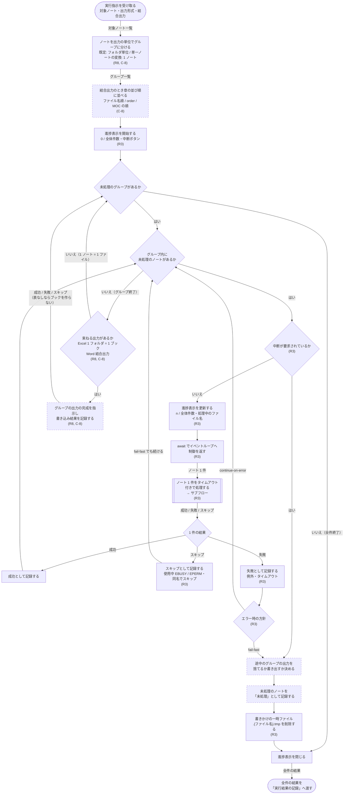
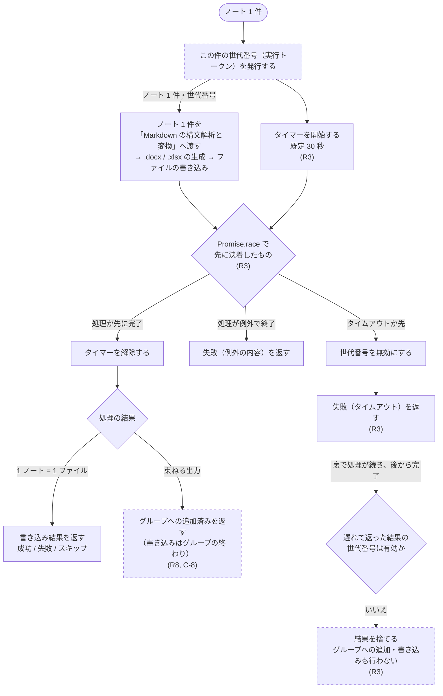

# 1 件ずつ順に変換 のフロー

最終更新: 2026-11-17
対応する要件: R3（実行中・書き込み時の使用中ファイルの扱い）、R8（Excel のファイルの単位・Word のファイルの単位）、R6 C-8（結合出力）

## 役割

「実行前の確認画面」から受け取った実行指示に従い、対象ノートを 1 件ずつ逐次処理で「Markdown の構文解析と変換」へ渡す。進捗表示・キャンセル・1 件ごとのタイムアウト・エラー時の方針（continue-on-error / fail-fast）を制御する。1 ノートでは完結しない出力（Excel の 1 フォルダ = 1 ブック、Word の結合出力）のために、ノートを出力の単位（グループ）に束ね、グループの終わりで出力の完成を指示し、全件の結果を「実行結果の記録」へ渡す。

## 入力と出力

| 区分 | 受け取るもの / 渡すもの | 相手のコンポーネント |
|---|---|---|
| 受け取るもの | 実行指示（チェック済みの対象ノート一覧・出力形式 Word / Excel / 両方・結合出力の有無） | 実行前の確認画面 |
| 受け取るもの | 書き込み結果（成功 / 失敗 / スキップ） | ファイルの書き込み |
| 渡すもの | ノート 1 件 | Markdown の構文解析と変換 |
| 渡すもの | 全件の結果 | 実行結果の記録 |
| 渡すもの（全体図にない） | グループの終わりの通知（ブック・結合 .docx の完成の指示） | .docx の生成 / .xlsx の生成（「決める必要があること」を参照） |

## フロー図

### メインフロー: グループとノートの二重ループ

### サブフロー: ノート 1 件をタイムアウト付きで処理する

## 各ステップの補足

| ノード名 | 内容 | 要件 ID |
|---|---|---|
| 実行指示を受け取る | 確認画面でチェックが付いたノートだけを受け取る。出力形式（Word / Excel / 両方）、結合出力の有無も含む。同名ファイルの扱いは設定値なので「ファイルの書き込み」が直接参照する | R2, R8, C-8 |
| ノートを出力の単位でグループに分ける | ループの外側の単位を「出力の単位（グループ）」、内側を「ノート」にする。Excel の 1 フォルダ = 1 ブックと Word の結合出力は、どちらも「フォルダ = 1 ファイル」なので、フォルダ単位のグループで両方を扱える。サブフォルダは別グループ（R8: サブフォルダは別のブック）。Vault 直下のノートは 1 グループ（ブック名 `{Vault 名}.xlsx`）。単一ノートの変換は、ノート 1 件だけのグループ（`{ノート名}.xlsx`）。Word 単体出力と Excel の 1 ノート = 1 ブック（オプション）では、グループ内でもノートごとに出力が完結する | R8, C-8 |
| 結合出力のとき章の並び順に並べる | C-8 の並び順（ファイル名順（既定）/ frontmatter の `order` / MOC のリンクの出現順、MOC にないノートは末尾にファイル名順）。ノートを 1 件ずつ渡す構造なので、渡す前に並べる必要がある。どのコンポーネントで並べるかは未定 | C-8 |
| 進捗表示を開始する | Notice またはステータスバーに表示し、中断ボタンを置く。全体件数はノートの件数 | R3 |
| 中断が要求されているか | 中断ボタンはフラグを立てるだけ。判定はノートの処理の前にだけ行うので、処理中の 1 件は最後まで処理してから止まる | R3 |
| 進捗表示を更新する | 各ノートの処理を始める直前に「n / 全体件数」と処理中のファイル名を更新する。更新を描画させるため、直後に制御を返す | R3 |
| await でイベントループへ制御を返す | 1 件ごとに `await` し、描画・入力イベント（中断ボタンのクリックを含む）を処理させる。逐次処理なので、同時に処理するノートは常に 1 件 | R3 |
| ノート 1 件をタイムアウト付きで処理する | サブフローを参照。構文解析・変換・生成・書き込みまでを 1 件として扱う | R3 |
| 成功 / スキップ / 失敗として記録する | 1 件ごとの結果を配列に追加する。スキップには理由（使用中・同名でスキップ）を付ける | R3 |
| スキップとして記録する | 使用中ファイル（Windows の `EBUSY` / `EPERM`）は失敗ではなくスキップとして扱う。そのため fail-fast でも止めずに次へ進む | R3 |
| エラー時の方針 | 設定の continue-on-error / fail-fast。失敗（例外・タイムアウト）のときだけ判定する | R3 |
| 束ねる出力があるか | グループの終わりで判定する。Excel の 1 フォルダ = 1 ブック、Word の結合出力のどちらかがあれば「はい」。形式が「両方」なら両方の完成を指示する | R8, C-8 |
| グループの出力の完成を指示し書き込み結果を記録する | ブックや結合 .docx を完成させ、「ファイルの書き込み」に渡す。シートが 1 枚もない（表のあるノートがない）フォルダではブックを作らず「表なし」を記録する（D-1b・R8）。この処理にもタイムアウトを掛けるか、全体図のどの矢印で指示するかは未定 | R8, C-8, D-1b |
| 途中のグループの出力を捨てるか書き出すか決める | 中断・fail-fast で止まったとき、途中まで追加したブック・結合 .docx を書き出すか捨てるかは要件にない | R3 |
| 未処理のノートを「未処理」として記録する | 中断で処理しなかったノートを結果に含めるかは要件にない | R3 |
| 書きかけの一時ファイルを削除する | 中断時に `.{ファイル名}.tmp` を削除する（R3）。正常な書き込みでは「ファイルの書き込み」が rename または失敗時の削除を行うので、ここで残っているのは主にタイムアウトで打ち切った件のもの | R3 |
| 世代番号（実行トークン）を発行する | タイムアウト後に遅れて返った結果を見分けるための値。発行方法（連番・`AbortController` など）は未定 | R3 |
| タイマーを開始する / Promise.race | 処理の Promise とタイマーの Promise を競わせる。既定 30 秒（設定値）。打ち切れるのは非同期の待ち時間だけで、メインスレッドを占有する同期処理は打ち切れない（その間は UI も固まる） | R3 |
| グループへの追加済みを返す | 束ねる出力では、ノート 1 件の時点ではファイルを書き込まず、シート・章の追加が済んだことだけを返す。この件の結果を何と記録するかは未定 | R8, C-8 |
| 結果を捨てる | タイムアウト後も裏で処理が続き、後から完了した場合、その結果を捨てる（R3）。ブックへのシート追加や、ファイルの書き込みまで止めるには、後ろのコンポーネントが世代番号を確認する必要がある | R3 |

## 決める必要があること

- **グループの終わりの通知の経路（全体図との矛盾）**: 全体図には「1 件ずつ順に変換」から「.docx の生成」「.xlsx の生成」への矢印がない。1 フォルダ = 1 ブックと結合出力では、グループの終わりに「ブックを完成させて書き込む」指示が必要になる。案は (a) 「1 件ずつ順に変換」→ 各生成コンポーネントへ「グループの終わり」の矢印を足す、(b) 「Markdown の構文解析と変換」経由で終わりの印を流す、(c) 生成側が対象一覧を事前に受け取り、最後のノートで自分で完成させる
- **ループの単位**: 本図では「外側 = 出力の単位（フォルダ単位のグループ）、内側 = ノート」の二重ループにし、1 ノートの構文解析結果（mdast）を Word・Excel の両方に使う案にした。これで Word 単体 / 結合、Excel 1 フォルダ = 1 ブック / 1 ノート = 1 ブック、形式「両方」の組み合わせをすべて扱える。この方針でよいか
- **単一ノートの変換かどうかの受け渡し**: R8 では単一ノートの変換のときだけ `{ノート名}.xlsx` になる。この区別を「変換対象の収集」から確認画面経由で受け取る必要がある（01・02 のフローとの境界）
- **結合出力の並べ替えの担当**: C-8 の並び順（特に MOC の順はリンクの解決に Obsidian API が必要）を、このコンポーネント・確認画面・.docx の生成のどこで行うか
- **束ねる出力のときの 1 件の結果**: ノート 1 件の時点では書き込みが起きないので、「書き込み結果（成功 / 失敗 / スキップ）」が返らない。ノート単位の結果（シート追加済み・表なし・失敗）と、出力ファイル単位の結果（ブック・結合 .docx の書き込み結果）の 2 種類を記録する形にするか（「実行結果の記録」10 のフローとの境界）
- **グループ内の 1 件が失敗したときの束ねる出力**: continue-on-error で、ブックからそのシートを除く・結合 .docx からその章を除いて完成させるか。グループの完成処理（ブックや .docx の書き出し）にもタイムアウトを掛けるか
- **中断・fail-fast で止まったときの途中のグループ**: 途中まで組み立てたブック・結合 .docx を捨てるか、処理済みの分だけで書き出すか。未処理のノートを「未処理」として結果に含めるか
- **タイムアウト後の遅れた結果を捨てる範囲**: 結果を捨てるだけでは、裏で続いた処理がブックへシートを足したり、ファイルを書き込んだりするのは止まらない。世代番号（または `AbortSignal`）を「.xlsx の生成」「ファイルの書き込み」まで渡して、書き込み直前に確認するか（09 のフローとの境界）
- **一時ファイルの把握**: 中断時に削除する一時ファイルの一覧を、どのコンポーネントが持つか（「ファイルの書き込み」が書き込み中のパスを公開するか）
- **警告の経路（全体図との矛盾）**: 未対応記法・リンク切れ・「表なし」の警告は「Markdown の構文解析と変換」や「.xlsx の生成」で発生するが、全体図にはそこから「1 件ずつ順に変換」または「実行結果の記録」への矢印がない。1 件の結果に警告を含めて返すか
- **全体件数の数え方**: 本図ではノートの件数とした。形式「両方」やグループの完成処理を件数に含めるか、完成処理中の表示（例: 「ブックを書き込み中: {フォルダ名}.xlsx」）を出すか
- **制御を返す方法**: R3 は「`await` でイベントループへ制御を返す」とだけ書いている。描画を確実に挟むための具体的な待ち方（`setTimeout(0)`・`requestAnimationFrame` など）は実装時に検証する
