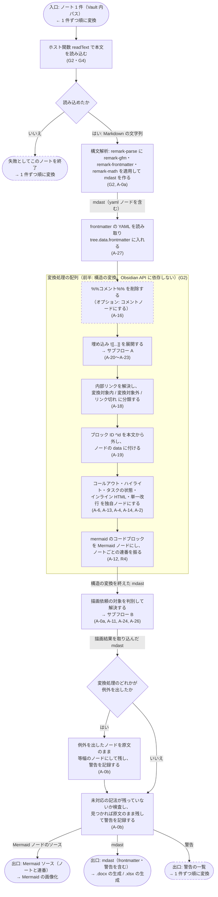
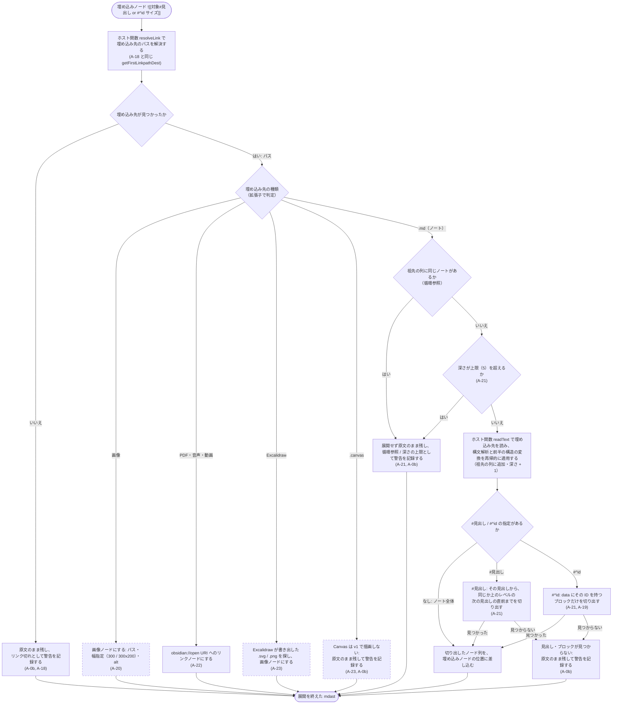
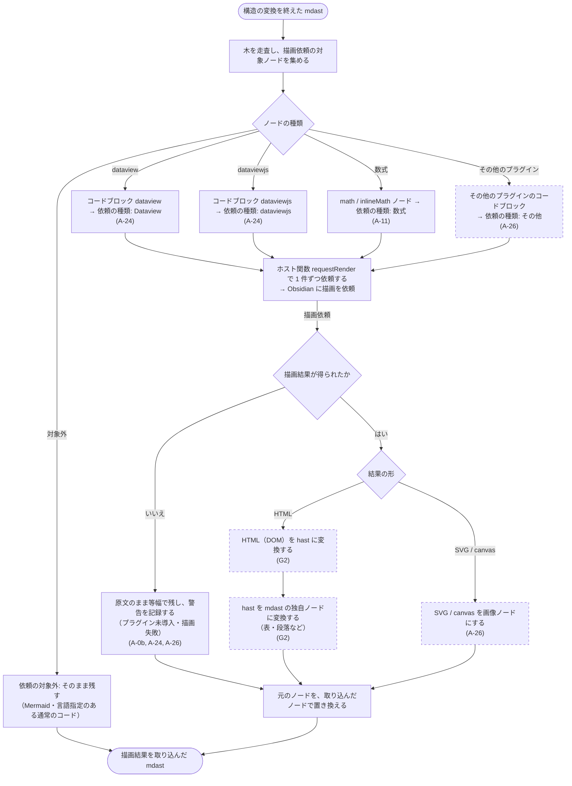
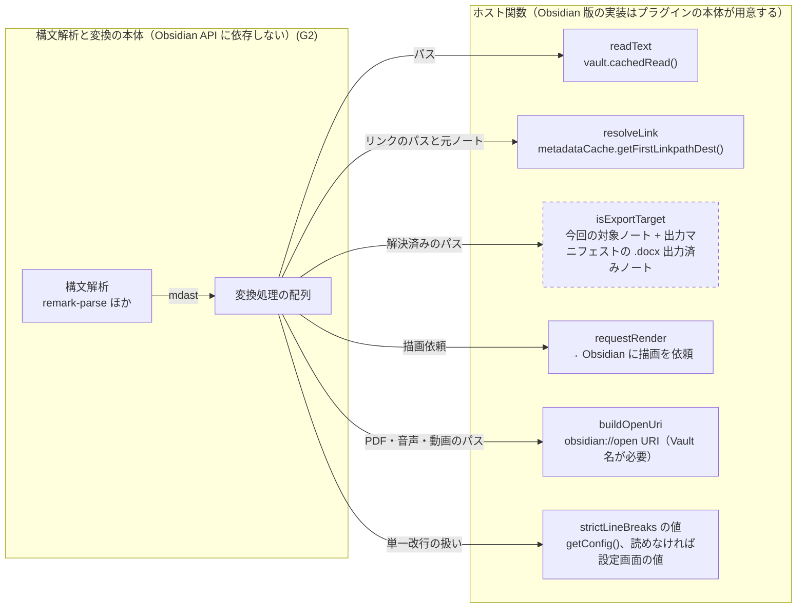

# Markdown の構文解析と変換 のフロー

最終更新: 2026-11-17
対応する要件: G2、R5 の A-0a・A-0b・A-2・A-16・A-17〜A-23（関連: A-4・A-6・A-11・A-13・A-14・A-19・A-24・A-26・A-27、R4 の命名規則）

## 役割

「1 件ずつ順に変換」から受け取ったノート 1 件を、構文解析（parse）で mdast にし、変換（transform）で Obsidian 独自の記法を独自ノード型に置き換える。Dataview・数式・他プラグインのコードブロックは「Obsidian に描画を依頼」に渡し、返ってきた HTML / SVG を hast を経由して mdast に取り込む。完成した mdast を出力形式ごとのレンダラ（.docx / .xlsx）に渡し、Mermaid のソースは「Mermaid の画像化」に渡す。

## 入力と出力

| 受け取るもの / 渡すもの | 内容 | 相手のコンポーネント |
|---|---|---|
| 受け取る: ノート 1 件 | 対象ノートの Vault 内パス（本文はこのコンポーネントがホスト関数で読む） | 1 件ずつ順に変換 |
| 受け取る: HTML / SVG | 描画依頼の結果（DOM）。得られなかったときは「描画できなかった」という結果 | Obsidian に描画を依頼 |
| 渡す: 描画依頼 | 依頼の種類（Dataview / dataviewjs / 数式 / その他のプラグインのコードブロック）、原文、元ノートのパス | Obsidian に描画を依頼 |
| 渡す: Mermaid ソース | 図ごとのソースと識別子（ノートと連番。R4 の `{ノート名}_mermaid_{連番2桁}`） | Mermaid の画像化 |
| 渡す: mdast | 標準のノード + 独自ノード（コールアウト・ハイライト・解決済みリンク・ブロック ID・Mermaid・取り込んだ描画結果・原文のまま残したノード）+ `tree.data` の frontmatter と警告の一覧 | .docx の生成、.xlsx の生成 |
| 渡す（全体図にない）: 失敗・警告 | ノートを読めなかったときの失敗、未対応記法・リンク切れなどの警告 | 1 件ずつ順に変換（→ 実行結果の記録）。「決める必要があること」を参照 |

## フロー図

### 全体の流れ

変換段は「変換処理の配列」（G2）として組む。配列を前半の「構造の変換」と後半の「描画依頼の解決」に分け、ノート埋め込みの展開（サブフロー A）は構造の変換だけを再帰的に使う。描画依頼は、埋め込みを展開し終えた木に対して 1 回だけまとめて解決する（サブフロー B）。

### サブフロー A: 埋め込み ![[...]] の展開（A-20〜A-23）

再帰の状態として「祖先のノートのパスの列（循環の検出用）」と「深さ」を持つ。展開したノートには前半の構造の変換だけを適用し、描画依頼は親の木でまとめて解決する。

### サブフロー B: 描画依頼の判別と取り込み（A-0a, A-11, A-24, A-26）

### Obsidian API に依存しない部分と依存する部分の境界（G2・G4）

構文解析と変換の本体は Obsidian API を直接呼ばない。Obsidian API が必要な処理は、呼び出し側（プラグインの本体）が「ホスト関数」の集まりとして外から渡す（依存性の注入）。単体テスト（G5 の Vitest）と CLI 版（H4）では、ホスト関数をテスト用・Node.js 用の実装に差し替える。

## 各ステップの補足

### 全体の流れ

| ノード名 | 内容 | 要件 ID |
|---|---|---|
| ホスト関数 readText で本文を読み込む | 入力はパスとし、本文はホスト関数で読む。Obsidian 版は `vault.cachedRead()`。ノート本体と埋め込み先（サブフロー A）で同じ関数を使う | G2, G4 |
| 構文解析 | `remark-parse` に `remark-gfm`（表・脚注・タスク・取り消し線・URL 直書き）、`remark-frontmatter`（YAML）、`remark-math`（`$...$` / `$$...$$`）を適用する。remark-parse は入力が不正でも例外を出さず木を返すため、この段に失敗の経路は置かない | G2, A-0a |
| frontmatter の YAML を読み取る | `yaml` ノードを読み取り、値を `tree.data.frontmatter` に入れる。文書プロパティへの割り当て（A-27）は .docx の生成が行う | A-27 |
| %%コメント%% を削除する | 既定は削除。オプションでは削除せずコメントノードにし、.docx の生成が `w:comment` にする。コードブロックとインラインコードの中の `%%` は対象外 | A-16 |
| 埋め込み ![[...]] を展開する | サブフロー A | A-20〜A-23 |
| 内部リンクを解決し、分類する | 対象: Wikilink・見出しリンク・別名付きリンク・`[text](note.md)`。`resolveLink` で解決し、`isExportTarget` で「変換対象内 / 変換対象外」を判定する。解決できなければ「リンク切れ」として表示テキストだけ残し、警告を記録する。.docx への相対パスやブックマーク名への変換は、出力パスと単体 / 結合出力を知っている側（.docx の生成）が行い、ここではリンク先のノートのパス・見出し・ブロック ID・分類だけを持たせる。外部リンク・URL 直書き（A-17）は標準の `link` ノードのまま渡す | A-17, A-18 |
| ブロック ID ^id を外す | 段落・リスト項目の末尾の `^id` を本文から取り除き、ノードの data に ID を付ける。ブックマーク名への変換（40 文字以内・英数字と `_`）は .docx の生成が行う。ブロック参照 `[[note#^id]]` は内部リンクの解決で扱う | A-19 |
| コールアウトなどを独自ノードにする | コールアウト: `[!type]` で始まる引用を、種類・タイトル・折りたたみ記号を持つノードにする（入れ子も保つ）。ハイライト: `==...==`。タスク: GFM が扱わない `[/]` `[-]` `[>]` などの状態。インライン HTML: `<u>` `` `` `<mark>` ` ` を書式のノードにし、それ以外のタグは除去してテキストを残す。改ページの `
` は改ページノードにする（A-8）。単一改行: `strictLineBreaks` がオフなら段落内改行（`break`）にする | A-2, A-4, A-6, A-8, A-13, A-14 |
| mermaid のコードブロックを Mermaid ノードにする | 言語 `mermaid` のコードブロックを Mermaid ノードにし、出現順に連番を振る（R4 の命名規則の `{連番2桁}`）。ソースと識別子を「Mermaid の画像化」に渡す | A-12, R4 |
| 描画依頼の対象を判別して解決する | サブフロー B | A-0a, A-11, A-24, A-26 |
| 変換処理のどれかが例外を出したか | 変換処理の配列の各処理を、ノード単位で例外を捕まえる形で呼ぶ。1 つのノードの失敗でノート全体を失敗にしない | A-0b |
| 例外を出したノードを原文のまま残す | 元の Markdown の該当範囲（mdast の `position`）を等幅のノードとして残し、警告に「記法の種類・ノートのパス・行番号」を記録する | A-0b |
| 未対応の記法が残っていないか検査する | 出力のレンダラが扱えない種類のノードが残っていれば、同じく原文のまま残して警告を記録する | A-0b |
| タグ・インラインフィールド | `#tag`（A-15）と `key:: value`（A-25）は変換処理を持たず、テキストのまま渡す | A-15, A-25 |

### サブフロー A: 埋め込みの展開

| ノード名 | 内容 | 要件 ID |
|---|---|---|
| 埋め込み先のパスを解決する | 内部リンクと同じ `resolveLink` を使う | A-18, A-21 |
| 埋め込み先の種類 | 拡張子で分岐する。`.excalidraw.md` は `.md` より先に Excalidraw として判定する | A-20〜A-23 |
| 画像ノードにする | 幅指定 `300` / `300x200` を数値として持たせる。EMU への換算・本文幅への縮小・WebP の PNG 化は .docx の生成が行う | A-20 |
| obsidian://open URI へのリンクノードにする | 表示はファイル名。URI はホスト関数 `buildOpenUri` で作る | A-22 |
| 循環参照 / 深さの上限 | 祖先の列（ルートのノートから現在のノートまで）に同じパスがあれば循環参照。同じノートを別々の場所で埋め込むのは循環ではないので展開する。深さの上限は 5 | A-21 |
| 構文解析と前半の構造の変換を再帰的に適用する | 埋め込み先にも、コメントの削除・埋め込みの展開・リンクの解決・ブロック ID・独自記法の変換を適用する。リンクの解決の基準は埋め込み先のノート自身のパス | A-21 |
| #見出し で切り出す | 指定した見出しのノードから、同じか上のレベルの次の見出しの直前まで（見出し自体を含む） | A-21 |
| #^id で切り出す | ブロック ID の処理で data に付けた ID を探し、そのノード 1 つだけを切り出す | A-19, A-21 |

### サブフロー B: 描画依頼

| ノード名 | 内容 | 要件 ID |
|---|---|---|
| 依頼の種類の判別 | コードブロックの言語名（`dataview` / `dataviewjs`）と、`remark-math` が作る `math` / `inlineMath` ノードで判別する。Mermaid は描画依頼ではなく「Mermaid の画像化」に渡す | A-0a, A-11, A-12, A-24 |
| requestRender で 1 件ずつ依頼する | 依頼は逐次に行う（R3 の逐次処理に合わせる）。ホスト関数として注入するので、本体は Obsidian API を知らない | G2, R3 |
| 描画結果が得られなかったとき | Dataview などのプラグインが入っていない・描画に失敗した・SVG も canvas も得られなかった場合。原文のまま等幅で残し、警告を記録する | A-0b, A-24, A-26 |
| HTML（DOM）を hast に変換する | 「Obsidian に描画を依頼」は DOM を返すので、文字列を経由せず DOM から hast を作る | G2 |
| hast を mdast の独自ノードに変換する | `table` → 表、`p` → 段落のように対応付ける。G2 では `hast-util-to-mdast` などを検討とされている | G2 |
| 数式 | 数式の結果（MathML・OMML・失敗時の SVG）をどの形で mdast に持たせるかは、A-11 の検証結果で決まる。Excel では数式は LaTeX のまま（A-33）なので、元の LaTeX も残す | A-11, A-33 |

## 決める必要があること

境界（全体図・ほかのコンポーネント）に関すること
- **失敗・警告を返す矢印が全体図にない**: 全体図では「1 件ずつ順に変換」が受け取る結果は「ファイルの書き込み」からの「成功 / 失敗 / スキップ」だけ。ノートを読めなかったときの失敗と、未対応記法・リンク切れの警告（A-0b、R3 の結果レポート）を、どの経路で「実行結果の記録」に届けるかを決める。案: 「Markdown の構文解析と変換 → 1 件ずつ順に変換」に「失敗 / 警告」の矢印を足す、または警告を mdast の `tree.data` に入れて書き込み結果と一緒に返す
- **Dataview の結果は HTML ではない**: A-24 では `api.query()` で構造データ（見出しと行）を受け取るが、全体図の矢印のラベルは「HTML / SVG」。構造データを受け取って直接 mdast の表にする経路を、矢印のラベルに加えるかを決める（「Obsidian に描画を依頼」の 05 と合わせて決める）
- **変換対象の一覧の受け渡し**: A-18 の「変換対象内」の判定には、今回の対象ノートと出力マニフェスト（R3）の記録が必要だが、全体図に「実行結果の記録」（マニフェスト）からこのコンポーネントへの矢印がない。ホスト関数 `isExportTarget` として「1 件ずつ順に変換」から渡す形でよいか
- **リンク先の出力パスの計算をどこでするか**: このフローでは、リンクにはリンク先のノートのパスと分類だけを持たせ、.docx への相対パスやブックマークへの変換は「.docx の生成」に任せた。その場合「.docx の生成」がリンク先の出力パスを知る必要があり、出力パスを決める「ファイルの書き込み」（09）の計算を共有する必要がある
- **Mermaid ノードと画像の対応付け**: 「Mermaid の画像化」の結果は直接「.docx の生成」に渡るため、mdast の Mermaid ノードと画像を何で対応付けるか（連番 / ハッシュ）。また、埋め込んだノートの中の Mermaid は、どのノート名と連番で命名するか（R4 の命名規則は 1 ノートの中の連番しか定めていない）
- **画像のバイナリを誰が読むか**: このフローでは画像ノードにパスだけを持たせた。バイト列を読むのはこのコンポーネント（ホスト関数）か、「.docx の生成」「.xlsx の生成」か
- **他プラグインの SVG のラスタ化**: A-26 で得た SVG / canvas を、.docx 用の PNG フォールバックと .xlsx 用の PNG（A-33）にする処理をどこで行うか（Mermaid は「Mermaid の画像化」が行う）
- **タイムアウトとキャンセルの伝達**: 「1 件ずつ順に変換」が `Promise.race` でタイムアウトした後も、このコンポーネントは描画依頼を続けてしまう。中断の合図（`AbortSignal` など）を受け取り、残りの描画依頼を出さないようにするか
- **出力形式による描画依頼の省略**: Excel だけを出力するとき、数式は LaTeX のまま（A-33）なので数式の描画依頼は不要。出力形式をこのコンポーネントに渡して依頼を省くか、常に同じ mdast を作るか（G2 は出力形式に依存しない中間表現を想定している）

要件に書かれていない・決まっていないこと
- **Wikilink・コールアウトなどを構文解析と変換のどちらで扱うか**: A-0a は「micromark 拡張で Wikilink・コールアウトに対応」（構文解析の段）、G2 は「変換段で独自ノード型として扱う」と書いており、段が一致しない。特に Wikilink の別名の `|` は GFM の表のセル区切りと衝突するため、表の中の Wikilink を正しく扱うには構文解析の段（micromark 拡張）で字句解析する必要がある可能性が高い。G2 の実装メモ「既存の remark プラグインで足りるものと自作が必要なものの洗い出し」で決める
- **複数の段落にまたがる `%%コメント%%`**: mdast では段落ごとにノードが分かれるため、変換段だけでは削除しにくい。構文解析の前に文字列として除く（コードブロックの中は除かない）か、micromark 拡張で扱うかを決める。オプションの「Word のコメントとして残す」との両立も合わせて決める
- **「その他のプラグインのコードブロック」の判別方法**: A-26 は Tasks クエリ・Charts・PlantUML などを例に挙げるが、どの言語名を描画依頼の対象にするかの規則がない。案: Obsidian に登録されたコードブロックの処理（プラグインが登録した言語）を問い合わせる、または設定で言語名の一覧を持つ
- **HTML → hast → mdast のライブラリと対応表**: G2 では `hast-util-to-mdast` などを「検討」としている。DOM から hast を作る方法（`hast-util-from-dom` など）と、どの HTML 要素をどの mdast ノードにするかの対応表が未定
- **frontmatter の YAML の読み取り方法**: YAML の構文解析ライブラリを足すか、Obsidian の `parseYaml()` / `metadataCache` の frontmatter をホスト関数で渡すか（後者は G2 の Obsidian 非依存を保つためにホスト関数経由にする）
- **Excalidraw の書き出し画像の探し方**: A-23 の「プラグインが自動エクスポートした .svg / .png」を、どのパス・名前の規則で探すか。見つからないときの扱い（A-0b として原文を残すか）
- **Canvas の埋め込みの v1 での扱い**: A-23 で Canvas の描画は後回し。v1 で `![[x.canvas]]` を見つけたときに、原文のまま残して警告する（このフローの案）か、ファイル名のリンク（A-22 と同じ obsidian:// URI）にするか
- **埋め込んだノートの見出しレベル**: 展開した節の見出しを、埋め込んだ位置の見出しレベルに合わせて下げるか、元のレベルのままにするか
- **ノート埋め込みの深さの上限**: A-21 は「例: 5」と書いている。既定値 5 で確定してよいか、設定で変えられるようにするか
- **ホスト関数の名前と範囲**: このフローで挙げた `readText` / `resolveLink` / `isExportTarget` / `requestRender` / `buildOpenUri` / `strictLineBreaks` は、このフローの案。インターフェースとして確定させるのは実装（フェーズ 2〜3）の前
