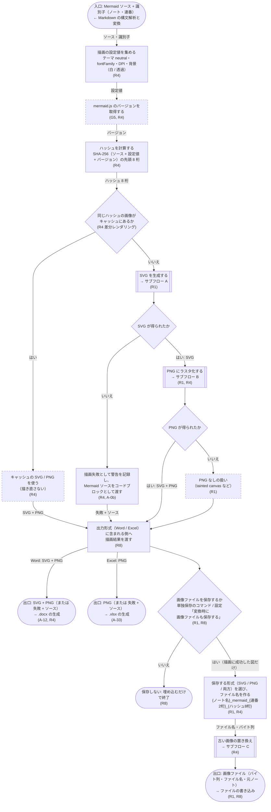
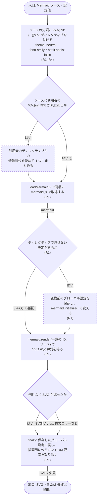
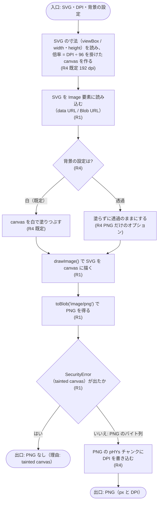
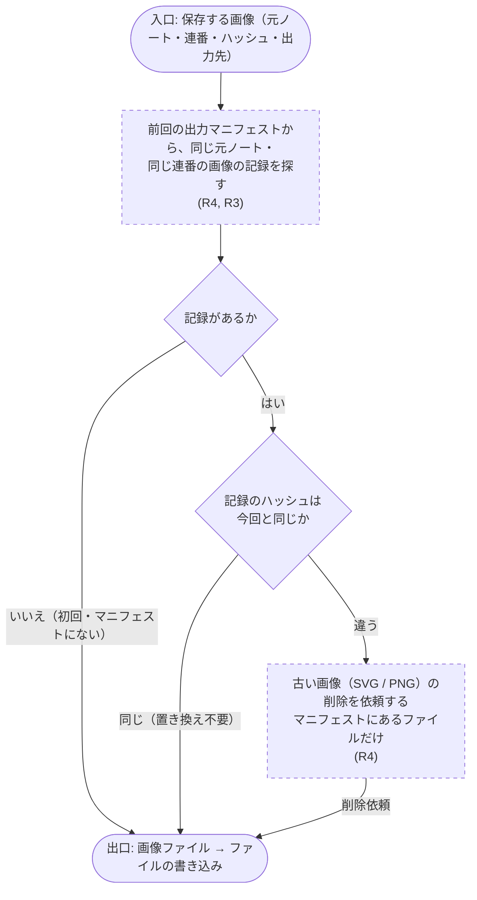

# Mermaid の画像化 のフロー

最終更新: 2026-11-17
対応する要件: R1、R4、R8「置き場所」「画像ファイルを出すタイミング」、R5 の A-12・A-33・A-0b（関連: R3「書き込み時」「実行中」「実行後」、G5、C-7）

## 役割

「Markdown の構文解析と変換」から Mermaid ソースを 1 図ずつ受け取り、Obsidian 同梱の mermaid.js で SVG を生成し、canvas で PNG にラスタ化する。描画結果を変える入力（ソース・設定値・mermaid.js のバージョン）からハッシュを計算し、キャッシュヒットなら描き直さない。生成した SVG / PNG を「.docx の生成」「.xlsx の生成」に渡し、画像ファイルを保存する条件を満たすときだけ、R4 の命名規則のファイル名を付けて「ファイルの書き込み」に渡す。

## 入力と出力

| 受け取るもの / 渡すもの | 内容 | 相手のコンポーネント |
|---|---|---|
| 受け取る: Mermaid ソース | 図ごとのソースと識別子（元ノートのパス・ノート内の連番。R4 の `{ノート名}_mermaid_{連番2桁}`）。04 の「Mermaid ノードにし、ノートごとの連番を振る」で作られたもの | Markdown の構文解析と変換 |
| 受け取る（全体図にない）: 実行の文脈 | 出力形式（Word / Excel / 両方）、画像ファイルを保存するか（単独保存のコマンド / 設定「変換時に画像ファイルも保存する」）、描画の設定値、前回の出力マニフェストの記録（読み取り専用） | 1 件ずつ順に変換（マニフェストは 実行結果の記録 が保存したもの）。「決める必要があること」を参照 |
| 渡す: SVG / PNG | 識別子・SVG・PNG（フォールバック用）・寸法（px と DPI）。描画に失敗したときは「失敗」と Mermaid ソース | .docx の生成 |
| 渡す: PNG | 識別子・PNG・寸法。描画に失敗したときは「失敗」と Mermaid ソース | .xlsx の生成 |
| 渡す: 画像ファイル | SVG / PNG のバイト列、R4 の命名規則によるファイル名、元ノートのパス（09 の「受け取る: 画像ファイル」と同じ形） | ファイルの書き込み |
| 渡す（全体図にない）: 古い画像の削除依頼 | マニフェストに同じノート・同じ連番で記録された、ハッシュの違う画像のパス | ファイルの書き込み（提案）。「決める必要があること」を参照 |
| 渡す（全体図にない）: 警告 | 描画失敗・PNG 化の失敗（ノートのパス・連番・理由） | 1 件ずつ順に変換（→ 実行結果の記録） |

## フロー図

### 全体の流れ

- 「.docx の生成」「.xlsx の生成」へは、実行指示の出力形式に含まれる側にだけ渡す（Word だけなら .xlsx へは渡さない）。R1 の単独保存のコマンドでは、どちらにも渡さない
- 描画に失敗した図は画像ファイルを保存しない（`Save` の「はい」の条件）

### サブフロー A: SVG の生成（mermaid.initialize() のグローバル設定に触れない）

`loadMermaid()` で得る mermaid.js は Obsidian のプレビューと共有している（R1）。設定は図ごとのディレクティブで渡し、グローバル設定を変える必要がある場合だけ、保存と `finally` での復元を行う。

### サブフロー B: PNG へのラスタ化

### サブフロー C: 古い画像の置き換え（R4）

点線枠のノードは、要件に決まっていない点を含む（「決める必要があること」を参照）。

## 各ステップの補足

### 全体の流れ

| ノード名 | 内容 | 要件 ID |
|---|---|---|
| 描画の設定値を集める | テーマは `neutral` に固定し、Obsidian の表示テーマ（ダーク等）には追従しない。`fontFamily` の既定は `"Yu Gothic", "YuGothic", "Hiragino Sans", "Meiryo", sans-serif`。DPI の既定は 192（印刷用プリセットは 300）。背景の既定は白、透過は PNG だけで選べる | R4 |
| mermaid.js のバージョンを取得する | Obsidian の更新で同梱の mermaid.js のバージョンが変わる前提で、キャッシュの判定に含める。バージョンを取得する方法は要件に書かれていない | G5, R4 |
| ハッシュを計算する | SHA-256 の先頭 8 桁。入力は Mermaid ソース + テーマ・フォント・DPI・背景 + mermaid.js のバージョン。ソースだけだと、設定を変えた後も古い画像が使い回されるため | R4 |
| 同じハッシュの画像がキャッシュにあるか | 差分レンダリング。キャッシュの置き場所（保存済みの画像ファイルか、別の場所か）は要件に書かれていない | R4 |
| キャッシュの SVG / PNG を使う | 描画（サブフロー A・B）を飛ばす。保存済みの画像ファイルをキャッシュとする場合、読むのは Vault API / `fs` のどちらか、誰が読むかが未定 | R4, G4 |
| SVG を生成する | サブフロー A | R1 |
| PNG にラスタ化する | サブフロー B。Word の SVG のフォールバックと、Excel のセルへの貼り付け（exceljs は SVG に非対応）の両方に PNG が必要なので、出力形式によらず作る | R4, A-12, A-33 |
| PNG なしの扱い | `htmlLabels: false` が効かない図で canvas が tainted になった場合。.docx は SVG に PNG のフォールバックを付けて埋め込む前提（R4）、.xlsx は PNG しか貼れない（A-33）ため、どちらも成り立たない。扱いは未定 | R1, R4, A-33 |
| 描画失敗として警告を記録し、ソースを渡す | `mermaid.render()` が例外を出したとき（構文エラーなど）。Word には Mermaid ソースをコードブロックとしてそのまま挿入し、結果レポートに記録する。タイムアウト（既定 30 秒）は「1 件ずつ順に変換」が 1 件単位で扱う | R4, A-0b, R3 |
| 出力形式に含まれる側へ描画結果を渡す | 実行指示の出力形式（Word / Excel / 両方）に含まれるレンダラにだけ渡す。R1 の単独保存のコマンドでは、どちらにも渡さず画像ファイルの保存だけを行う | R8, R1 |
| SVG + PNG → .docx の生成 | SVG を PNG の代替画像付き（`a:blip` + `asvg:svgBlip`、`docx` ライブラリの `type: "svg"` + `fallback`）で埋め込むための 2 つを渡す。本文幅への縮小・最大高さ・小さい図を拡大しない処理は .docx の生成が行うので、ここでは寸法（px と DPI）を添える | A-12, R4, C-7 |
| PNG → .xlsx の生成 | セルに固定配置する PNG を渡す | A-33 |
| 画像ファイルを保存するか | Word / Excel への変換では埋め込むだけで、画像ファイルは出さない。保存するのは、R1 の単独保存のコマンドを実行したときと、設定「変換時に画像ファイルも保存する」（既定オフ）が有効なときだけ。Vault 内に画像が溜まるのを防ぐため | R8, R1 |
| 保存する形式を選び、ファイル名を作る | 設定の SVG / PNG / 両方 は、画像ファイルとして保存する形式だけに効く（埋め込みは常に SVG + PNG、Excel は常に PNG）。ファイル名は `{ノート名}_mermaid_{連番2桁}_{ハッシュ8桁}.{svg\|png}` で、このコンポーネントが決めて渡す（09 の補足「ファイル名は『Mermaid の画像化』が決めて渡す」と一致）。置き場所（.docx と同じフォルダ）は「ファイルの書き込み」が決める | R1, R4, R8 |
| 古い画像の置き換え | サブフロー C | R4 |

### サブフロー A: SVG の生成

| ノード名 | 内容 | 要件 ID |
|---|---|---|
| ディレクティブを付ける | `%%{init: {"theme": "neutral", "fontFamily": "...", "htmlLabels": false}}%%` の形で、図ごとにソースの先頭へ付ける。`mermaid.initialize()` を呼ばないので、Obsidian のプレビュー表示は変わらない。`htmlLabels: false` は、HTML ラベル（`<foreignObject>`）による tainted canvas を避けるため | R1, R4 |
| 利用者のディレクティブとの優先順位 | ノートのソースに利用者が書いた `%%{init}%%` がある場合、どちらを優先するか（テーマは R4 で `neutral` に固定）が要件に書かれていない | — |
| loadMermaid() で mermaid.js を取得する | Obsidian API の `loadMermaid()`。プレビューと同じインスタンス | R1 |
| ディレクティブで渡せない設定があるか | 要件は「ディレクティブで渡せない設定がある場合だけ」保存と復元を行うとしている。どの設定が該当するかは、全図種のサンプル（G5）で確認するまで分からない | R1, G5 |
| 変換前のグローバル設定を保存する | `mermaid.initialize()` で変える前に、変換前の設定を保存する。どの API で現在の設定を読み出すかは要検証 | R1 |
| mermaid.render() で SVG を得る | `render()` に渡す ID は、同じ画面のプレビューと衝突しない一意の値にする | R1 |
| finally で元に戻す | 例外時も含め、保存した設定に戻す（R1）。`render()` が描画用に一時的に DOM へ足した要素も取り除く | R1 |

### サブフロー B: PNG へのラスタ化

| ノード名 | 内容 | 要件 ID |
|---|---|---|
| canvas を作る | canvas の幅と高さを SVG の寸法の DPI / 96 倍にする（既定 192 dpi = 2 倍） | R4 |
| canvas を白で塗りつぶす | Mermaid の SVG は背景が透過なので、`drawImage()` の前に白で塗る。透過のオプションを選んだときは塗らない | R4 |
| toBlob('image/png') | PNG のバイト列を得る | R1 |
| SecurityError が出たか | `<foreignObject>` を含む SVG を描いた canvas は tainted になり、`toBlob()` が `SecurityError` を投げる。`htmlLabels: false` が効かない図種で起こりうる（R1 の要検証） | R1 |
| pHYs チャンクに DPI を書き込む | `toBlob()` が作る PNG には解像度の情報がないため、`pHYs` チャンク（単位: ピクセル / メートル。192 dpi ≒ 7559）を足し、Word で開いたときの実寸を合わせる | R4 |

### サブフロー C: 古い画像の置き換え

| ノード名 | 内容 | 要件 ID |
|---|---|---|
| 同じ元ノート・同じ連番の画像の記録を探す | 前回の出力マニフェストを読む。マニフェストは「実行結果の記録」が実行の最後に保存するもの。実行の途中でどう受け取るか、マニフェストに連番が記録されるかは未定（10 の「決める必要があること」と同じ論点） | R4, R3 |
| 記録のハッシュは今回と同じか | 同じならファイル名も同じなので、置き換えは不要 | R4 |
| 古い画像の削除を依頼する | ハッシュの違う古い画像を削除する。マニフェストにないファイルには触れない。ノートから図そのものが消えた場合の削除（孤立画像の削除）は R4 の後回しなので、このフローでは扱わない | R4 |

## 決める必要があること

境界（全体図・ほかのフロー図）に関すること
- **Mermaid ノードと画像の対応付け（04 `04-parse-transform.md` と同じ論点）**: 画像は mdast を経由せず、このコンポーネントから「.docx の生成」「.xlsx の生成」へ直接渡る。このフローでは、04 が付けた識別子「元ノートのパス + ノート内の連番」を対応付けのキーとして画像に添える案をとった（ハッシュは設定で変わるので、キーには使わない）。埋め込んだノート（A-21）の中の Mermaid をどのノート名・連番で命名するかは、04 と同じく未定
- **描画に失敗したときにソースを誰が持つか（04 との境界）**: R4 は「Mermaid ソースをコードブロックとしてそのまま挿入」とする。mdast の Mermaid ノードにもソースが残っているので、このコンポーネントは「失敗」だけを返し、.docx の生成がノードのソースからコードブロックを作る形でもよい。どちらにするかを 07 と合わせて決める
- **Excel で描画に失敗したとき**: R4 の失敗時の扱いは Word についてだけ書かれている。.xlsx ではソースを文字列としてセルに入れるか、何も貼らずに警告だけにするか（A-0b の「原文を残す」に従うか）を決める
- **古い画像の削除を誰が行うか（09 `09-write-file.md` と同じ論点）**: このフローでは、削除を「ファイルの書き込み」に依頼する案をとった（書き込み系の操作を 09 のアダプタに集め、R3 の「元ノートに書き込まない」の確認も同じ場所で行える）。全体図にはこの依頼の矢印がない。削除が失敗した（使用中など）ときの扱いも未定
- **古い画像を削除するタイミング**: 新しい画像の書き込みに失敗・スキップしたのに古い画像だけ消えると、画像が 1 つもなくなる。削除は新しい画像の書き込みが成功した後にするか（その場合は 09 側の処理になる）を決める
- **マニフェストの読み方（10 `10-record-results.md` と同じ論点）**: 古い画像の置き換えには、実行の途中で前回のマニフェストを読む必要があるが、全体図にはこのコンポーネントへの矢印がない。案: 「1 件ずつ順に変換」が実行の開始時に読み込み、読み取り専用の一覧として渡す。また、同じノート・同じ連番で探すために、マニフェストの記録に「出力の種類（画像）・元ノート・連番・ハッシュ」を持たせる必要がある（10 の「マニフェストの記録の形式」）
- **削除した画像のマニフェストからの除去（10 と同じ論点）**: 削除した古い画像の記録を、どの経路で「実行結果の記録」に伝えるか。削除を 09 が行うなら、09 の結果に「削除したパス」を含める形が考えられる
- **画像ファイルの同名ファイルの扱い（09 と同じ論点）**: ファイル名にハッシュが入るため、同名 = 同じ内容。キャッシュヒットで同名のファイルが既にあるときは、書き込みを依頼しない（または 09 側で常にスキップ）とし、R3 の「連番」は画像に適用しない案を提案する
- **Excel だけを出力するとき・単独保存のときの画像の置き場所（09 と同じ論点）**: 画像は「.docx と同じフォルダ」に置くと定義されているが、.docx を作らない場合の定義がない
- **実行の文脈の受け取り方（全体図にない入力）**: 出力形式・画像ファイルを保存するか・描画の設定値・マニフェストを、どのコンポーネントから受け取るか。全体図の入力は「Mermaid ソース」だけ
- **R1 の単独保存のコマンドの流れ**: 単独保存のコマンドは .docx / .xlsx を作らず画像ファイルだけを出す。このコマンドでも「1 件ずつ順に変換」→「Markdown の構文解析と変換」を通って Mermaid ソースを受け取るのか、別の入口から直接 .md を読むのかが全体図にない。フェーズ 1（最初の実用機能）はこのコマンドなので、先に決める必要がある
- **警告を返す経路（04・10 と同じ論点）**: 描画失敗・PNG 化の失敗の警告を「実行結果の記録」に届ける矢印が全体図にない
- **タイムアウト・中断の伝達（03 `03-run-sequential.md`・09 と同じ論点）**: `mermaid.render()` のハングは「1 件ずつ順に変換」の `Promise.race` で打ち切るが、裏で描画が続いて遅れて結果が返る。サブフロー A の `finally`（グローバル設定の復元）は、遅れて返ったときにも必ず実行される必要がある。中断の合図（`AbortSignal` など）を受け取り、画像ファイルの書き込み依頼を出さないようにするかを決める
- **キャプションと代替テキストの材料（07 との境界）**: R4 のキャプション（Mermaid の frontmatter の `title`）と代替テキスト（図の種類から自動で作る）の材料は Mermaid ソースにある。このコンポーネントが title と図の種類を取り出して画像に添えるか、.docx の生成がソースから取り出すかを決める

要件に書かれていない・決まっていないこと
- **キャッシュの置き場所**: R4 の「同じハッシュの画像が既にあれば描き直さずに使う」は、保存済みの画像ファイルを指すと読める。しかし R8 で画像ファイルは既定で保存しないため、既定の設定ではキャッシュが効かない。案: (1) 保存済みの画像ファイルだけをキャッシュとする、(2) 実行中のメモリにだけ持つ（同じ図が複数のノートにある場合に効く）、(3) プラグインのデータフォルダにキャッシュ専用の置き場所を作る
- **mermaid.js のバージョンの取得方法**: `loadMermaid()` で得たオブジェクトからバージョンを読めるか（例: `mermaid.version` の有無）は要検証。読めない場合に Obsidian のバージョンで代用するか
- **tainted canvas（SecurityError）のときの扱い**: PNG が作れないと、Word の SVG のフォールバックと Excel の貼り付けが成り立たない。案: (1) 描画失敗と同じくソースのコードブロックにする、(2) Word は SVG だけで埋め込み、Excel は失敗扱いにする。全図種のサンプル（G5）で発生する図種を確認してから決める
- **ディレクティブで渡せない設定**: どの設定がディレクティブで渡せないか（グローバル設定の保存・復元が必要か）は、全図種のサンプルでの検証待ち。現在のグローバル設定を読み出す API も要検証
- **利用者が書いた `%%{init}%%` との優先順位**: ノートの Mermaid ソースに利用者がテーマなどを書いている場合、R4 の固定設定（`neutral`・白背景）で上書きするか、利用者の指定を残すか。残す場合、ハッシュの入力にも影響する
- **SVG のテキストのフォント**: Word の中で SVG のテキストがどう描画されるか（フォントの代替）は R4 で要検証。アウトライン化は R4 の後回し
- **透過背景のときの SVG**: 背景の透過は「PNG だけで選べる」ので、SVG は常に白背景にするか（SVG に白の矩形を足すか）、SVG はもともと透過のままにするかが書かれていない。ハッシュの「背景」が PNG 用の設定だけを指すかにも関わる
