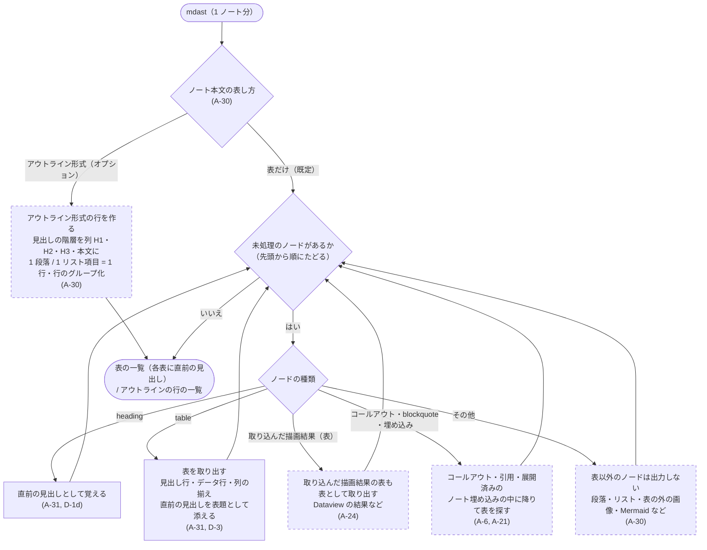
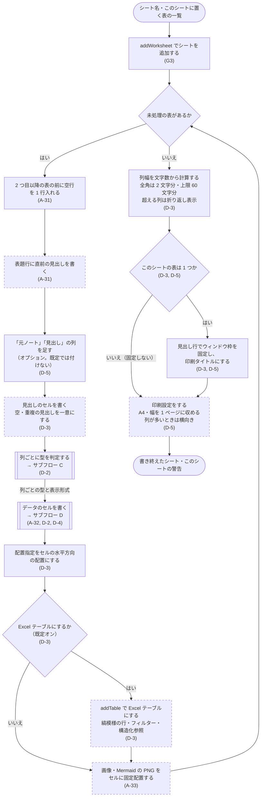
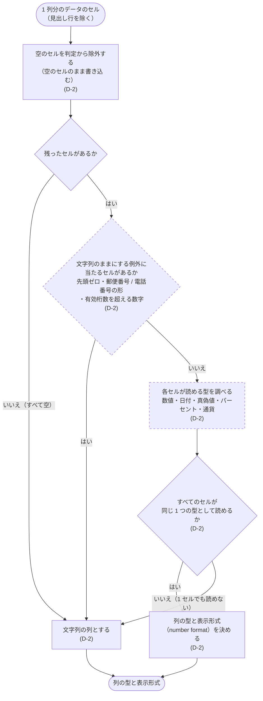
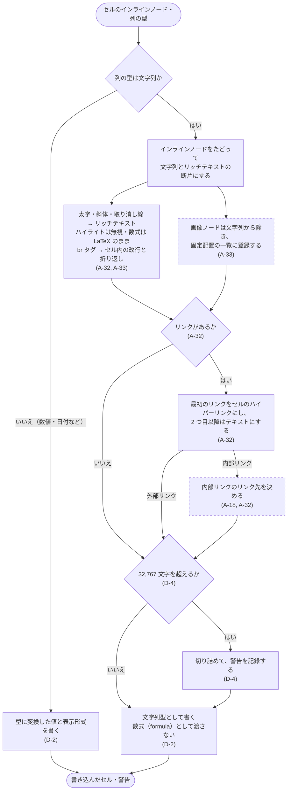

# .xlsx の生成 のフロー

最終更新: 2026-11-17
対応する要件: G3、R5 の Excel に関する項目（A-0b・A-30〜A-34）、R7 全体（D-1〜D-5）、R8「Excel のファイルの単位」、R3 の個人情報の設計原則

## 役割

「Markdown の構文解析と変換」が作った mdast を、「1 件ずつ順に変換」から出力単位とグループの情報と一緒に受け取り、Markdown の表を抽出して `exceljs`（G3）のワークシートに書き込む。既定では 1 ノート = 1 シート、1 フォルダ = 1 ブックなので、ノートを受け取るたびにグループ（フォルダ）のブックへシートを足し、「グループの終わり」の情報が付いたノートで目次シート・ブックのプロパティを加えてバイト列にし、「ファイルの書き込み」へ渡す。表のないノートはシートを作らず「表なし」（理由付きのスキップ）を返し、シートが 1 枚もできないフォルダではブックを作らない。

## 入力と出力

| 区分 | 受け取るもの / 渡すもの | 相手のコンポーネント |
|---|---|---|
| 受け取るもの | mdast（04 が作ったもの。標準のノード + 独自ノード。`tree.data` に frontmatter と警告の一覧）。表のセルの中はインラインノード（書式・解決済みリンク・画像）。数式ノードは元の LaTeX も持つ（04 の補足「数式」） | 1 件ずつ順に変換（04 が 03 に返した mdast を 03 が渡す） |
| 受け取るもの | Mermaid の PNG・寸法（図ごと。元ノートのパス + ノート内の連番で識別）、または描画失敗 + Mermaid ソース | Mermaid の画像化 |
| 受け取るもの（全体図にない） | mdast に添えた出力単位（単一ノート / 1 フォルダ = 1 ブック / 1 ノート = 1 ブック）とグループの情報（どのブックに入るか・グループの終わりか）、ノートごとの `AbortSignal` | 1 件ずつ順に変換 |
| 渡すもの | .xlsx のバイト列・元のパス（単一ノート / 1 ノート = 1 ブックではノートのパス、1 フォルダ = 1 ブックではフォルダのパス）・出力単位・`AbortSignal`。09 の入力の形に合わせる | ファイルの書き込み |
| 渡すもの（全体図にない） | ノート 1 件を足したときの「グループへの追加済み」（途中の状態で、最終結果にしない）と、そのノートの警告（セルの切り詰めなど）。表のないノートは「スキップ（理由: 表なし）」。ブックを作らなかったときも「スキップ（理由: 表なし）」で、03 がグループの全ノートに付ける。生成の失敗は例外として呼び出し元に伝わる | 1 件ずつ順に変換（→ 実行結果の記録） |

## フロー図

### 全体の流れ: シートを足してブックを完成させる

ノート 1 件ごとに上半分（シートの追加）を通り、1 フォルダ = 1 ブックでは「グループの終わり」の情報が付いたノートのときだけ続けて下半分（ブックの完成）を通る。単一ノートと、オプションの 1 ノート = 1 ブックでは、シートを足した直後に続けて下半分を通る。ブックの状態（ブック・シート名の一覧・テーブル名の一覧・目次用の一覧）は、このコンポーネントがグループの終わりまで保持する。

```mermaid
flowchart TD
  In(["入口: mdast（1 ノート分・frontmatter・警告）<br/>+ 出力単位とグループの情報・signal<br/>← 1 件ずつ順に変換<br/>(D2, D3)"])
  GetBook["このグループのブックの状態を取り出す<br/>なければ new Workbook で作る<br/>(R8, D-1b)"]
  Extract[["表を抽出する<br/>→ サブフロー A<br/>(A-30, A-31)"]]
  HasTbl{"シートに書く内容があるか<br/>表が 1 つ以上 / アウトライン形式<br/>(D-1b, A-30)"}
  NoTbl["シートを作らず、<br/>このノートの結果を<br/>スキップ（理由: 表なし）にする<br/>(D-1b, D5)"]
  Assign["シートの割り当てを決める<br/>既定: 1 ノート = 1 シート<br/>オプション: 1 表 = 1 シート<br/>(A-31, D-1a, D-1b)"]
  Name["シート名を決める<br/>ノート名 / 直前の見出し / 表 n<br/>31 文字・禁止文字・重複は (2)<br/>(D-1d)"]
  AbortChk{"タイムアウトで打ち切られているか<br/>signal.aborted<br/>(R3, D2)"}
  AbortEnd(["シートを足さずに打ち切る<br/>（結果は 03 が捨てる）"])
  Sheet[["シートを追加して表を書き込む<br/>→ サブフロー B<br/>(D-2, D-3, A-32, A-33)"]]
  SheetOK{"このノートのシートを<br/>書き終えたか"}
  Rollback["このノートで足したシートと<br/>シート名・テーブル名を取り除く"]:::undecided
  Unit{"出力単位と<br/>グループの終わりか<br/>（03 が添えた情報）<br/>(R8, D3)"}
  RetAdded(["グループへの追加済み（途中の状態）と<br/>このノートの結果・警告を返す<br/>→ 1 件ずつ順に変換<br/>(D5)"])
  Count{"ブックのシートが<br/>1 枚以上あるか<br/>(R8, D-1b)"}
  NoBook(["ブックを作らず<br/>スキップ（理由: 表なし）を返す<br/>→ 1 件ずつ順に変換<br/>(R8, D-1b, D5)"])
  TocChk{"シートが 2 枚以上あるか<br/>(D-1c)"}
  Toc["目次シートを先頭に置く<br/>全シートの一覧・各シートへのリンク<br/>元ノートの Vault 内パス・見出し<br/>(D-1c)"]
  Creator["作成者を決める<br/>frontmatter の author → 設定の作成者名 → 空<br/>OS のユーザー名は使わない<br/>(D-5, C-8, R3)"]
  Props["ブックのプロパティを設定する<br/>タイトル・作成者・作成日時<br/>Vault の絶対パスは入れない<br/>(D-5, R3)"]
  Buffer["xlsx.writeBuffer でバイト列にする<br/>グループの状態を破棄する<br/>(G3)"]
  BufOK{"生成できたか"}
  Fail(["例外を呼び出し元に伝える<br/>→ 1 件ずつ順に変換で「失敗」"])
  Out(["出口: .xlsx のバイト列・元のパス・出力単位<br/>→ ファイルの書き込み"])

  In --> GetBook
  GetBook -->|"ブックの状態"| Extract
  Extract -->|"表の一覧（直前の見出し付き）<br/>/ アウトラインの行"| HasTbl
  HasTbl -->|"いいえ"| NoTbl
  HasTbl -->|"はい"| Assign
  Assign -->|"シートごとの表の組"| Name
  Name -->|"シート名"| AbortChk
  AbortChk -->|"はい"| AbortEnd
  AbortChk -->|"いいえ"| Sheet
  Sheet --> SheetOK
  SheetOK -->|"はい"| Unit
  SheetOK -->|"いいえ（例外）"| Rollback
  Rollback --> Fail
  NoTbl --> Unit
  Unit -->|"1 フォルダ = 1 ブック（既定）で<br/>グループの途中"| RetAdded
  Unit -->|"単一ノート / 1 ノート = 1 ブック<br/>/ グループの終わり"| Count
  Count -->|"いいえ"| NoBook
  Count -->|"はい"| TocChk
  TocChk -->|"はい"| Toc
  TocChk -->|"いいえ（1 枚）"| Creator
  Toc --> Creator
  Creator --> Props
  Props --> Buffer
  Buffer --> BufOK
  BufOK -->|"はい"| Out
  BufOK -->|"いいえ（例外）"| Fail

  classDef undecided stroke-dasharray: 5 5
```

### サブフロー A: 表の抽出

### サブフロー B: シートへの書き込み（1 シート分）

### サブフロー C: 列の型の判定

表の 1 列ごとに行う。見出し行は判定に含めず、常に文字列のまま書く。

### サブフロー D: セル 1 つの書き込み

### Vault 全体の集計（A-34）を図に含めない理由

A-34 の集計（frontmatter の一覧・タスクの一覧・Dataview の結果を 1 つのブック `{Vault 名}_集計.xlsx` にまとめる）は、このファイルの図に含めず、別の図にする。理由は次のとおり。

- 入力が違う: このフローの入力はノート 1 件分の mdast だが、集計の入力は Vault 全体の frontmatter・タスク・Dataview の `api.query()` の結果で、04 の構文解析と変換を 1 件ずつ通る形ではない（frontmatter は `metadataCache` から読める）。
- 起動経路が違う: 集計は専用のコマンド「Vault を Excel に集計」から起動され（R8）、01 → 02 → 03 の流れに乗るかどうかが全体図に描かれていない。
- 単位が違う: 集計は「1 フォルダ = 1 ブック」のグループに属さず、常に 1 つのブックを出力ルートの直下に置く（R8）。シートも「1 ノート = 1 シート」ではなく、集計の種類ごとに 1 シートになる。

ただし、シートへの書き込みの部品（サブフロー C の型の判定、サブフロー D のセルの書き込み、サブフロー B の Excel テーブル・列幅・印刷設定）は集計でも同じ規則（D-2〜D-5）を使う。そのため、これらはノートに依存しない部品として作り、集計の図から呼べる形にしておく。集計では「元ノート」「見出し」の列を常に付ける（D-5）。

## 各ステップの補足

### 全体の流れ

| ノード名 | 内容 | 要件 ID |
|---|---|---|
| 入口 | 03 から届くノート 1 件ごとに呼ばれる。04 は mdast を 03 に返し、03 が出力単位とグループの情報（どのブックに入るか・グループの終わりか）を添えてこのコンポーネントを呼ぶ。形式「両方」でも、同じ mdast を 07 と 08 がそれぞれ受け取る | G2, R8, D3 |
| このグループのブックの状態を取り出す | グループ（1 フォルダ = 1 ブックではフォルダ、単一ノート / 1 ノート = 1 ブックではノート 1 件）ごとに、ブック・使用済みのシート名・使用済みのテーブル名・目次用の一覧（シート名・元ノートの Vault 内パス・見出し）を保持する。07 の結合出力が章の一覧を保持するのと同じ形 | R8, D-1b |
| 表を抽出する | サブフロー A。既定は表だけ（A-30）。アウトライン形式（オプション）では表がなくてもシートを作る | A-30, A-31 |
| シートに書く内容があるか | 表だけのとき、表が 1 つもなければ「いいえ」。アウトライン形式のときは常に「はい」（D-1b の括弧書き） | D-1b, A-30 |
| スキップ（理由: 表なし）にする | シートを作らず、このノートの結果を理由付きのスキップ（理由: 表なし、ノートのパス）にする。警告ではなく結果として 03 に返る | D-1b, R3, D5 |
| シートの割り当てを決める | 既定の 1 ノート = 1 シートでは、ノート内の表をすべて 1 シートに縦に並べる。オプションの 1 表 = 1 シートでは、表ごとに 1 シート | A-31, D-1a, D-1b |
| シート名を決める | 1 ノート = 1 シートではノート名。1 表 = 1 シートでは直前の見出し、なければ連番「表 n」。Excel の制約（31 文字以内、`[ ] : * ? / \` を使えない、ブック内で重複不可）に合わせる。重複したら末尾に ` (2)`、` (3)` … を付け、付けた後も 31 文字に収まるように元の名前を切り詰める。使用済みのシート名はブックの状態で管理する（1 フォルダ = 1 ブックでは、別のノートのシートとも重複を確認する） | D-1d |
| タイムアウトで打ち切られているか | シートをブックに足す前に、03 から受け取った `signal.aborted` を確かめる。abort 済み（タイムアウト）なら、失敗扱いのノートのシートをブックに足さない。中断ボタンでは abort されない。書き込み（rename）の前の確認は「ファイルの書き込み」が行う | R3, D1, D2 |
| シートを追加して表を書き込む | サブフロー B を、割り当てたシートの数だけ繰り返す | D-2, D-3, A-32, A-33 |
| このノートで足したシートを取り除く | シートの書き込みの途中で例外が出たとき、書きかけのシートがブックに残ると、グループの終わりにそのまま出力される。`workbook.removeWorksheet()` で取り除き、シート名・テーブル名・目次用の一覧からも消してから例外を伝える案。要件にないため点線枠 | R3 |
| 出力単位とグループの終わりか | 03 が mdast に添える情報で判定する。単一ノート（実行する件数が 1 件）は `{ノート名}.xlsx`、オプションの 1 ノート = 1 ブックも `{ノート名}.xlsx` で、どちらもここでブックを完成させる。1 フォルダ = 1 ブック（実行する件数が 2 件以上のときの既定）では「グループの終わり」の情報が付いたノートまで待つ | R8, D3 |
| グループへの追加済みとこのノートの結果・警告を返す | 03 のサブフローの結果に入る。「グループへの追加済み」は途中の状態で、最終結果にしない。表なしのノートも、シートを足さずにここを通り、結果は「スキップ（表なし）」になる。ブックの書き込み結果は、03 がそのグループの全ノートに付ける | R8, D-1b, D5 |
| ブックのシートが 1 枚以上あるか | 表のあるノートがないフォルダ（R8 の境界条件）、および表のないノートを単一ノートで変換したとき、「いいえ」になる | R8, D-1b |
| ブックを作らずスキップ（理由: 表なし）を返す | 09 には何も渡さない。03 の「束ねた出力の結果をグループの全ノートに付ける」の矢印のラベル「表なしならブックを作らずスキップ」に対応する。1 フォルダ = 1 ブックでは、03 がこの結果をグループの全ノートに付けるので、各ノートの状態はスキップ（表なし）になる。結果レポートの件数はノートの数で数える | R8, D-1b, D5 |
| シートが 2 枚以上あるか | シートが 1 枚だけのブックでは目次シートを作らない。1 表 = 1 シート（オプション）では、単一ノートでもシートが 2 枚以上になりうるので、ノートの件数ではなくシートの枚数で判定する | D-1c |
| 目次シートを先頭に置く | 全シートの一覧。各行にシート名と、そのシートへのハイパーリンク `#'シート名'!A1`（シート名の中の `'` は `''` にする）、元ノートの Vault 内パス（Vault からの相対パス。絶対パスは入れない: R3）と見出しを置く。exceljs で既存のシートより前にシートを挿入する方法は要検証 | D-1c, R3 |
| 作成者を決める | 07 の「作成者を決める」と同じ規則。frontmatter の `author` → 設定の作成者名 → 空。OS のユーザー名は参照しない | D-5, C-8, R3 |
| ブックのプロパティを設定する | `workbook.title`・`workbook.creator`・`workbook.created`。`exceljs` が `creator`・`lastModifiedBy` などに既定値を入れるかは要検証で、空のときも明示的に指定する | D-5, R3 |
| xlsx.writeBuffer でバイト列にする | `workbook.xlsx.writeBuffer()`。exceljs のブラウザ向けビルドが Electron のレンダラプロセスで動くかは G4 の要検証。成功・失敗にかかわらず、このグループのブックの状態を破棄する | G3, G4 |
| 例外を呼び出し元に伝える | 03 のサブフローで「処理が例外で終了」→「失敗」として記録される（07 と同じ） | R3 |
| 出口 | バイト列に、元のパス（ノートまたはフォルダ。Vault 直下のノートをまとめたブックでは Vault のルート）と出力単位と `signal` を添えて渡す。09 は出力ファイルごとに結果（出力パス・内容ハッシュ・状態）を返す。ファイル名（`{ノート名}.xlsx` / `{フォルダ名}.xlsx` / `{Vault 名}.xlsx`）と出力パスは 09 が決める | R8 |

### サブフロー A: 表の抽出

| ノード名 | 内容 | 要件 ID |
|---|---|---|
| ノート本文の表し方 | 既定は Markdown の表だけを抜き出す。オプションでアウトライン形式 | A-30 |
| アウトライン形式の行を作る | 見出しの階層を列「H1・H2・H3・本文」にし、1 段落 / 1 リスト項目 = 1 行、行のグループ化（exceljs の `outlineLevel`）で折りたためるようにする。H4 以下・表・画像・コードブロックをどう行にするかが要件にないため点線枠 | A-30 |
| 直前の見出しとして覚える | 表の表題行（A-31）と、1 表 = 1 シートのシート名（D-1d）に使う。見出しのレベルは問わず、表より前で最も近い見出し | A-31, D-1d |
| 表を取り出す | GFM の表（`table` ノード）。先頭の行が見出し行、`align` が列の揃え。セルの中身はインラインノードのまま持つ | A-31, D-3 |
| 取り込んだ描画結果の表 | 04 が Dataview の結果・dataviewjs の HTML から作った表を、ノートの表として抽出するか。A-24 は Word の表にすることだけを書いているため点線枠 | A-24 |
| 中に降りて表を探す | コールアウト・引用の中の表、ノート埋め込み（A-21、04 で展開済み）の中の表を抽出の対象にするか。要件にないため点線枠 | A-6, A-21 |
| 表以外のノードは出力しない | 表だけ（既定）のとき、段落・リストなどは出力しない。A-33 は「画像と Mermaid は PNG にしてセルに固定配置する」と書いているが、表の外にある画像・Mermaid を表だけのシートのどこに置くか（置かないか）が決まっていないため点線枠 | A-30, A-33 |

### サブフロー B: シートへの書き込み

| ノード名 | 内容 | 要件 ID |
|---|---|---|
| addWorksheet でシートを追加する | サブフロー A・全体の流れで決めたシート名で追加する | G3 |
| 空行を 1 行入れる | 1 シートに複数の表を縦に並べるとき、表と表の間を空行で区切る | A-31 |
| 表題行に直前の見出しを書く | 各表の前に直前の見出しを表題行として置く。直前の見出しがない表、および 1 表 = 1 シート（見出しがシート名になる）で表題行を置くかは要件にないため点線枠 | A-31 |
| 「元ノート」「見出し」の列を足す | 1 ノート = 1 シートでは目次シートで分かるため既定で付けない（オプションで付けられる）。1 フォルダ = 1 ブックで 1 表 = 1 シートのときも同じ扱いとした | D-5 |
| 見出しのセルを書く | 見出し行は型の判定に含めず文字列で書く。Excel テーブルの列名は空・重複を許さない（Excel がファイルの修復を求める）ため、空の見出しに名前を付け、重複に連番を付ける必要がある。付け方は要件にないため点線枠 | D-3 |
| 列ごとに型を判定する | サブフロー C | D-2 |
| データのセルを書く | サブフロー D | A-32, D-2, D-4 |
| 配置指定をセルの水平方向の配置にする | Markdown の `:---` / `:---:` / `---:` を `alignment.horizontal` の left / center / right にする。指定がない列は Excel の既定のまま | D-3 |
| addTable で Excel テーブルにする | 既定オン。表ごとに別のテーブル（ListObject）にする。テーブル名はブック内で一意にする必要があり、その付け方は要件にない。exceljs の `addTable()` で、リッチテキスト・ハイパーリンクのセル（A-32）をテーブルの中に保てるかは要検証のため点線枠 | D-3 |
| 画像・Mermaid の PNG をセルに固定配置する | `workbook.addImage()` で PNG を登録し、`worksheet.addImage()` でセルに置く（exceljs は SVG に非対応のため PNG: A-33 の要検証）。Mermaid は 06 から届いた PNG を、元ノートのパス + 連番でノードと対応付ける。固定の方式（`editAs: 'oneCell'` など）、画像の大きさ、行の高さの調整は要件にないため点線枠 | A-33, R4 |
| 列幅を文字数から計算する | exceljs には自動調整がないので、列の各セルの文字数（全角文字は 2 文字分）の最大値から計算する。複数の表を縦に並べたシートでは、同じ列にあるすべての表のセルで最大値をとる。上限 60 文字分で、超える列は `wrapText` で折り返し表示にする | D-3 |
| このシートの表は 1 つか | 固定できる行は 1 か所だけなので、表が 2 つ以上のシートではウィンドウ枠を固定しない | D-3 |
| 見出し行でウィンドウ枠を固定し、印刷タイトルにする | `views: [{ state: 'frozen', ySplit: 見出し行の行番号 }]`。表題行がある場合は表題行と見出し行までを固定する。印刷タイトル（`pageSetup.printTitlesRow`）にも同じ行を指定し、毎ページ繰り返す | D-3, D-5 |
| 印刷設定をする | 用紙 A4（`paperSize: 9`）、幅を 1 ページに収める（`fitToWidth: 1`、`fitToHeight: 0`）。「列が多いとき」に横向きにする列数のしきい値が要件にないため点線枠 | D-5 |

### サブフロー C: 列の型の判定

| ノード名 | 内容 | 要件 ID |
|---|---|---|
| 空のセルを判定から除外する | 空のセルは型の判定に使わず、空のセルのまま書き込む | D-2 |
| 残ったセルがあるか | 列のセルがすべて空なら文字列の列とする | D-2 |
| 文字列のままにする例外 | 先頭がゼロの値（`00123`）、郵便番号・電話番号の形、Excel の数値の有効桁数（15 桁）を超える数字。1 セルでも当たれば、列全体を文字列にする（1 セルでも読めなければ文字列、の規則と同じ考え方）。郵便番号・電話番号の「形」の定義と、桁数のしきい値（「決める必要があること」を参照）が決まっていないため点線枠 | D-2 |
| 各セルが読める型を調べる | 数値・日付・真偽値・パーセント（`12%`）・通貨（`¥1,200`）。日付は `YYYY-MM-DD`・`YYYY/MM/DD`（後ろに `HH:mm` が付いてもよい）だけで、`11/17` のような年のないものは文字列。真偽値の表記・通貨記号の種類・桁区切りだけの数値（`1,200`）を数値とみなすかが決まっていないため点線枠 | D-2 |
| すべてのセルが同じ 1 つの型として読めるか | 判定は列単位。1 セルでも読めなければ列全体を文字列のままにする | D-2 |
| 列の型と表示形式を決める | 型に合わせて表示形式（`numFmt`）を設定する。例: パーセントは値 0.12 + `0%`、通貨は値 1200 + 通貨の書式、日付は `yyyy-mm-dd`（時刻付きは `yyyy-mm-dd hh:mm`）。具体的な書式文字列は要件にない | D-2 |

### サブフロー D: セル 1 つの書き込み

| ノード名 | 内容 | 要件 ID |
|---|---|---|
| 型に変換した値と表示形式を書く | 数値・日付・真偽値はその型の値として書く。`-5` のように `-` で始まる値も、数値として読めた列では数値として書く（数値は数式として評価されないので、数式インジェクションにならない） | D-2 |
| 文字列とリッチテキストの断片にする | 太字・斜体・取り消し線は `richText` の断片の `font`（`bold`・`italic`・`strike`）にする。ハイライトは文字単位で表せないので無視する。数式は LaTeX のまま文字列にする（04 が元の LaTeX を残す）。インラインコード・脚注参照など A-32 にない要素は表示テキストだけ残す | A-32, A-33 |
| br タグ → セル内の改行 | ` ` を改行文字（`\n`）にし、そのセルの `alignment.wrapText` を有効にする | A-32 |
| 画像ノードを固定配置の一覧に登録する | セルの中の画像（`![[a.png]]`）をサブフロー B の固定配置に回す。画像のバイト列を誰が読むか、PNG 以外の形式をどうするかが未定のため点線枠 | A-33 |
| 最初のリンクをセルのハイパーリンクにする | 1 セルに 1 つまでなので、2 つ目以降のリンクは表示テキストだけにする。exceljs で、リッチテキストとハイパーリンクを 1 つのセルで両立できるかは要検証 | A-32 |
| 内部リンクのリンク先を決める | Wikilink などの内部リンクを、元ノート（`obsidian://`）・出力した .docx・同じブックの中のシート（`#'シート名'!A1`）のどれに向けるかが要件にない（A-34 のノート名の列だけは「`obsidian://` か出力した .docx」と決まっている）ため点線枠。リンク切れ・変換対象外は 04 の分類に従い、表示テキストだけ残す | A-18, A-32, A-34 |
| 32,767 文字を超えるか | Excel のセルの文字数の上限。超えたら切り詰め、結果レポートで警告する（ノートのパス・シート名・セルの位置） | D-4 |
| 文字列型として書く | `=` `+` `-` `@` で始まる値も含めて、文字列はすべて文字列型の値として exceljs に渡し、`{ formula: ... }` として渡さない。文字列型のセルは .xlsx では数式として評価されない（D-2 の数式インジェクション対策）。数値・数式として渡されていないことを単体テストで確認する | D-2 |

## 決める必要があること

境界（全体図・ほかのコンポーネント）に関すること
- **グループ内の 1 件が失敗したとき（03-run-sequential.md と同じ論点）**: 本図では、シートの書き込みの途中で例外が出たら、そのノートで足したシートを取り除いてから例外を伝える案にした（点線枠）。continue-on-error のとき、残りのシートでブックを完成させる前提。この方針でよいか
- **中断・fail-fast で止まったときの途中のブック（03-run-sequential.md と同じ論点）**: 保持しているブックの状態を捨てるか、処理済みのシートだけでブックを完成させて書き出すか。捨てる場合でも、ブックの状態の破棄をこのコンポーネントに指示する経路が必要になる
- **ドライランでの「表なし」（02-confirm-modal.md と同じ論点）**: 表があるかどうかは構文解析しないと分からないので、確認画面では「ブックを作る予定」と表示され、実行後に「スキップ（表なし）」になりうる
- **フォルダ単位のブックの置き場所（09-write-file.md と同じ論点）**: このコンポーネントはフォルダのパスと出力単位だけを渡し、`{フォルダ名}.xlsx` をフォルダのミラーに置くか親フォルダに置くかは 09 が決める。09 の未決のまま
- **画像のバイト列を誰が読むか（04-parse-transform.md・07-docx-render.md と同じ論点）**: セルの中の画像（A-33）を貼るには、画像ファイルのバイト列が必要。07 と同じ方式（このコンポーネントが読み込み関数をホスト関数として受け取る、または 04 が読む）にそろえる。exceljs が受け付けるのは PNG / JPEG / GIF なので、SVG・WebP などの画像の PNG 化を誰が行うか（07 の「SVG の PNG フォールバックを誰が作るか」と同じ論点）も合わせて決める
- **Mermaid の PNG の待ち合わせと対応付け（06-mermaid-image.md・07-docx-render.md と同じ論点）**: 06 の PNG は全体図では mdast を経由せずに直接届く。元ノートのパス + 連番で対応付ける 06 の案に従ったが、シートを書く前にそのノートの図の PNG がすべて届いている必要がある。どこで待つかを決める
- **Excel で Mermaid の描画に失敗したとき・PNG が得られないとき（06-mermaid-image.md と同じ論点）**: R4 の失敗時の扱い（ソースをコードブロックとして挿入）は Word についてだけ書かれている。.xlsx では Mermaid ソースを文字列としてセルに入れるか、何も貼らずに警告だけにするか。canvas が tainted で PNG が得られない場合（06）も同じ
- **Vault 全体の集計（A-34）の起動経路**: 上の「図に含めない理由」のとおり、集計は別の図にする。集計のコマンドが 01〜03 の流れに乗るか、専用の入口からこのコンポーネントの部品（サブフロー B〜D）を呼ぶかが全体図にない。フェーズ 4 で集計の図を作るときに決める
- **Obsidian 依存の処理の扱い（07-docx-render.md と同じ論点）**: このコンポーネントは画像の読み込み以外に Obsidian API を使わない想定。G2 は render 段の扱いを明記していないので、07 と同じくホスト関数で外から渡す形にそろえるか

要件に書かれていない・決まっていないこと
- **表だけ（既定）のときの表の外の画像・Mermaid**: A-30 の既定は「表だけを抜き出す」、A-33 は「画像と Mermaid は PNG にしてセルに固定配置する」。表の外にある画像・Mermaid を、表だけのシートに貼るか（どこに貼るか）、出力しないか。表の中の画像（セルの中の `![[a.png]]`）だけを対象にする解釈もある
- **抽出する表の範囲**: コールアウト・引用・リストの中の表、ノート埋め込み（A-21）で展開された表、Dataview の結果（A-24）から作った表を、ノートの表として抽出するか
- **表題行**: 直前の見出しがない表に表題行を置くか（置かない / ノート名を置く）。1 表 = 1 シートで表題行を置くか。表題行の書式（太字など）
- **Excel テーブルの列名とテーブル名**: Excel テーブルの列名は空・重複を許さない。空の見出しの名前（`列1` など）と重複時の付け方。テーブル名（ブック内で一意、空白不可）の付け方
- **シート名の細部**: 禁止文字 `[ ] : * ? / \` を削除するか、別の文字（`_` など）に置き換えるか。Excel はシート名の重複を大文字・小文字を区別せずに判定するので、重複の確認もそれに合わせるか。D-1d にない Excel の制約（空の名前、先頭・末尾の `'`、予約名 `History`）への対応。目次シートの名前（例:「目次」）と、同じ名前のノートのシートが衝突したときの扱い
- **型の判定の細部**
  - 「16 桁を超える数字」（D-2）と「Excel の数値の有効桁数は 15 桁」の関係: 16 桁ちょうどの数字（例: クレジットカード番号の形）は 15 桁を超えて精度が落ちるが、「16 桁を超える」には当たらない。しきい値を「15 桁を超える」にするか
  - 郵便番号・電話番号の「形」の定義（`123-4567`、`03-1234-5678` など、どの正規表現にするか）
  - 真偽値として読む表記（`true` / `false`、`TRUE` / `FALSE`、`はい` / `いいえ`、`✓` など）
  - 通貨記号の種類（`¥` だけか、`$`・`€`・`円` も含めるか）と、通貨の列の表示形式
  - 桁区切りだけの数値（`1,200`）・負の数の表記（`△100`、`(100)`）を数値として読むか
  - 1 つの値が複数の型として読める場合の優先順位（例: 列が `1` と `0` だけのとき数値か真偽値か）
  - 日付のタイムゾーン: exceljs は JavaScript の `Date` を UTC として書き込むため、ローカル時刻の日付・時刻がずれる場合がある（要検証）。日付・時刻をどの時刻として書くか
- **セルの中の要素**: インラインコード・脚注参照・タグ（`#tag`）などの A-32 にない要素を、表示テキストだけにするか、書式（等幅など）を付けるか
- **内部リンクのリンク先**: セルの中の Wikilink を、元ノート（`obsidian://`）・出力した .docx・同じブックの中のシートのどれに向けるか。リンク先が同じブックの別のシートにある場合に、シートへのリンクを優先するか
- **画像の配置の細部**: セルへの固定の方式（`editAs: 'oneCell'` / `'absolute'`）、画像の大きさ（R4 の「本文幅に収める」は Word の規則で、Excel の基準がない）、画像に合わせて行の高さ・列幅を変えるか、1 セルに複数の画像があるときの並べ方
- **exceljs の機能の検証（要検証）**: `addTable()` のテーブルの中でリッチテキスト・ハイパーリンクのセルを保てるか、リッチテキストとハイパーリンクを 1 つのセルで両立できるか、既存のシートより前に目次シートを挿入する方法、ブックのプロパティの既定値（OS のユーザー名が入る経路がないことを、生成した .xlsx の `docProps/core.xml` のテストで確認する）
- **印刷設定の「列が多いとき」**: 横向きにする列数（または列幅の合計）のしきい値
- **ブックのタイトル**: 単一ノートでは frontmatter の `title`、なければノート名、1 フォルダ = 1 ブックではフォルダ名、とする案。1 フォルダ = 1 ブックの作成者（`author`）を、どのノートの frontmatter から取るか（ノートごとに違いうる。07 の「結合出力の文書プロパティ」と同じ論点）
- **目次シートの「見出し」の列**: D-1c の「元ノートの Vault 内パスと見出し」の「見出し」が、ノートの最初の見出し（または frontmatter の `title`）か、シートに置いた表の表題（直前の見出し）かが決まっていない
- **アウトライン形式（A-30 のオプション）の細部**: H4 以下の見出しの扱い、アウトライン形式の中の表・画像・コードブロックの行の作り方、ウィンドウ枠の固定と Excel テーブルを適用するか

## 決定済み（2026-11-17）

- D1・D2: 打ち切りの合図は 03 がノートごとに作る `AbortSignal`。シートをブックに足す前に `signal.aborted` を確かめ、abort 済み（タイムアウト）なら足さない。中断ボタンでは abort されない（旧「タイムアウト後に遅れて返ったノート」を解決）
- D3: mdast は 03 から、出力単位とグループの情報（どのブックに入るか・グループの終わりか）を添えて受け取る。「グループの終わり」の情報が付いたノートでブックを完成させる（旧「グループの終わりの通知の経路」を解決）
- D3: 単一ノートかどうかは、実行する件数（確認画面でチェックが残ったノート）が 1 件かで 03 が判定し、出力単位として渡す（旧「単一ノートの変換かどうかの受け渡し」を解決）
- D5: 「グループへの追加済み」は途中の状態で、最終結果にしない。ブックの書き込み結果は 03 がグループの全ノートに付け、ノートの状態はいちばん重いもの（失敗 > スキップ > 成功）になる（旧「束ねる出力のときのノート 1 件の結果」を解決）
- D5: 「表なし」は警告ではなく理由付きのスキップ。ブックを作らなかったときのスキップ（表なし）もグループの全ノートに付くので、レポートの件数はノートの数で数え、ノートの「表なし」とフォルダの「表なし」を二重に数えない（旧「『表なし』の運び方」を解決）
