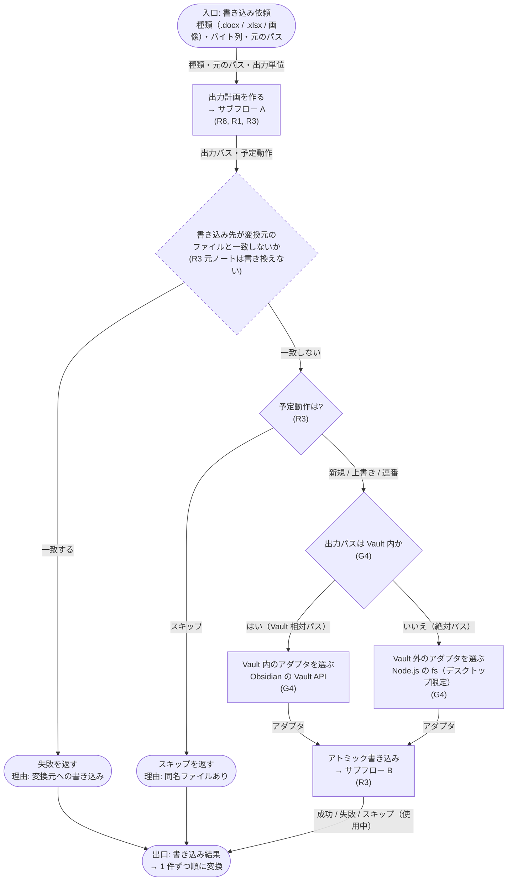
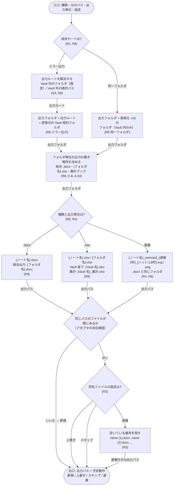
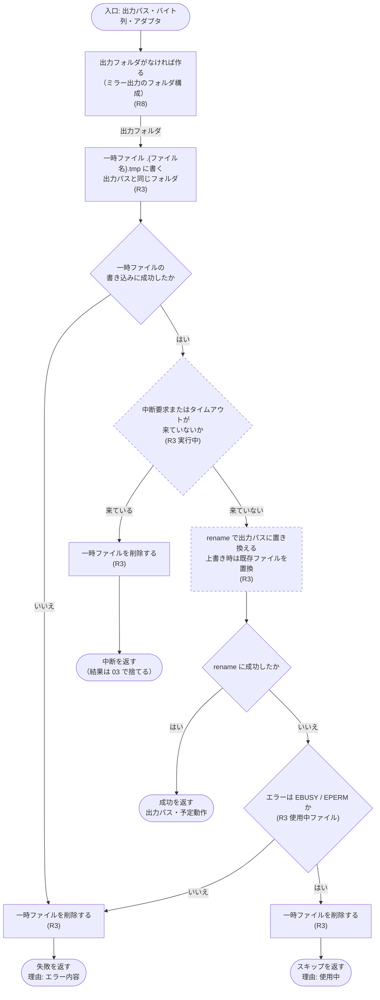

# ファイルの書き込み のフロー

最終更新: 2026-11-17
対応する要件: G4、R3「書き込み時」、R8「置き場所」「ファイル名」、R1 の保存モード、R4「ファイル名とキャッシュ」

## 役割

「.docx の生成」「.xlsx の生成」「Mermaid の画像化」から受け取ったバイト列を、出力パスに書き込むコンポーネント。出力パスと予定動作（新規 / 上書き / スキップ / 連番）を決め、出力先アダプタ（Vault API / Node.js の `fs`）を選び、一時ファイル経由のアトミック書き込みで保存する。結果を成功 / 失敗 / スキップのいずれかとして「1 件ずつ順に変換」に返す。

## 入力と出力

| 受け取るもの / 渡すもの | 内容 | 相手のコンポーネント |
|---|---|---|
| 受け取る: .docx | バイト列、元ノートのパス（結合出力ではフォルダのパス）、出力単位（単体 / 結合） | .docx の生成 |
| 受け取る: .xlsx | バイト列、元ノートまたはフォルダのパス、出力単位（単一ノート / 1 フォルダ = 1 ブック / 1 ノート = 1 ブック / Vault 全体の集計） | .xlsx の生成 |
| 受け取る: 画像ファイル | SVG / PNG のバイト列、R4 の命名規則によるファイル名、元ノートのパス | Mermaid の画像化 |
| 渡す: 書き込み結果 | 成功（出力パス・予定動作）/ 失敗（理由）/ スキップ（理由: 同名の設定 / 使用中） | 1 件ずつ順に変換 |
| 提供する: 出力計画の計算（提案） | 出力パスと予定動作を、書き込まずに計算する処理（サブフロー A）。ドライランで使う | 実行前の確認画面 |

## フロー図

### 全体の流れ

### サブフロー A: 出力パスの計算と予定動作の判定

書き込みは行わない。存在確認だけをアダプタに問い合わせる。「実行前の確認画面」のドライランからも同じ処理を呼ぶ（提案。「決める必要があること」を参照）。

### サブフロー B: アトミック書き込み

## 各ステップの補足

| ノード名 | 内容 | 要件 ID |
|---|---|---|
| 出力計画を作る | サブフロー A を呼ぶ。出力パスと予定動作は、書き込みの直前にもう一度計算する（ドライランの後に、同名ファイルが作られたり消されたりしている場合があるため） | R3, R8 |
| 書き込み先が変換元のファイルと一致しないか | 「元ノートは書き換えない」を書き込みの手前で保証するための確認。v1 の要件には仕組みの指定がないため点線枠 | R3 |
| 予定動作は? | スキップならバイト列を捨て、何も書かずに返す | R3 |
| Vault 内 / Vault 外のアダプタを選ぶ | 出力パスが Vault 内なら Vault API、Vault 外なら Node.js の `fs`。構文解析・変換・出力の中核からはアダプタを経由してだけ書く | G4 |
| 出力ルートを解決する | 既定は Vault 内の出力フォルダ。Vault 外の絶対パスも選べる | G4, R8 |
| 出力フォルダ（ミラー出力） | 出力ルートの下に、変換元と同じフォルダ構成を作る | R1, R8 |
| 出力フォルダ（同一フォルダ） | 変換元 .md と同じフォルダ。Vault 内だけで、出力ルートは使わない | R1, R8 |
| フォルダ単位の出力の置き場所を決める | 結合 .docx と `{フォルダ名}.xlsx` は「そのフォルダの出力先に置く」、集計ブックは「出力ルートの直下」とあるが、細部が決まっていないため点線枠（「決める必要があること」を参照） | R8, C-8, A-34 |
| ファイル名（.docx） | 単体出力 `{ノート名}.docx`、結合出力 `{フォルダ名}.docx` | R8 |
| ファイル名（.xlsx） | 単一ノートの変換 `{ノート名}.xlsx`。フォルダ・複数ノート・Vault 全体の変換では 1 フォルダ = 1 ブックで `{フォルダ名}.xlsx`、Vault 直下は `{Vault 名}.xlsx`。オプションの 1 ノート = 1 ブックでは `{ノート名}.xlsx`。集計は `{Vault 名}_集計.xlsx` | R8 |
| ファイル名（画像） | `{ノート名}_mermaid_{連番2桁}_{ハッシュ8桁}.{svg\|png}`。ファイル名は「Mermaid の画像化」が決めて渡す。置き場所はどちらの保存モードでも .docx と同じフォルダ | R4, R8 |
| 同じパスのファイルが既にあるか | アダプタの存在確認だけを使う。書き込み系の呼び出しはしない | R3 |
| 空いている番号を探す | `name (1).docx` から順に、存在しない番号を探す | R3 |
| 出力フォルダがなければ作る | ミラー出力ではフォルダ構成を作る必要がある | R8 |
| 一時ファイルに書く | 名前はドットで始める `.{ファイル名}.tmp`。Obsidian はドットで始まるファイルを索引の対象にしないため、書き込み中にファイルエクスプローラーに表示されない。rename を同じファイルシステム内で行うため、出力パスと同じフォルダに置く | R3 |
| 中断要求またはタイムアウトが来ていないか | rename の直前で確認し、来ていれば置き換えずに一時ファイルを消す。タイムアウト後に遅れて書き込みが完了し、失敗扱いの件のファイルが出力される状態を防ぐため。要件に指定がないため点線枠 | R3 |
| rename で出力パスに置き換える | 完成した一時ファイルを出力パスに rename する。Vault API で既存ファイルを置き換える方法は要件に指定がないため点線枠 | R3 |
| エラーは EBUSY / EPERM か | Word / Excel で開いているファイル（Windows）。中断せずスキップとして返し、レポートに記録してもらう | R3 |
| 一時ファイルを削除する | 失敗・使用中・中断のどの経路でも、壊れた .docx / .xlsx や一時ファイルを残さない | R3 |

## 決める必要があること

- **ドライランとの境界（02 との関係）**: 出力パスの計算と予定動作の判定（サブフロー A）を、書き込みを行わない純粋な処理として切り出し、「実行前の確認画面」もこれを呼ぶ形を提案する。存在確認だけはアダプタ（Vault API / `fs`）に依存するので、アダプタを引数で渡す。書き込み時にはもう一度計算し、ドライランの結果と違ったとき（例: 確認後に同名ファイルができた）に、そのまま書き込み時の判定に従うか、警告するかを決める必要がある
- **フォルダ単位の出力の置き場所**: 「`{フォルダ名}.xlsx` をそのフォルダの出力先に置く」の「出力先」が、そのフォルダのミラー（`出力ルート/A/B/B.xlsx`）か、親フォルダ（`出力ルート/A/B.xlsx`）かが決まっていない。結合 .docx（`{フォルダ名}.docx`）も同じ。親フォルダに置く場合、同じ親にある同名のノート（`A/B.md` → `A/B.docx`）と衝突しうる
- **同一フォルダモードでの集計ブックの置き場所**: A-34 の集計ブックは「出力ルートの直下」だが、同一フォルダモードでは出力ルートを使わない。Vault 直下に置くのかを決める
- **Excel だけを出力するときの画像ファイルの置き場所**: 画像ファイルは「.docx と同じフォルダ」と定義されている。Excel だけを選んだときや、R1 の単独保存のコマンドで .docx を作らないときは、「.docx を出すとしたら置くフォルダ」とするかを決める
- **元ノートの保護を保証する仕組み**: R3 は「書き込み系 API を呼ばない」という設計原則だけで、仕組みは決まっていない。案: (1) 書き込みはこのコンポーネントのアダプタを経由する以外に行わない、(2) 書き込みの直前に、出力パスが今回の変換元ファイルと一致しないこと、拡張子が .docx / .xlsx / .svg / .png であることを確認する。なお、同一フォルダモードで「上書き」を選ぶと、ユーザーが手で置いた同名の .docx / .png を上書きしうる（手編集の検知は R3 の後回し）
- **中断・タイムアウトとの境界（03 との関係）**: `Promise.race` のタイムアウトは書き込みを止められないため、遅れて rename まで進むと、失敗扱いの件のファイルが出力に残る。中断要求（`AbortSignal` など）をこのコンポーネントに渡し、rename の直前で確認する形を提案する。また、キャンセル時の「書きかけの一時ファイルの削除」は、このコンポーネントが `finally` で必ず行う形にし、03 は削除を担当しない形にするかを決める
- **Vault API でのアトミックな置き換え**: Vault 内の出力で、ドットで始まる一時ファイルの書き込みと、既存ファイルへの rename による置き換えに、Vault API のどのメソッド（`vault.adapter` の `writeBinary` / `rename` など）を使うかが決まっていない。既存ファイルがある場合に rename が置き換えに対応しているか、Obsidian のファイル一覧（`TFile`）に正しく反映されるかを要検証とする
- **Vault API 経由での EBUSY / EPERM の判定**: Vault 内の出力でも、Word で開いたファイルへの rename は失敗する。Vault API がエラーコード（`EBUSY` / `EPERM`）をそのまま返すかは要検証
- **画像ファイルへの同名ファイルの設定の適用**: 画像のファイル名にはハッシュが入るため、同名 = 同じ内容になる。キャッシュヒットの判定は「Mermaid の画像化」が行う前提で、ここに届いた画像に「連番」を適用するか（ハッシュ付きの名前に `(1)` が付くのは無意味）、画像は常に上書きとするかを決める
- **古い画像の削除を誰が行うか（06 との関係）**: R4 の「古い画像の置き換え」はファイルの削除を伴う。削除もこのコンポーネントのアダプタを経由させるか（書き込み系の操作をここに集める）、「Mermaid の画像化」が直接行うかを決める
- **書き込み結果の単位と内容（03・10 との関係）**: 1 ブック・結合 .docx は複数のノートから 1 つのファイルになるため、結果の単位は「出力ファイル」になる。「1 件ずつ順に変換」「実行結果の記録」が、それを元ノートにどう対応付けるかを決める。また、出力マニフェストに記録する内容ハッシュを、バイト列を持っているこのコンポーネントが計算して結果に含めるか、パスを Vault 相対 / 出力ルート相対のどちらで返すかも決める
- **全体図との差**: 全体図ではこのコンポーネントの出力は「成功 / 失敗 / スキップ」の 3 種類だが、サブフロー B には「中断」の経路がある。中断を 4 つ目の結果として増やすか、失敗の一種として扱うかを決める
