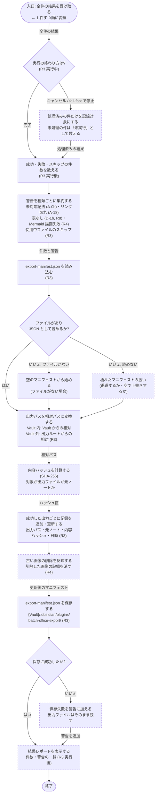

# 実行結果の記録 のフロー

最終更新: 2026-11-17
対応する要件: R3「実行後」（結果レポート・出力マニフェスト）、R3「書き込み時」（使用中ファイルのスキップの記録）、R4「古い画像の置き換え」、R5 A-0b・A-18、R7 D-1b、R8「Excel のファイルの単位」の境界条件

## 役割

「1 件ずつ順に変換」から全件の結果を受け取り、成功・失敗・スキップの件数と警告を集約して結果レポートとして画面に表示する。あわせて、今回書き込んだ出力ファイルを出力マニフェスト `export-manifest.json` に反映して保存する。マニフェストは次回以降の実行で「Mermaid の画像化」（古い画像の置き換え）と「Markdown の構文解析と変換」（A-18 のリンク先の判定）が読む。

## 入力と出力

| 受け取るもの / 渡すもの | 内容 | 相手のコンポーネント |
|---|---|---|
| 受け取る: 全件の結果 | 1 件ごとの結果（成功 / 失敗 / スキップ、出力パス、元ノート、失敗・スキップの理由）、警告（未対応記法・リンク切れ・表なし など）、実行の終わり方（完了 / キャンセル / fail-fast による停止） | 「1 件ずつ順に変換」 |
| 渡す: 結果レポートの画面表示 | 件数と警告の一覧 | 利用者（画面） |
| 渡す: export-manifest.json の保存 | 出力パス・元ノート・内容ハッシュ・日時の一覧 | ファイル（プラグインのデータフォルダ）。次回の実行で「Mermaid の画像化」「Markdown の構文解析と変換」が読む |

## フロー図

点線枠のノードは、要件に決まっていない点を含む（下の「決める必要があること」を参照）。

## 各ステップの補足

| ノード名 | 内容 | 要件 ID |
|---|---|---|
| 全件の結果を受け取る | 「1 件ずつ順に変換」が逐次処理を終えた（または中断した）後に 1 回だけ呼ばれる。1 件ごとの結果には、成功 / 失敗 / スキップの区別と、出力ファイルのパスを含む | R3 |
| 実行の終わり方は? | 完了・キャンセル・fail-fast による停止の 3 通り。キャンセルと fail-fast では、未処理の件が残る | R3 実行中 |
| 処理済みの件だけを記録対象にする | 中断時は、書き込みが完了した出力だけがディスクに存在する。書きかけの一時ファイルは「1 件ずつ順に変換」が削除済み（R3）。処理済みの分を記録するかどうかは要件に書かれていない | R3 |
| 成功・失敗・スキップの件数を数える | 使用中ファイル（`EBUSY` / `EPERM`）のスキップと、同名ファイルの扱いで「スキップ」を選んだ場合のスキップは、どちらもスキップとして数える | R3 |
| 警告を種類ごとに集約する | 要件で「レポートに記録する」と書かれているもの: 未対応・変換失敗の記法（A-0b）、リンク切れ（A-18）、表のないノート・表のあるノートがないフォルダ（D-1b、R8）、Mermaid の描画失敗（R4）、使用中ファイルのスキップ（R3）、セルの文字数上限を超えた切り詰め（D-4）、必要なプラグインがない（A-24） | R3, A-0b, A-18, D-1b, R4, R8 |
| export-manifest.json を読み込む | 保存場所はプラグインのデータフォルダ。Vault 内の出力フォルダには置かない（同期の対象やファイルエクスプローラーの表示に混ざるのを避けるため） | R3 |
| 空のマニフェストから始める | 初回の実行ではファイルがない。この場合は空の一覧として扱う（ファイルがないことはエラーではない） | R3 |
| 壊れたマニフェストの扱い | JSON の構文エラーや、想定と違う形式のとき。要件に書かれていない | — |
| 出力パスを相対パスに変換する | Vault 内の出力は Vault からの相対パス、Vault 外の出力は出力ルートからの相対パスで記録する。Vault を移しても使えるようにするため | R3 |
| 内容ハッシュを計算する | 要件は「内容ハッシュ」とだけ書いている。ハッシュの方式は、R2 の後回しの差分変換に合わせて SHA-256 とする | R3, R2 |
| 成功した出力ごとに記録を追加・更新する | 記録する項目は、出力パス・元ノート・内容ハッシュ・日時。同じ出力パスの記録があれば置き換える | R3 |
| 古い画像の削除を反映する | 「Mermaid の画像化」が古い画像を削除した場合、その画像の記録をマニフェストから消す必要がある。削除の情報がどの経路でここに届くかは決まっていない | R4 |
| export-manifest.json を保存する | 保存先は `{Vault}/.obsidian/plugins/batch-office-export/export-manifest.json` | R3 |
| 保存失敗を警告に加える | 出力ファイルの書き込みはすでに終わっているので、マニフェストの保存に失敗しても出力は消さない。どう扱うかは要件に書かれていない | — |
| 結果レポートを表示する | 成功・失敗・スキップの件数と、警告の一覧を表示する。表示の形式（モーダル・Notice など）は要件に書かれていない。詳細ログファイルの出力は R3 で後回し | R3 |

## 決める必要があること

- **中断時に記録するか**: キャンセル・fail-fast で途中終了したとき、処理済みの出力をマニフェストに記録するか。要件に記述はない。書き込みが完了したファイルはディスクに残るので、記録しないと次回の A-18（出力済みの .docx へのリンク）と R4（古い画像の置き換え）がそのファイルを認識できない。処理済みの分を記録する案が自然だが、決定が必要
- **マニフェストの読み込みのタイミングと、読む側への渡し方（全体図の境界との不整合）**: 全体図ではこのコンポーネントは実行の最後にだけ呼ばれ、ほかのコンポーネントへの矢印を持たない。しかし「Mermaid の画像化」（R4 の古い画像の置き換え）と「Markdown の構文解析と変換」（A-18 の変換対象の範囲）は、実行の途中でマニフェストを読む必要がある。誰が実行の開始時に読み込み、どう渡すか（例: 読み込みと保存を別のモジュールに分けて実行の開始時に読む）を決める必要がある。G2 により、構文解析と変換の段には Obsidian API に依存しない形（読み込み済みの一覧など）で渡す必要がある
- **古い画像の削除の記録の経路**: R4 で「Mermaid の画像化」が古い画像を削除したとき、その画像の記録をマニフェストから消す必要がある。全体図には、削除の情報をこのコンポーネントへ運ぶ矢印がない（「ファイルの書き込み」→「1 件ずつ順に変換」の矢印は 成功 / 失敗 / スキップ だけ）
- **警告の運び方（全体図の境界との不整合）**: 未対応記法・リンク切れは「Markdown の構文解析と変換」、表なしは「.xlsx の生成」、描画失敗は「Mermaid の画像化」で発生する。全体図ではこれらの警告を「1 件ずつ順に変換」へ運ぶ矢印がなく、「全件の結果」に含まれる経路が決まっていない
- **マニフェストの記録の形式**: 要件で決まっている項目は「出力パス・元ノート・内容ハッシュ・日時」だけ。次の点が未定
  - R4 の「同じノート・同じ連番」で古い画像を探すために、画像の連番と出力の種類（docx / xlsx / 画像）を記録するか
  - 1 つの出力に複数の元ノートがある場合（1 フォルダ = 1 ブックの .xlsx、結合出力の .docx）に、元ノートを配列で持つか
  - 将来の形式変更に備えた、形式のバージョン番号を持つか
- **内容ハッシュの対象**: 出力ファイルのハッシュか、元ノートのハッシュか（または両方か）。後回しの「手編集の検知」には出力ファイルのハッシュが、R2 の後回しの「差分変換」には元ノートのハッシュが必要になる
- **Vault 外の出力の記録**: 出力ルートからの相対パスだけを記録すると、設定で出力ルートを変えた後に、記録がどのルートに対する相対パスか区別できない。出力先が Vault 内か Vault 外かの区別と、出力ルートの識別（出力ルートそのものは Vault の絶対パスと同様に個人情報を含みうる点に注意: R3）をどう記録するか
- **ファイルがない・壊れているときの扱い**: ファイルがないときは空として扱う（初回の実行）でよいが、壊れているときに空として上書きすると過去の記録が失われる。壊れたファイルを別名で退避して警告するか、保存をやめるかを決める
- **マニフェストの保存が失敗したときの扱い**: 結果レポートに警告を出す以外に、再試行するか。保存自体をアトミック書き込み（一時ファイル → rename、R3）にするか、Obsidian の `vault.adapter` 経由で書くか
- **スキップした出力の扱い**: 同名ファイルの扱いで「スキップ」した場合と、使用中ファイルでスキップした場合、既存のマニフェストの記録（前回の出力）をそのまま残すか
- **結果レポートの表示の形式**: モーダル・Notice・ペインのどれで表示するか。警告が多い場合の表示（種類ごとの折りたたみ、ノートを開くリンクなど）
- **R1 の単独保存のコマンドとの関係**: Mermaid 画像の単独保存のコマンドで保存した画像も、このコンポーネントで記録・レポートするか（R4 の古い画像の置き換えは、単独保存で出した画像にも効く必要がある）
