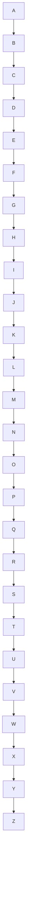
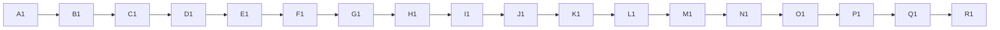

# 画像の見切れの確認

段落 1。ページの途中から画像が始まる場合を確かめる。

## 縦長の画像（ページより高い）

![[tall.png]]

## 横長の画像（ページより広い）

![[wide.png]]

## ページの下端にかかる画像

これは段落。これは段落。これは段落。これは段落。これは段落。これは段落。これは段落。これは段落。

これは段落。これは段落。これは段落。これは段落。これは段落。これは段落。これは段落。これは段落。

![[mid.png]]

## 幅を指定した画像

![[mid.png|200]]

## 縦長の Mermaid 図

## 横長の Mermaid 図

最後の段落。
