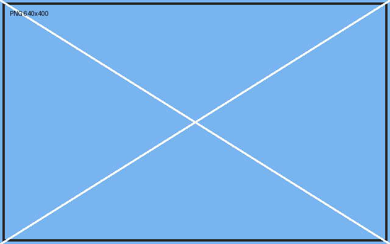
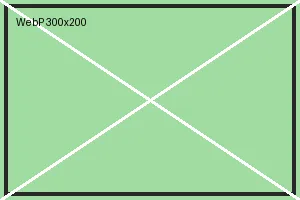

# 画像

## 形式ごと

PNG（640×400、そのままの大きさ）:

![[sample-png.png]]

JPEG（1600×900、本文の幅に縮める）:

![[sample-large.jpg]]

WebP（PNG にして埋め込む）:

![[sample-webp.webp]]

GIF（PNG にして埋め込む）:

![[sample-gif.gif]]

SVG（PNG の代替画像を付ける）:

![[sample-svg.svg]]

## 大きさの指定

幅 200: ![[sample-png.png|200]]

幅 300・高さ 100（縦横比は指定どおり）: ![[sample-png.png|300x100]]

代替テキストと幅: ![[sample-png.png|青い四角|150]]

## Markdown 形式

## 外部の画像と、見つからない画像

外部 URL（リンクだけ）: 

見つからない画像（文字だけ残して警告）: ![[ない画像.png]]
