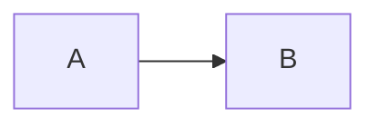

# 他のプラグインのコードブロック

開発用ビルド（`npm run build:dev`）が登録するテスト用の処理で確かめる。本番ビルドでは処理が登録されていないので、コードのまま残る（警告は出ない）。

## SVG を描く処理

```boe-test-svg
SVG の図
```

## 少し遅れて canvas を描く処理（描画の完了待ち）

```boe-test-canvas
canvas の図
```

## 処理が登録されていない言語（ふつうのコード）

```unknown-plugin
そのまま残る
```

## Mermaid（このプラグインが描く）


